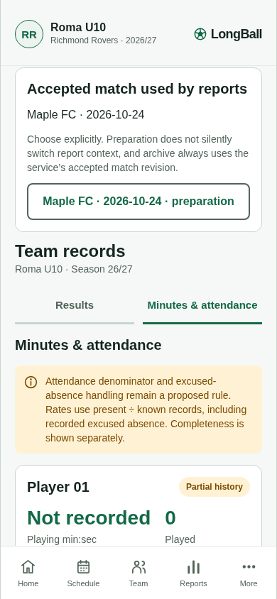
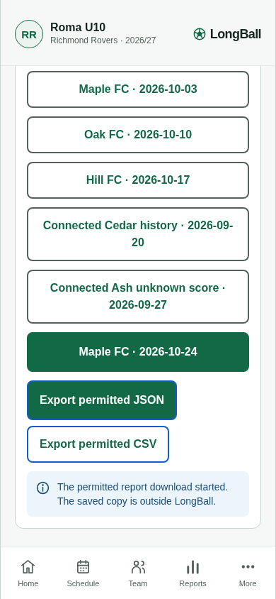
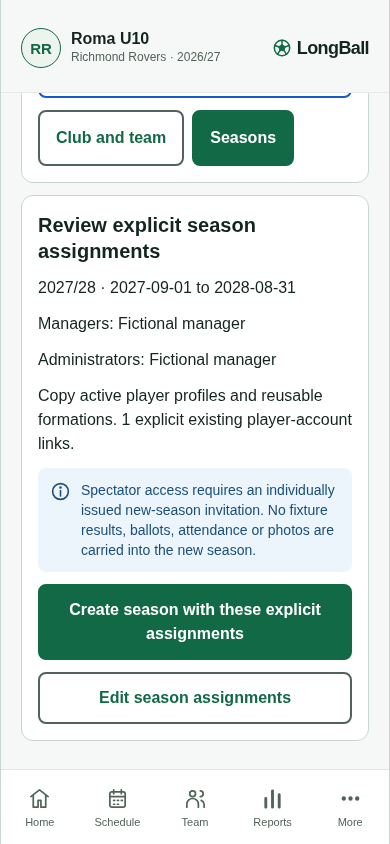
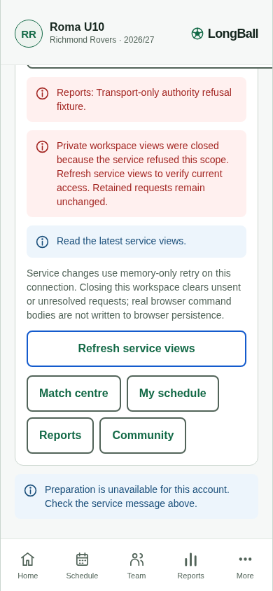
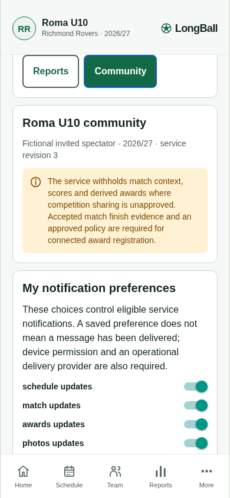

# Connected records, season and access review · 4108

Five phone-browser/HTTP journeys passed together on **21 October 2026** at **390 × 844**, with no uncaught page errors or horizontal overflow. The frozen web bundle was **`index-4108b23540176f94638dc263073b3912.js`**. The actual API bundle SHA-256 was **`0ab39063e4bc217333a15f121fd49ade321eaf07e986ddb41bac18e2ef8a3697`**.

This is an **uncommitted development candidate**, based on `3b2d83d591074a6fe887c4f3e6300626d4e138af` on `dev/longball-m0-journey`. Later staff/album UI source changes are outside this exact bundle. These results do not claim a final release or production readiness.

The harness used Chromium, local browser export port 4173 and a new isolated fictional SQLite API on port 4314. It used UI actions and real HTTP, with read-only service/IndexedDB inspection. It respected the normal service request window and Retry-After; no rate policy was disabled.

| Journey | Verified behavior |
| --- | --- |
| Historical records | Rich historical add, audited correction with reason, unknown score excluded from draw/points/known-result denominators, historical minutes displayed as Not recorded. |
| Accepted reports and exports | Canonical 50-second match, explicit accepted context/classification, archive from accepted revision 15, actual season JSON/CSV and match JSON downloads with audience/projection/policy metadata. |
| Configuration and rollover | Administrator-safe DTO without roster/attendance fields; explicit manager/admin/one-player assignments; September 2027–August 2028 destination; source preparation/records/grants/accepted snapshot preserved; no automatic spectator grants; duplicate next year disabled. |
| Known denial closure | A delayed transport-only403 arrived after a parallel private preparation reply. Bound private views closed; fresh identity read reopened them after the fixture was removed. This is **not** evidence of a real account revocation. |
| New account invitation | A fictional account with zero prior memberships explicitly accepted the exact source-season invitation over HTTP, received spectator access only and persisted no acceptance code in its browser journal. |

[Exact outcomes](summary.json) accompany the screenshots below. Exported fictional files remain in `.local/connected-records-review/`. Repeat with `node scripts/connected-records-review.mjs` after building/serving the web export and API; the script manages its own isolated API database.

Four mocked native-export adapter tests and five deferred-session export-boundary cases separately passed. The actual-used outbox-readiness condition also covers null/no-membership/expired/disabled versus current scope. Real OIDC provider/device races, native share sheets/process-death cleanup and physical iPhone/Android acceptance were not proved by this browser run. The invitation browser case uses explicit fictional API identities; native no-membership readiness is pure-boundary evidence until configured-device testing.
