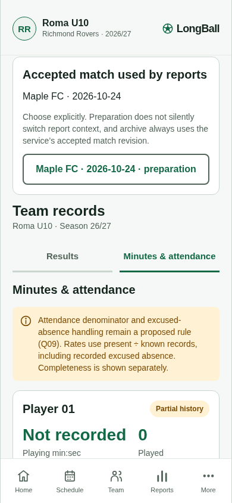
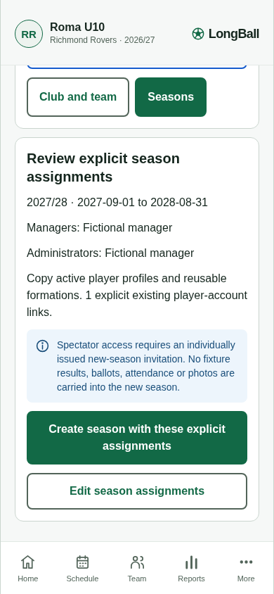
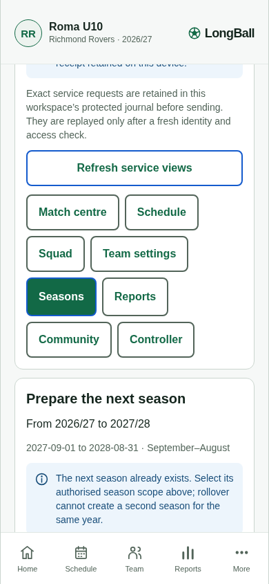

# Connected rich records and seasons browser evidence

The **uncommitted development candidate** on `dev/longball-m0-journey` passed three real-browser/HTTP journeys on 21 October 2026 at 390 × 844. The loaded web bundle was **`index-ca91e5e22aa0031c1489323df6c73a5c.js`**; the source base commit was `3b2d83d591074a6fe887c4f3e6300626d4e138af`. This is review evidence, not a final release or a production-readiness claim.

The harness used Chromium, the local browser export at port 4173 and a newly isolated fictional SQLite API at port 4314. It performed UI actions and actual HTTP calls; it did not inject application state. Service/IndexedDB reads verified persisted outcomes.

- Rich historical add and audited correction preserved unknown attendance/minutes; an unknown score added no draw, points or known-result denominator.
- A canonical 50-second match was completed, explicitly selected/classified for reports and archived from accepted revision 15. Actual season JSON/CSV and match JSON downloads preserved audience, projection version and policy metadata.
- Administrator configuration returned no private roster/attendance fields. Explicit manager, administrator and one player assignment created the September 2027–August 2028 season. Source preparation, records, grants and accepted match snapshot remained unchanged; spectators gained no automatic destination access. A duplicate next-year rollover was disabled.

There were no uncaught browser exceptions or horizontal-overflow failures. [Machine-readable outcomes](summary.json) record the exact cases. Downloads remain in `.local/connected-records-review/` and contain fictional data.

Repeat with `node scripts/connected-records-review.mjs` after building the web export/API and serving the former on port 4173. Port 4314 must be free; the harness creates its own disposable fictional database and closes that API afterward.

Native share sheets, physical iPhone/Android behavior, real configured identity-provider races and production PostgreSQL/browser deployment were not exercised by this harness. Four mocked native-export boundary tests separately check access before sharing and temporary-file removal on success, session closure and share failure. The native process-death cleanup behavior remains a device check. Normal notice wording and later source fixes require a fresh candidate build; this evidence remains bound to the exact bundle above.
