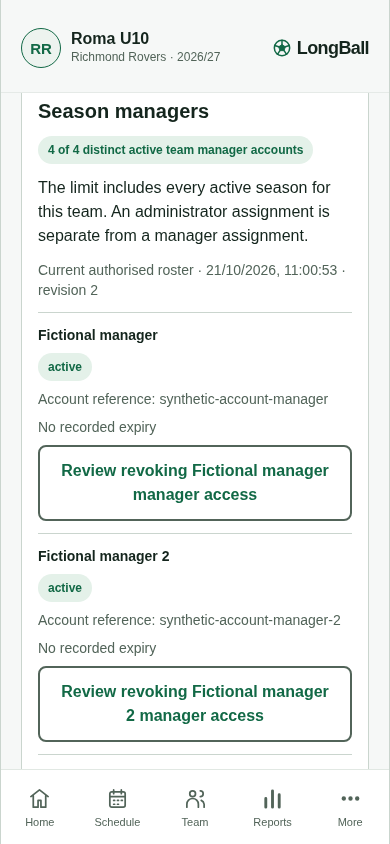
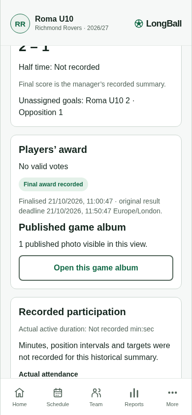
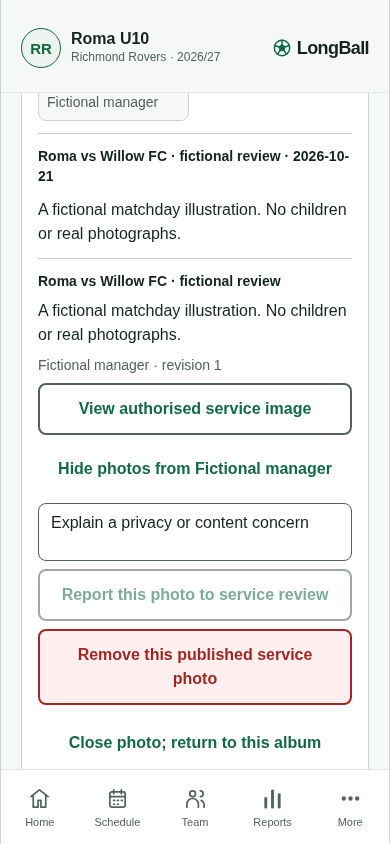

# Connected staff and report albums browser proof

Recorded 21 October 2026 at 390 × 844 in Chromium against an isolated real HTTP API and fresh fictional SQLite data. Run with `node scripts/connected-staff-review.mjs` from the repository root; the script uses port 4316 by default and closes its own API afterward.

This is an **uncommitted development candidate**, on branch `dev/longball-m0-journey`, based on commit `3b2d83d591074a6fe887c4f3e6300626d4e138af`. It is not release acceptance.

- Web: `index-574b3e4289da41fb548779d3b27caa53.js`; SHA256 `34f026256d1eb1dca1a1686a6d2a02a4ec2f8389c715a9c70497c224abb92427`.
- API: SHA256 `bcf92d7d6937c965c88637c089168636122c29c06b817291faee480ebe7df558`.
- No app projections or database rows were injected. Fictional report and award setup used normal HTTP commands. Browser actions issued the staff writes and navigated the report and album.

| Check | Observed result |
| --- | --- |
| Fifth distinct team manager | Service refused the confirmed assignment; staff revision remained 0 and manager count remained 4. |
| Explicit this-season revocation | Review was read-only; confirmation sent the recorded reason and saved revision 1/count 3. |
| Existing adult replacement | Separate review and confirmation saved revision 2/count 4. All three command IDs matched their exact idempotency keys and included expected revisions. |
| Award policy | Child ballot was refused with `POLICY_NEEDED`; no club sharing policy was approved. A manager then deliberately sealed the actual fictional no-valid-votes result. The explicit 59-minute fictional cutoff does not select a production default. |
| Match report composition | The permitted manager DTO and detail showed the sealed no-valid-votes award and one published photo reference. Historical entry retained unknown minutes. |
| Exact album destination | The report opened the same currently permitted Willow game album and its published illustration drilldown. No uploaded image bytes were fetched in this check. |
| Phone layout | No horizontal overflow and no browser page errors. |

Native authentication, encrypted device storage, picker/share sheets, physical device layout and configured-provider acceptance remain separate checks. Winning-label composition and private filtering have service/helper evidence; this browser scenario exercises the safe no-valid-votes path because normal service policy correctly withholds child voting.

