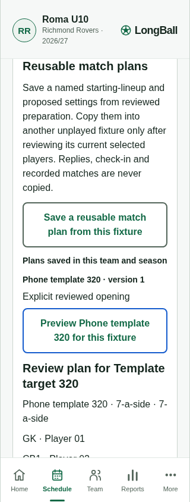
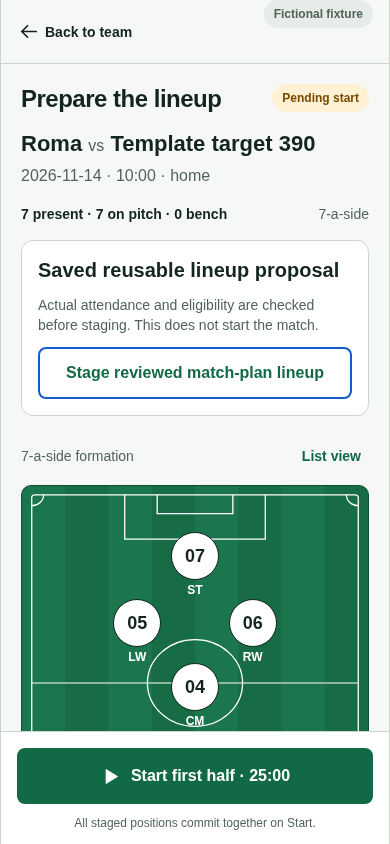

# Reusable match-plan evidence

Isolated development branch `dev/longball-match-plans`, based on consumer-entry source `f4fbffe` with EV05 core `06c22ac`. The feature commit is recorded in Git; [summary.json](summary.json) records exact tested source hashes and web artifact SHA-256.

- 34 application/preparation/rollover tests passed, including stale preview/version rejection, eligibility changes, immutable history, exact retry and canonical buffer boundaries.
- Two actual HTTP journeys passed against SQLite and PostgreSQL 18.6: private manager-only mutation, exact receipt replay, fresh source/template changes, claimed/played refusal and no attendance inference. The PostgreSQL fixture uses explicit operator-owned synthetic test mode; it is not a new restricted-role RLS proof.
- [Browser report](report.json): actual UI at 320×844 and 390×844, preview before confirmation, durable copy/reload, actual check-in before explicit staging, stopped match clock, no overflow or page errors. IndexedDB was read only for evidence; no state injection.
- Root/mobile TypeScript, scoped ESLint and `git diff --check` passed.

Commands:

```sh
node node_modules/vitest/vitest.mjs run packages/application/src/match-plans.test.ts packages/application/src/preparation.test.ts packages/application/src/season-service.test.ts --maxWorkers=1
node node_modules/vitest/vitest.mjs run --config apps/api/vitest.config.ts apps/api/src/match-plans.test.ts --maxWorkers=1
LONGBALL_REVIEW_BASE_URL=http://127.0.0.1:4388 node scripts/match-plans-review.mjs
```

The PostgreSQL command used the existing local test database environment without recording its connection string. The local review server URL is only a test coordinate. Native physical controls and encrypted lifecycle acceptance remain unproved. Q07 is not approved by this increment.




