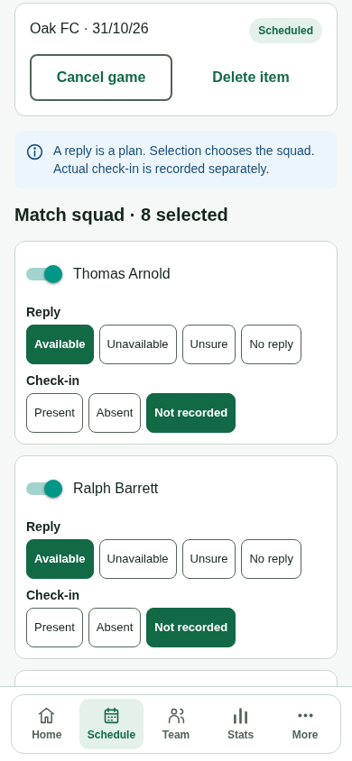
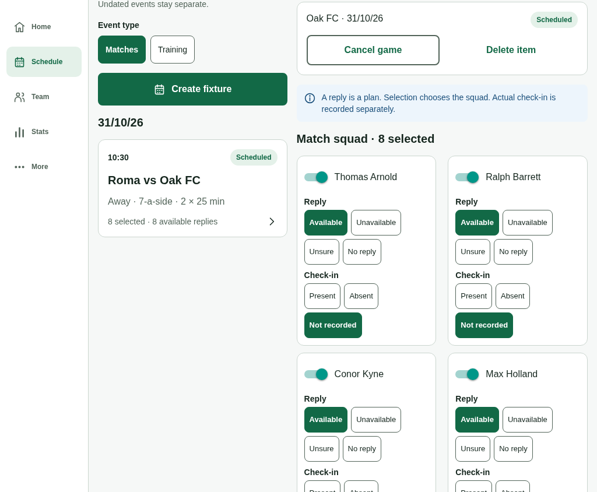

# Manager persona evidence

The actual compiled browser client used generated Manager credentials against an isolated SQLite API and worker. Service discovery and transport were redirected to the owned loopback processes; business responses were not replaced. No public demo credentials, email delivery, paid services or physical devices were used.

## Accepted runs

| Evidence | Original observation time (UTC) | Result |
| --- | --- | --- |
| [Full candidate6 report](report.json) | 25 Oct 26, 22:47:19–22:51:57 | 14 journey groups passed; no findings, page, transport or unexpected HTTP failures; pinned artifacts remained stable. |
| [Candidate6 keyboard proof](keyboard-candidate6/report.json) | 25 Oct 26, 22:47:35–22:47:50 | Enter opens a fixture; Space saves its reply and retains focus; Tab/Shift-Tab follow input order; Enter explicitly discards a local draft without saving it. |
| [Candidate7 navigation-notice proof](navigation-notice-candidate7/report.json) | 25 Oct 26, 22:55:43–22:55:49 | A normal team-header action blocks the dirty draft. After explicit Discard and allowed Home navigation, the resolved draft warning is absent. |

The full journey and keyboard runs use browser SHA-256 `91c5b2b6013ee0f496c9e13d73bb59b073d0d8b32e0bf0c56f658cf5908b4813`. The focused candidate7 proof uses `a2b86b6642ba5d1a9ee4c08199f84663c3e02c43b1934aaade92f1326f812fdb`. These are distinct browser builds. The full 14-group scenario was not rerun on candidate7; its only subsequent change clears the exact resolved draft-navigation warning after navigation is allowed, preserving service/authentication errors.

All three reports use API SHA-256 `7e6a4fc28acac0d106ca98e5a3955f2d06932d8da7d3fe99cef7c45ca3a1c3e4`, worker `b9077f122adf3b1bc6122df9beaf5610f1ea2928c852c1da4280619cf05a45f5` and helper `6a9da668a2d0fe88245328f3df167f6da815917c90634d66e5a1288fde751698`. Each retains its own original timestamps and source metadata; a dirty workspace HEAD is not substituted for a compiled-artifact fingerprint.

## What the full journey proves

- Sixteen consecutive availability replies accept revisions 1–16 with 96 authenticated requests: six per edit, including both current-authority checks and preparation/records/player-stat refreshes. Initial browser requests (16), two direct reads and the burst total 114 against the unchanged 120-request limit. No budget wait occurs inside the burst. Its first reply uses keyboard Space, retains focus and creates exactly one write.
- Home opens the actual next training occurrence and does not request attendance before it is held. All ordinary Manager sections and protected team documents remain reachable on a phone.
- Saved custom formations retain exact slot identities, labels, role codes and geometry after a name-only save. Dirty drafts require explicit save/discard; internal formation switching offers Keep editing. Decimal input retains `0.`, rejects incomplete coordinates and persists a reviewed coordinate change.
- League, alert, fixture, saved-setup, import, series and cancellation-reason drafts remain available when navigation is blocked. Local discard actions do not submit them. A saved player setup uses distinct eligible players after auto-fill.
- A real scoped invitation produces a locally rendered QR code, remains protected until its one-time disclosure is explicitly closed and sends no email. A genuine BIFF/OLE XLS downloads and its imported preview remains until explicit discard; an uploaded protected PDF downloads byte-for-byte unchanged.
- Weekly series creation, a separate availability reply, held-session attendance and cancelling one occurrence preserve the other dates. Fixture creation, postponement, restoration, reasoned cancellation and deletion of an unplayed item reach actual persistence.
- The Manager explicitly acquires recording, checks in eight players, stages seven core-position starters, confirms kickoff/pause and uploads. The next-substitution countdown decreases during actual active time and freezes while paused. Independent canonical reads confirm accepted attendance and lineup at revision 12. Hardware sound delivery is not claimed.
- Tablet stats select the chosen player and show the core-position legend. Account Help, Privacy, pending data-request intake and explicit logout are reachable without approving or fulfilling deferred policies.

## Layout evidence

The [original spacing baseline](spacing-baseline/report.json) measures a phone squad card at 314px. The accepted candidate measures 226px, about 28% shorter, while every reply/attendance target remains 44px. At 1024px, the actual nested detail pane uses two card columns with no horizontal overflow. Forced phone mode and font-aware space checks remain part of the layout implementation.

| Phone squad | Tablet squad |
| --- | --- |
|  |  |

## Preserved failures and limits

The [original Manager baseline](baseline/report.json) is failed evidence: it records ignored Home event targeting, destructive custom-formation reconstruction, lost drafts and 16 requests for one reply. Its lifecycle stop was a harness omission of the required cancellation reason, not a bypassable product failure. Earlier local attempts additionally retain a Principal/membership schema assumption and later explicit schedule-filter preconditions; those were corrected before the accepted full run.

The [candidate6 navigation-notice observation](navigation-notice-candidate6/report.json) retains the real stale-warning defect subsequently covered by the candidate7 proof. The earlier keyboard attempt remains separately under `.local/quality/persona-manager-keyboard-final-attempt-*`; RN Web's radio role did not activate with Space before the web-only correction. Neither failure is relabelled as an accepted run.

Phone/tablet browser evidence does not prove native installation, hardware keyboard/assistive-technology behaviour, encrypted storage, operating-system prompts, background timing, cross-device clock exchange or audio delivery. The owner deferred physical iPhone/Android testing. Q05/Q09/Q10 and governed export/deletion/support fulfilment remain pending.

The [artifact manifest](artifact-manifest.json) records original file hashes, observation times and filesystem modification times. Copied JSON reports are unchanged; [SHA256SUMS](SHA256SUMS) covers this published subset.
