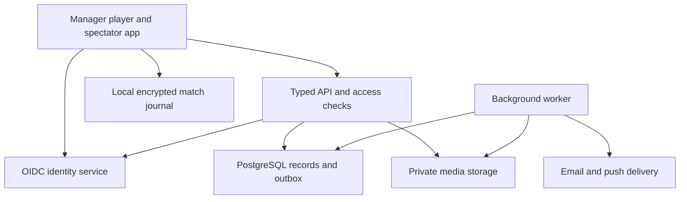

# LongBall mobile design and build pack

Version 0.1 | 20 October 2026 | Specification for review and implementation planning

LongBall is an iPhone and Android application for managing amateur football teams. It combines preparation, fair playing-time suggestions, reliable match recording, team records and a private player/spectator experience. This pack develops the agreed Richmond Rovers/Roma U10 concept into product, interface, engineering, assurance and delivery requirements.

The proposed implementation route is Codex with a cross-platform native app. The complete requested integrated pilot includes F01-F28. A manager-only demonstration is an intermediate milestone. Initial use remains free to users. Infrastructure, store accounts, development and support have separate costs.

This is a comprehensive provisional specification. It is not a built application, a tested production architecture or permission to incur costs. It can support synthetic implementation and engineering evaluation now. Real-data onboarding, publication and release require the open owner, recovery, competition-policy and operating decisions recorded below.

## Pack index

- [Product, decisions and traceability](#product-decisions-and-traceability)
- [UX, screens and visual design](#ux-screens-and-visual-design)
- [Match engine and offline recording](#match-engine-and-offline-recording)
- [Report definitions](#report-definitions)
- [Data, API, identity and protection](#data-api-identity-and-protection)
- [Platform, assurance, delivery and operations](#platform-assurance-delivery-and-operations)
- [Developer handover and BUILD_START](#developer-handover-and-build_start)
- [Priority owner decisions](#priority-owner-decisions)

The archive contains the visual booklet, machine-readable API/design/fairness contracts, proposed contributor guidance, configuration names, validation evidence and the source concept snapshot. This Markdown file is the canonical specification. Supporting files implement its contracts or illustrate selected states; they are not independent product briefs.

## How to use this pack

1. Read the product and confirmed decision register first. D01-D28 preserve the user's decisions.
2. Use UI01-UI35 and the visual booklet to implement the interface. The booklet illustrates eight selected states and does not replace the complete screen catalogue.
3. Use the match-engine rules and examples as the behavioural authority for clocks, fairness and recording. A suggested move never changes the actual lineup until the manager confirms it.
4. Use the data/security section and machine-readable contracts together. If a contract conflicts with a confirmed product rule, stop and correct the contract before generating code.
5. Execute delivery increments through UI, API, storage and tests. Record actual test outcomes. Planned tests in this pack have not been run against an application.

The source is LongBall Concept Review v0.12, saved version 12, read on 20 October 2026. It is included in the archive as a reference snapshot. This mobile pack develops that source without silently accepting its unresolved recommendations. Source identifiers remain stable. Technical and visual choices are proposed architecture/design choices under the present design brief, not new user-confirmed D-series decisions.

## Recommended implementation boundary

Use a TypeScript Expo/React Native development build for iPhone and Android, a durable local SQLite match journal, a typed Node API, PostgreSQL, private object storage and a background worker. Evaluate Keycloak as the reference OIDC identity implementation for username-based child identities and stronger adult authentication. Keep its operational overhead explicit. Club/team permissions belong to the application data model, not merely to identity-provider roles.

Codex is the recommended builder for this handover. ChatGPT Sites is not the runtime or native packaging route. A future public information/privacy/deletion-request website is a small supporting surface, not a substitute for the native match controller. No repository, lockfile, executable build scripts, signing account or deployment has been established by this specification.

Prefer one API deployment and one worker initially. Modules such as scheduling, reports and awards are logical boundaries, not separate microservices. Use PostgreSQL for the job/outbox queue. Add another queue service only if measured requirements justify it. Keep a pure shared TypeScript match reducer/planner independent of UI and network libraries so the app and server can replay the same versioned rules.



Only the authorised controlling device records an offline match branch. Server projections become authoritative for other viewers after accepted synchronisation. A spectator cannot see an unsynchronised goal. A database transaction and idempotent event acknowledgement must precede any claim that an event was synchronised.

## Mobile readiness and boundaries

Current mobile planning readiness is 60/100 under the App Expert (Mob) rubric. The source baseline was 50/100. The developed design and integration boundaries account for the increase. This is a different rubric from the concept review's 68.5/100 App Expert (Design) score, so the numbers are not a progress percentage or evidence of regression.

| Area | Score out of 10 | Evidence and remaining gap |
|---|---:|---|
| Outcomes and users | 10 | Named pilot, roles, goals and core outcomes established. Pilot measures still require validation. |
| Scope | 5 | Full F01-F28 scope is preserved. Proposed release sequencing and optional additions need owner acceptance. |
| Journeys and rules | 5 | Ordinary workflows are detailed. Competition and exceptional-match policies remain open. |
| Platform and distribution | 5 | Native reference route and distribution plan specified. Actual phone inventory and account ownership remain unconfirmed. |
| Design and accessibility | 10 | Delegated design developed into tokens, 35 screens, states and reviewable mock-ups. Usability testing remains a delivery task. |
| Data | 5 | Data model and ownership boundaries specified. Controller, age-field and retention decisions remain open. |
| Identity and access | 5 | Role and technical model specified. Verified household recovery authority remains open. |
| Integrations | 10 | No existing club-system integration is required in the brief. Proposed identity, media, email and platform notification boundaries and fallbacks are specified. |
| Quality security and privacy | 5 | Threats, controls and acceptance criteria specified. Club policies and live-service assurance remain open. |
| Deployment budget and ownership | 0 | No named operator, accepted budget, support commitment or target date. |

The 90% gate has not passed. The user requested the full design, so settled areas have been developed rather than stopping at discovery. A specification can be complete enough for review while the product still needs owner decisions. Do not convert an authored proposal into a confirmed user requirement to raise the score.

Safe starting work: synthetic screens, pure match reducer/planner, generated-contract validation, local offline/replay experiments and automated access tests using fictional users. Release blockers: Q05 verified recovery, Q09 data/lifecycle responsibility, Q10 ownership/budget/support, Q21 competition sharing policy and unresolved match exceptions affecting the actual pilot.

## New competition-policy finding Q21

The planning context assumes an England/UK pilot and Europe/London team time. The actual league and governing body have not been identified. Confirm this assumption; if Roma is governed elsewhere, replace the competition and jurisdiction analysis before live use.

The FA Handbook 2026/27, printed page 130, rules C166.1-C166.2, permits publication of specified U8-U11 trophy-event results but restricts publication of development-fixture results and tables. The official PDF was retrieved and read on 20 October 2026. This is relevant to Roma U10's proposed live scores and season results.

I DONT KNOW whether Roma's league treats the proposed invited-team spectator access as publication under its rules. Ask the club or league to confirm the applicable competition and permitted audience. Do not infer that an authenticated app is exempt. This finding does not remove F22 or F27 from the requested design.

Proposed control: a versioned competition sharing policy defines permitted audiences and content for development, trophy, friendly and unclassified fixtures. Unclassified or unapproved sharing remains disabled in a real-data pilot until the responsible owner confirms the policy. Preserve manager recording and historical statistics. Apply the policy to scorecards, goal notifications, result tables, award summaries, image captions, exports and deep links, including derived totals that would reveal restricted results. Do not hide operational policy failures behind a false empty list.

Acceptance CP-01: given a fixture with sharing disabled, when a spectator requests its score directly or through a season summary, then the service returns a policy-denied response without the score. CP-02: changing a competition policy is authorised, versioned and audited. CP-03: a trophy exception is applied only when the match is explicitly classified and the approved policy permits it. CP-04: existing invitations do not override the sharing policy.

Source: [The FA Handbook 2026/27](https://www.thefa.com/-/media/files/thefaportal/governance-docs/rules-of-the-association/2026-27/the-fa-handbook-2026-27.ashx), printed page 130, PDF page 134. [Official handbook landing page](https://www.thefa.com/football-rules-governance/lawsandrules/fa-handbook).

## Suggested decision defaults for review

| Reference | Proposed default | Still required |
|---|---|---|
| Q05 | A verified parent/carer recovery contact, separate from the child's sign-in. Managers initiate recovery, a verified account-level route completes it. | Owner acceptance and verification method. This does not create a separate guardian app role. |
| Q14 | First name plus surname initial, with a manager-approved collision label. Explicit new-season spectator renewal. | Confirm labels and renewal details. |
| Q06-Q07 | Configurable substitution batch cap, prospectively versioned keeper policies, explicit pause action and visible exception handling. | Competition rules and manager acceptance of proposed defaults. |
| Q15 | Close voting at actual full time plus 59 minutes, leaving one minute to finalise by the confirmed 60-minute deadline. Permit an earlier deliberate manager closure after full time. | Accept the proposed cutoff, which replaces BR17's earlier recommended 60-minute cutoff. D15's finalisation deadline is unchanged. |
| Q15/Q18 | Keep abandoned and special outcomes separate from ordinary completed games. Preserve awards through audited review. | Club-approved award and points policy for exceptions. |
| Q09 | No date of birth unless required. Manager-confirmed age at a dated season reference, private retention/deletion workflow and no unnecessary medical notes. | Controller, lawful-basis assessment, retention periods and age-data decision. |
| Q10 | Named product/operating owner, monitored spending ceiling and phased synthetic-to-real pilot. | Owner, budget, target date and support responsibilities. |

## One delivery sequence

The product increments, older A/B labels and technical milestones describe the same delivery, at different levels. They are not competing definitions of the MVP.

| Product scope | Earlier label | Technical milestones | Meaning |
|---|---|---|---|
| P0 Design prototype | Design work | M0 feasibility and decisions | Synthetic visual review and physical-device experiments. |
| P1 Manager pilot | A | M1 identity/preparation, M2 live match, manager parts of M3 | An intermediate evaluation slice, not the complete requested app. |
| P2 Integrated pilot | B | Remaining M3, M4 shared experience, M5 controlled Roma pilot | Full F01-F28 integrated scope with player/spectator roles. |
| P3 Live service | Release | M6 club release and ongoing operations | Validated distribution, support, lifecycle and recovery. |

Incident severity labels in the operations section are separate from these product increments.


## Product, decisions and traceability

Product specification. Source: LongBall Concept Review v0.12, 20 October 2026, current saved version 12. This section preserves the source identifiers. Delivery priorities and detailed defaults below are proposals, unless explicitly identified as a confirmed D-series decision. The source remains the authority for earlier decisions. This pack is a specification, not evidence of implementation or release readiness.

### Product definition

LongBall helps amateur football managers organise a team, run matches, share playing time fairly and maintain a private team record. Child accounts support the player and a parent using the same account. Invited spectators can follow permitted scores, awards and photos. The confirmed starting organisation is Richmond Rovers, piloted with Roma U10 in season 26/27. Other clubs are a future possibility, not an agreed launch commitment.

The first useful result is a manager-created fixture with a valid starting lineup and an understandable substitution plan. The full integrated pilot also requires player accounts, training and match attendance, private spectator access, voting, moderated photos, results and historical entry. A manager-only prototype does not complete the user's requested product.

### Confirmed decision register

| ID | Decision carried forward |
|---|---|
| D01 | Child players and adult managers. |
| D02 | Richmond Rovers, Roma U10 pilot, season 26/27. |
| D03 | Every format from 5 through 11 players, including goalkeeper, with rolling substitutions. |
| D04 | Fairness tolerance is ±10% of each individual target, not a maximum spread between players. |
| D05 | First- or second-choice goalkeeper qualifies. One qualifying available keeper may stay in goal. Two or more share goalkeeper duties equally where feasible and use the common total-minute target. |
| D06 | Players or managers can invite spectators to a team. Simple individual access expires each season. |
| D07 | Present match-squad players can cast one changeable teammate vote. Candidate must have played. No self-votes. Hide ballots/tallies. Joint highest-count winners. |
| D08 | Prefer sensible substitution timings, allow adjustment for fairness, and allow half-time changes. |
| D09 | Flat pitch, crisp markings and circular player pieces, with original artwork and restrained cartoon treatment. |
| D10 | Manager sets score-lead threshold and return-to-normal option. No automatic player moves. |
| D11 | Roma uses seven pitch places and 50-minute games, split into two planned 25-minute halves. |
| D12 | Parents may use the child account. No separate guardian login is required for the pilot. |
| D13 | Global unique identity, separate team memberships and statistics. Q16 supersedes separate team logins. |
| D14 | Manual end of each half and manual second-half start. Pre-match and half-time lineups commit only on Start. |
| D15 | Final players' award is logged and displayed within 60 minutes of actual full time, with the documented connectivity exception. |
| D16 | Seasons run 1 September to 31 August. Roma has 13 registered players, usually 8–9 attending. |
| D17 | Support iPhone and Android. Technology choice and exact supported versions require the mobile design. |
| D18 | Player game photos require approval. Managers explicitly publish their own photos without a second reviewer. |
| D19 | Record opposition, results, scorers and historical games. All ordinary completed games, including friendlies, receive 3/1/0 app points. |
| D20 | Club logo inheritance with optional team logo override. |
| D21 | Maximum four active managers per team, including an admin managing that team. Secure activation, remembered login and optional local four-digit PIN. Stronger adult sign-in. Players see own named attendance/minutes and team summaries. |
| D22 | Roma prefers five-minute continuous playing spells and avoids routine changes in the first/last 15% of each half. Flexible for fairness and injury. |
| D23 | Actual first-half length does not change planned second-half length. Final fairness uses actual active duration. |
| D24 | Targets cover periods of availability only. Available bench time qualifies. Keep actual participation history. |
| D25 | Downloaded fixture/squad supports offline clock, goals, substitutions and availability recording, followed by synchronisation. |
| D26 | One manager and device control a live game, with explicit handover. Other managers retain ordinary team administration. |
| D27 | Initial use is £0. No subscriptions or payment collection in initial scope. Hosting and development are not established as cost-free. |
| D28 | LongBall is the working name, using this capitalisation. Final branding and domain remain Q20. |

The more detailed rules retain BR01–BR06 for fairness/keepers/availability, BR07–BR13 for clocks/events/control/alerts, BR14 for score-aware mode, BR15–BR17 for invitations/publication/voting, BR18–BR19 for substitution timings, BR20–BR22 for identity/recovery/seasonal access, BR23–BR24 for photos, BR25–BR26 for results/history and BR27–BR28 for logos/display labels. BR28's AndyC-style label and other source recommendations remain proposals.

### Roles and boundaries

| Role | Permitted work | Important boundary |
|---|---|---|
| R01 Administrator | Configure authorised clubs/teams, appoint managers, carry out defined support/recovery tasks. | Platform administration does not automatically provide routine access to all child records. A separate assigned R02 role occupies a manager place. |
| R02 Team Manager | Assigned-team fixtures, roster, attendance, planning, reports, corrections, historical entry, invitation revocation and photo review. | Only the current match controller can edit live match events. No manager access to another player's ballot. No cross-club credential takeover. |
| R03 Child Player | Own permitted profile/preferences, availability, own reports, team summaries, spectator invitations, one ballot and photo submission. | No teammate named attendance/minutes, authoritative score changes or general photo publication. Parent use has identical permissions and no additional vote. |
| R04 Superseded | No separate guardian role in the pilot. | Do not reintroduce it during implementation without a scope decision. |
| R05 Spectator | Invited-team scores/scorers, season results, final awards and published photos. | No upload, vote, invitations, injuries, attendance, player minutes, pending photos or other-team access. |

Permissions apply to API responses, exports, cached views, image links and notifications, not just screen visibility. Where an account has several roles, the selected club/team/season and action context must be explicit. Team membership never merges playing records across teams.

### Outcomes and validation measures

These are proposed acceptance targets, not measured outcomes or user-approved commercial commitments.

| Goal | Proposed measure | Evidence required |
|---|---|---|
| G01 Fair participation | Meet ±10% in every feasible deterministic test case. Explain every infeasible case. Position intervals sum exactly to playing intervals. | Automated scenario results and Roma manager review. |
| G02 Simple matchday use | Confirm a prepared substitution in at most two taps from the live screen, excluding an optional correction. | Outdoor usability sessions on both supported platforms. Record baseline/current method and task time. |
| G03 Reliable records | No duplicated events from retry. Scores, minutes, results and form reconcile after correction and recovery. | Event replay, offline/recovery and historical-entry tests. |
| G04 Clear coordination | Responses, selection, actual attendance and availability intervals remain distinct in every supported journey. | Scenario tests and manager review of denominators. |
| G05 Shared match experience | One counted valid ballot per eligible player. No unpublished image is retrievable by a general viewer. Freshness is truthful. | Access tests, vote-cutoff tests and media-link tests. |

Baseline coaching time, demand, user satisfaction and comparative product benefit are unknown. Record them during pilot validation. Do not promise a percentage saving or claim uniqueness from the specification.

### Delivery scope

| Increment | Included outcome | Exit evidence |
|---|---|---|
| P0 Design prototype | Synthetic Roma setup, mobile navigation, pitch interaction, clock states, substitution explanation and viewer examples. | Manager/family comprehension and touch-target review. No real children or published photos. |
| P1 Manager pilot | F01–F06 and F09–F21, F24–F25 account separation needed by managers, F27–F28. Basic manager training/attendance entry from F08 and report foundations. | Complete downloaded-match journey on real iPhone and Android devices, including recovery and corrections. |
| P2 Integrated pilot | Complete F01–F28 across child/parent and spectator roles. F07 availability, full F08/F19, F22 spectators, F23 awards and F26 photos. | Full role/access tests and club-approved live-data operating arrangements. |
| P3 Live service | Validated devices, supported onboarding/recovery, monitoring, backups, support, moderation and lifecycle procedures. | Named owner accepts release evidence and unresolved risks. |

These increments sequence the requested functions. They do not remove P2 from the requested application. MVP here means the completed integrated pilot, not P0 or P1 alone. P1 may use synthetic participants until live-data prerequisites are satisfied.

All F01–F28 are proposed Must haves for the integrated pilot. F07 and some field/behaviour details originated as recommendations and remain distinguishable from confirmed requirements. Roster import, calendar export, recurring training and reusable match plans are Should haves. Assists, announcements and maximum bench spells are Could haves. Payments, public profiles, unrestricted chat, video analysis, fitness prediction and medical advice are outside scope. Bookings, temporary dismissals and shoot-outs are excluded from automatic match planning until the pilot competition requires them and its rules are specified.

### Capability backlog and end-to-end acceptance

Tests below are planned, not passed. Service names are conceptual implementation boundaries and need not be separate deployed services. S01–S08 retain the source section IDs. UI screen IDs are mapped in the UX specification.

| ID / increment | Capability and dependency | Given / When / Then acceptance | Section → service/data → test |
|---|---|---|---|
| F01 / P1 | Club/team setup and logos. R01/R02 permissions. | Given Roma has a team logo, when the club logo changes, then Roma keeps its override. Removing the override restores inheritance without changing players. | S03/S06 → configuration, club/team/media → AT-F01 |
| F02 / P1 | Seasons and rollover. Depends F01. | Given 26/27 ends 31 August 2027, when the next season is created, then previous records remain unchanged and new spectator access is explicit. | S06 → configuration/access, season/membership → AT-F02 |
| F03 / P1 | Player profile and snapshots. Depends F05/F25. | Given two players share initials, when profiles are saved, then their IDs and records remain distinct. Changes do not rewrite saved match profiles. | S03 → profile, membership/profile snapshot → AT-F03 |
| F04 / P1 | Three position preferences and eligibility. | Given a running match, when a player changes preferences, then the saved live plan does not change silently. Next-match setup can use the new preferences. | S03/S04 → profile/planner, preferences → AT-F04 |
| F05 / P1–P2 | Adult/child account activation and own security. Depends defined recovery. | Given four active managers including an admin-manager, when a fifth is assigned, then the request is rejected. Local PIN cannot create a remote session. | S01/S03/S06 → identity/access, account/grant/device → AT-F05 |
| F06 / P1 | Fixtures and overrides. | Given a fixture is postponed, when it is rescheduled, then its identity/history remain and it creates no absence. Duration override affects that match only. | S02 → schedule, fixture → AT-F06 |
| F07 / P2 | Player availability response. Depends F05/F06. | Given a player replies Available, when the manager opens match setup, then the response is shown separately from actual attendance. No response remains unknown. | S01/S02 → attendance, response/selection → AT-F07 |
| F08 / P1–P2 | Training dates and manager attendance. | Given one cancelled training session, when attendance reports refresh, then it does not count as absence or delete other occurrences. | S02/S05 → schedule/attendance, session/attendance → AT-F08 |
| F09 / P1 | Reusable formation slots for 5–11. | Given two centre-back slots, when players exchange them, then the slots remain distinct and reporting aggregates their shared position type. | S03/S04 → planner, formation/slot → AT-F09 |
| F10 / P1 | Staged lineup and match squad. Depends F09. | Given a prepared lineup, when Start is confirmed, then capacity, unique allocations, availability and keeper coverage validate and all starting intervals share one time. | S04 → match, squad/staged lineup → AT-F10 |
| F11 / P1 | Manual halves, countdown, pause/recovery. | Given a 23:40 first half, when the manager starts the second, then its planned length stays 25:00. Half-time adds no minutes. Zero does not end a half. | S04 → match clock, clock events → AT-F11 |
| F12 / P1 | Playing/bench/unavailable and position intervals. | Given a live position swap, when confirmed, then total playing time remains continuous and position totals equal it. | S04/S05 → participation, interval/projection → AT-F12 |
| F13 / P1 | Deterministic fair-time suggestions. Depends F04/F12/F17/F24. | Given nine fully available players and one fixed keeper over 50 minutes, when targets calculate, then keeper target is 50:00 and each outfielder is 37:30 before tolerance. | S04/S05 → planner, policy/targets → AT-F13 |
| F14 / P1 | Confirmed substitutions, staging and correction. | Given a half-time edit, when saved before restart, then no playing time changes. Start commits the full batch once. A correction retains the former event. | S04 → match, substitution/correction → AT-F14 |
| F15 / P1 | 90/60/30/0 and overdue alerts. | Given a scheduled change is replaced, when its old warning time arrives, then it does not alert. Paused or half-time play has no active sub alerts. | S04/S06 → local alerts, plan revision → AT-F15 |
| F16 / P1 | Team/opposition goals and own goals, type/time. | Given opposition scores an own goal, when logged, then our score increases without crediting a team player. Historical unknown type remains unknown. | S04/S07 → match/results, goal → AT-F16 |
| F17 / P1 | Injury and other unavailability. | Given an injured player leaves at 12:30, when recorded, then participation stops at 12:30 and future suggestions exclude them until a manager confirms return. | S04 → match/participation, availability event → AT-F17 |
| F18 / P1–P2 | Role-filtered match report. | Given a detailed completed match, when opened, then half/full-time scores reconcile and permitted timelines/positions derive from intervals. Spectators never receive named minutes. | S04/S05/S07 → reports, match projections → AT-F18 |
| F19 / P1–P2 | Attendance and season minutes/positions. | Given goalkeeper was second preference at match time, when current preference changes to first, then the old non-primary-goalkeeper total remains unchanged. | S05 → reports, snapshots/REP02–REP04 → AT-F19 |
| F20 / P1 | Offline recovery, control, corrections/export. | Given downloaded match data and offline event retries, when the controller reconnects, then each event is recorded once at its original effective time. Handover never silently merges competing histories. | S04/S06 → sync/control/audit, event/device/epoch → AT-F20 |
| F21 / P1 | Score-aware position choices. | Given threshold four, when score becomes 5–1 at a decision point, then second/third positions may be suggested without changing entitlement. Return toggle affects future priorities, not automatic moves. | S04/S06 → planner, score-mode snapshot → AT-F21 |
| F22 / P2 | Invited spectator match centre. | Given an expired team-season grant, when an existing score/photo link is opened, then that access is denied while unrelated valid roles remain. Player invitations require no extra manager-approval step. | S03/S07 → access/read models, invitation/grant → AT-F22 |
| F23 / P2 | Private player ballot and final award. | Given valid tied highest counts, when finalisation runs by the deadline, then joint winners publish. Self/duplicate/late votes are rejected. Offline late full-time sync flags a missed deadline. | S04/S07 → awards/worker, ballot/result → AT-F23 |
| F24 / P1 | Practical substitution windows. | Given Roma's 25-minute half, when routine changes are proposed, then 03:45–21:15 is preferred and five-minute spells are preferred. Necessary exceptions are explained. | S04/S06 → planner, timing policy → AT-F24 |
| F25 / P1–P2 | Global identity and team-separated profiles. | Given one player in Roma and another team, when teams switch, then each team's shirts, preferences, attendance, minutes and ballots stay separate. | S01/S03/S06 → identity/access, memberships → AT-F25 |
| F26 / P2 | Game photos and manager review. | Given a pending player photo, when another viewer requests its thumbnail or image URL, then access is denied. Approval publishes once. Manager uploads require explicit Publish. | S08 → media/moderation, asset/review → AT-F26 |
| F27 / P1–P2 | Results, points and W/D/L form. | Given scores 3–1, 2–2 and 0–1, when totals calculate, then P3/W1/D1/L1/GF5/GA4/GD+1/Pts4. Correcting 2–2 to 2–3 produces Pts3. | S05/S07 → results, REP07 → AT-F27 |
| F28 / P1 | Historical summary entry and corrections. | Given a past 3–1 game with one named goal, when saved, then two team goals are unassigned and no minutes, attendance, clock or award window is invented. | S02/S05 → results/audit, historical summary → AT-F28 |

### Journey coverage

J01 onboarding ends in a usable fixture/lineup. J02 preparation ends in a validated staged plan. J03 recording covers both manual halves, changes, offline use and handover. J04 closes actual play, preserves the independent award deadline and reviews reports. J05 records training and reviews/rolls the season. J06 invites/accepts/revokes spectator access. J07 casts/changes/finalises a ballot. J08 uploads/reviews/publishes/removes photos. J09 creates/corrects historical results without inventing detail. Each journey requires loading, empty, denial, failure, retry and expired-session behaviour as defined by the UX pack.

REP01–REP07 are retained. In particular, attendance denominators remain proposed, zero-minute attendees remain recorded, historical reporting shows detail coverage, and no app result table claims official league rank.

### Remaining decisions and reversible planning positions

| Existing ID | What remains unresolved | Planning position and release effect |
|---|---|---|
| Q05 | Who verifies recovery across global memberships? | Manager initiates, account-level verified adult route completes it. Identity/recovery specification must identify evidence and authority before real accounts. Do not restore manager knowledge of existing PINs/passwords. |
| Q06 | Maximum simultaneous changes and non-Roma minimum spells. | Propose configurable batch cap and duration-based starting defaults, with emergency exceptions. Engine must label these as settings, not competition rules. |
| Q07 | Keeper-policy transitions, under-strength play, pause policy and abandoned matches. | Use explicit policies in the match-engine specification. Preserve actual history, show unavailable places and distinguish pause from running-clock stoppage. Validate competition rules before live use. |
| Q08 | Locked/background alert expectations, failed phone and offline handover. | Specify platform limitations and safe recovery. No promise of guaranteed audible alerts or instant remote revocation of an offline device. |
| Q09 | Data controller/operator, age versus DOB, retention, deletion, export and cross-team support access. | Use minimum fields and scoped data. Configure retention periods only after the owner approves the category-specific schedule. Shared-account use and existing report visibility are already settled. |
| Q10 | Owner, funding, build/running budget, deadline and support. | Estimates and workload assumptions can be designed, but no spending or live service is authorised by a specification. |
| Q14 | AndyC-style labels and season renewal details. | Propose first name plus surname initial, manager-approved collision label and explicit annual renewal. These do not change invitation rights or team scope. |
| Q15 | Abandoned/corrected matches and award eligibility corrections. | Preserve final results, use audited review, never silently reopen voting. Ordinary 60-minute rule and spectator visibility remain settled. |
| Q18 | Awarded games, forfeits and shoot-outs. | Mark exceptional outcomes for review and exclude from automatic ordinary points until rules are supplied. Ordinary friendlies remain included. |
| Q20 | Final launch name/domain. | Use LongBall internally under D28. Launch-brand choice remains separate. |

Resolved: Q05A/B/C, Q06A/B, Q07A/B, Q08A/B, Q11/Q12/Q13/Q16, Q17 and Q19. Q18's all-game scope is resolved. Q14/Q15's ordinary spectator/voting rules are resolved. Do not ask these again.


## UX, screens and visual design

Version 0.1, 20 October 2026. Based on LongBall Concept Review v0.12. This specification develops the accepted product rules into a proposed interface. D01–D28 remain authoritative. UI choices below are implementation proposals, not evidence of user testing. Unresolved recovery, privacy, retention, match exceptions and operating decisions remain open.

### 1 Design intent and hierarchy

The manager's primary task is to record what happened while continuing to coach. The live screen prioritises match status, time, score, current players and one actionable substitution suggestion. Administration uses conventional white surfaces. Pitch decoration appears only where spatial positions are useful.

Use LongBall with this exact capitalisation. Do not imply the working name has final clearance. Club and team identities remain separate. Team views show a team logo when supplied, otherwise the club logo, otherwise a neutral original badge. App navigation retains the LongBall identity. Do not reproduce Subbuteo artwork, figures, logos or packaging.

UX-P01 proposes three experience modes within one signed-in app: Manager, Player and Spectator. A person with multiple permissions chooses an explicit active role and team. This changes navigation, not authorisation. Server permissions remain controlling. Show club, team and season in the context selector. A child account shared with a parent remains one Player experience, with one ballot. Account classification is separate from the currently selected role. A child account cannot gain manager or administrator access by changing a profile age, label or role selector. Adult manager/administrator assignment requires the verified adult-account process in the identity specification. A parent using a child account does not become a verified adult actor through that shared session.

UX-P02 proposes portrait-first phones with an optional wider two-pane layout. No essential action requires landscape or a tablet. The operating-system safe area remains clear. The live view has no advertisement, promotional banner, subscription prompt or unrelated announcement. Initial use is free under D27.

### 2 Information architecture

Existing S01–S08 section IDs remain unchanged. Screens add UI-prefixed IDs.

| Active role | Bottom navigation | Secondary destinations |
|---|---|---|
| Manager | Home, Schedule, Team, Reports, More | More: Photos, Invitations, Team settings, My account, Help. Matchday opens full-screen from a fixture or Resume match. |
| Player | Home, Schedule, My game, Photos, More | My game contains own team-season reports. More: My profile, Invite spectator, Team results, My account, Help. |
| Spectator | Scores, Results, Photos, Account | Team selector and visible access expiry. No training, roster administration, private reports, voting or upload controls. |
| Administrator without team role | Clubs, Teams, People, Operations, Account | Role assignment, permitted account support and configuration. No automatic access to all children's detailed records. |

Managers who also hold R01 can enter Administration from More. An administrator's R02 assignment counts towards the four-manager limit. Switching team never displays combined minutes or voting across teams.

On entering a live match, hide bottom navigation and show a labelled Back to team control. Leaving that screen does not pause or stop the clock. The header includes recording status and an accessible account/security route. End half and End match are explicit controls, never consequences of navigation.

### 3 Screen catalogue

Every screen implements the shared states in section 4 and its specific states below. Entry routes accept identifiers, then revalidate access and the competition sharing policy. A deep link is never a permission grant. Q21 is a release gate for competition-specific score/result publication, including whether invited spectators are permitted. Preserve the requested score functionality, but do not enable sharing merely because a user has a team role.

| ID and section | Roles and entry | Layout, content and actions | Exit, validation and specific states |
|---|---|---|---|
| UI01 Welcome and activation, S06 | All, invitation or signed-out launch | LongBall title, invitation context, Activate account, Sign in, privacy/help links. Reuse an existing global account when applicable. | Continue to activation or UI03. Invalid, used, revoked or expired invitation explains the relevant state without exposing another person's data. |
| UI02 Sign in and local unlock, S06 | All, returning launch | Secure account sign-in, remembered session, optional recognised-device PIN unlock. Adult stronger sign-in follows technical specification. Reset PIN and Recover account are distinct. | UI03 or last authorised context. A four-digit local PIN cannot create a remote session, extend access or reset credentials. Recovery details depend on Q05. |
| UI03 Context and role selection, S01 | Accounts with multiple contexts | Club, team, season and role cards, current context labelled. Default to the last valid context. | UI04 or UI05. Expired spectator grants remain an account-access message, not a selectable live team. Unsynchronised controller state warns before changing context. |
| UI04 Manager home, S01 | Assigned manager | Next event, Resume match when applicable, preparation status, pending photo reviews, upcoming schedule and recent result. Primary action Prepare match or Resume match. | UI06, UI13 or UI14. No event: Create fixture. Missing player preferences show a setup task without inventing eligibility. |
| UI05 Player home, S01 | Child account, including parent use | Next match/training card, availability response, own profile action, current match score, discreet vote card when eligible, latest published team photo. | UI06, UI22 or UI28. Do not show teammates' minutes/attendance. Closed voting replaces the voting action with the final award or pending result. |
| UI06 Schedule, S02 | Managers and players | Upcoming/past switch, match/training filters, date grouping, opponent or training label, time and own response. Manager adds event or past result. | UI07/UI08/UI23. Empty list offers a relevant manager action or a player explanation. Cancelled events remain visibly cancelled and cannot collect attendance as held events. |
| UI07 Fixture detail and availability, S02 | Manager/player | Opposition, home/away, location, arrival/kick-off, format and duration, own Available/Unavailable/Unsure response. Manager sees roster responses separately from selected/present status. | UI13. Manager may edit/reschedule/cancel. A response does not mark actual attendance or full-match availability. Spectator uses UI21 rather than this screen. |
| UI08 Training detail and attendance, S02 | Manager/player | Date, time, location and own response. Manager check-in list uses Present, Absent, Not recorded and a separate excused marker if approved under Q09. | Back to schedule or reports. Player sees own attendance only. Recurrence edit distinguishes this occurrence from the series. |
| UI09 Team roster, S03 | Manager, own-profile entry for player | Manager lists player label, shirt, preferences and membership status. Add/invite player, archive membership and open profile. | UI10/UI31. Capacity is separate from actual roster count. Duplicate names or initials never trigger automatic account merging. |
| UI10 Player profile and preferences, S03 | Player's own record, assigned manager | Proposed display label, initials, shirt, preferred foot, ranked positions and eligible goalkeeper indication. Manager-owned identity/shirt fields are read-only for players. Age field remains dependent on Q09. Child/adult account classification is not a player-editable profile preference. | Save back to UI09 or UI05. Explain that changes apply to future plans and do not rewrite completed matches or silently alter a live plan. |
| UI11 Formation editor, S03 | Manager | Selected format, flat pitch, named position slots, role type, drag or tap placement, saved-template list. Distinguish slots such as CB1/CB2 while aggregating the CB role in reports. | UI12/UI13. Validate 5–11 slots including goalkeeper. Template changes do not alter saved match snapshots. |
| UI12 Match policy settings, S04 | Manager before match, controller for live changes | Duration, keeper policy explanation, preferred minimum spell, per-half buffer, score-lead threshold, Return to normal toggle, sharing and alert settings. | Save match copy, then UI13/UI14. Require an explicit return-setting choice. Show future-plan effect and any resulting conflict before applying a live edit. |
| UI13 Match preparation, S04 | Assigned manager, controller acquisition step | Present/absent/pending roster, expected late arrivals, staged pitch and bench, keeper coverage, target summary, next planned changes, download/sync status. Green Start first half action. | UI14 after one validated commit. Block missing keeper, invalid allocations or unavailable players. Distinguish soft timing preferences from actual blocking conditions. |
| UI14 Live match console, S04 | Controller edits, other managers read | Status/connection/controller strip, score, half countdown, flat pitch with player discs, available bench, next-sub card, Goal/Substitute/Unavailable action rail and End half. | UI15–UI20 or back to team. Non-controller mode is labelled Viewing with Request handover. Countdown zero shows Time elapsed and added active time. It does not end play. |
| UI15 Goal entry and correction, S04 | Controller | Our goal/Opposition goal, scorer where relevant, Open play default, Free kick, Penalty, Own goal handling, captured event time and confirm. Separate correction action exposes prior value and reason. | Return to UI14. Opposition own goal adds to our score without crediting our player. Clock continues. Historical entries use UI23 and do not assume open play. |
| UI16 Substitution review, S04 | Controller | Outgoing/incoming players and destination slots, current versus projected minutes, reason for suggestion, one batch effective time, Confirm now, Defer, Edit. Manual changes can be staged by drag or tap. | Confirm returns to UI14 and replans. Validate again at confirmation. Position-only swaps preserve continuous playing time. A stale plan asks for review, never commits invisibly. |
| UI17 Availability change, S04 | Controller | Player, Arrived/Leaving/Injured/Unavailable/Return, current effective time, replacement selection when needed, confirmation. No diagnosis or free-text medical note. | UI14. Return requires manager confirmation. Other users receive only their permitted summary, without sensitive reason. Pitch vacancy remains a visible issue until resolved. |
| UI18 Half-time, S04 | Controller edits, other managers view | Saved half-time score, Half-time label, first-half elapsed time, staged second-half pitch/bench, differences and Start second half. | UI14 after validated atomic start. No elapsed playing or bench time accrues during the break. Do not show a compulsory half-time countdown. |
| UI19 Match completion and report, S04/S05 | Managers, role-filtered summary for others | Final score, actual duration, save/sync status, report review, fairness exceptions for manager/own account, goals, separate ballot-closes and result-due times and game album. | UI24/UI22/UI27. Finishing the report does not control the award deadline. Reopening uses audited correction and does not start another vote. |
| UI20 Controller handover and recovery, S04 | Assigned managers with permitted recovery authority | Current controller, recipient, sync health and pending records, explicit transfer confirmation. Recovery distinguishes resumed device, unavailable device and conflicting history. | UI14. Block an ordinary transfer while authority or record history is ambiguous. The technical design defines recovery; UI never promises two offline devices can safely record concurrently. |
| UI21 Scores and spectator match centre, S07 | Authorised team viewers | Live/past matches, score, opponent, half/status, permitted scorer events, last recorder sync, final award and published-album link. Spectator expiry stays accessible. | UI24/UI27. No named minutes, injuries, attendance, votes or contacts. A stale score says Updates delayed rather than showing a false live badge. |
| UI22 Players' award ballot and result, S04/S07 | Eligible present player votes; authorised viewers see final result | Teammates who played, excluding self. One selection, Confirm vote, Current choice, Change vote. Once actual full time is known, show Voting closes at [time] and Result due by [time]. UX-P04 proposes closing ballots at +59 minutes and finalising by +60 minutes, unless a manager closes earlier after full time. | Return to match/home. Show confirmed, sending, failed, closed, ineligible, no valid votes, winner or joint winners. No running totals, public vote counts or individual ballot disclosure. |
| UI23 Add past result, S02/S05 | Manager | Season, played date, opposition, score, optional known half-time/scorers/types/times, duplicate-match check and review. Unknown is an explicit option. | UI24/UI25. No inferred minutes, attendance, goals or player award. Known credited goals cannot exceed score. Date outside season requires deliberate correction. |
| UI24 Match report, S05 | Role-filtered | Score source, completeness, half/full-time score, known scorers, award and published photos. Manager has detailed timeline; player has own timeline plus permitted team summary. | UI25/UI26, correction or export. Historical gaps say Not recorded. Ordinary viewers cannot recover hidden rows through drill-down or export. |
| UI25 Season results and form, S05/S07 | All authorised team viewers | P/W/D/L/GF/GA/GD/Pts, labelled latest-five form, game rows, All games default and optional type filters. Date/opponent/result link to UI24. | UI24/UI23. Label it Team results, not league position. Exclude unresolved special outcomes from automatic points. Blank score is never a draw. |
| UI26 Participation and attendance, S05 | Managers; player's own rows | Season/filter, coverage statement, attendance dates, minutes by position, all keeper minutes, non-primary keeper minutes and fairness exceptions. | Match or own profile. Manager selects player; player has no teammate selector. Charts always have a text/table equivalent. Unknown data is not zero. |
| UI27 Game albums, S08 | Authorised team viewers | Team/season, newest game first, date/opponent/thumbnail count, album grid, upload action only for players/managers. | UI28/UI30. Album sorting uses played date, not upload date. A spectator's expired permission blocks thumbnails and full images. |
| UI28 Photo upload and own submissions, S08 | Player/manager | Game context, permitted image picker, preview/caption, content-policy acknowledgement where required. Player: Submit for approval. Manager: Publish photo. | UI27 or own submissions. Separate upload from publication. Show pending/failed/rejected/withdrawn. No automatic retry publishes a draft. |
| UI29 Private photo-review queue, S08 | Authorised team reviewers | Pending thumbnail, game, uploader, caption, policy check, Approve/Reject, private reason. Managers' own uploads use explicit publish without a second reviewer. | Next pending item or UI27. Require current review permission; prevent publication of a changed/replaced revision without reviewing it. |
| UI30 Photo viewer and concern report, S08 | Authorised viewers | Image, game/date, caption, Close, Report photo, Report uploader and Hide this uploader. Confirm the gallery-only scope before hiding. Manager Remove where authorised. | Return to original album and scroll position. Show report reference/status without disclosing reporter identity to the uploader. Hide/block filters that uploader’s gallery content for this account, not official match records. Restore through UI33. No public sharing, face tagging or comments in initial proposal. Removal blocks future retrieval but cannot recall existing copies. |
| UI31 Invitations and access, S03/S06 | Player creates own-team spectator invite; manager manages team invites | Invite spectator, team/season/expiry, individual invitation status. Manager sees and revokes team invitations. Player-issued invitations do not gain an extra approval step. | UI01 for recipient. Existing accounts reuse identity; permissions remain separate. Spectators cannot invite. |
| UI32 Club team and season settings, S06 | Authorised admins/managers | Club/team names and logos, age group, format/duration defaults, season dates/label, roster roll-forward and manager assignments. | Team context/home. Removing team logo restores inheritance. Prevent a fifth active manager. Season rollover preserves previous records and does not renew spectator access silently. |
| UI33 My account security and help, S06 | All | Account identity/classification, valid memberships, local unlock, recognised devices, recovery, notification preferences, Hidden uploaders, My reports, Export my account data, Delete my account, privacy/help and Log out. | UI02 or return. Account recovery/export/deletion operate at global-account scope, across teams. Show the affected memberships and distinguish leaving a team from deleting the account. Reauthenticate or use the authorised recovery process. Preserve unsynchronised match records and resolve controller handover before destructive local removal. |
| UI34 Administration and support, S06 | R01 with explicit scopes | Clubs/teams, manager creation, scoped account-support tasks and audit information. Sensitive record access requires the specified separate permission. | UI32 or support detail. No support action can cast a child's vote or silently publish content. Unresolved recovery authority blocks that operation. |
| UI35 Access unavailable, S06/S07 | Any denied/expired account | Specific recoverable message, valid alternative teams, contact/help or invitation renewal route. | UI03/UI02. Expiring one spectator grant must not disable another valid role or team. Do not retain denied content behind an overlay. |

### 4 Shared screen and component states

| State | Required behaviour and copy pattern | Recovery and preservation |
|---|---|---|
| Initial loading | Stable skeleton matching layout, short label such as Loading matches. Announce loading once. Never use an empty-state message while loading. | Cancellation or navigation remains available. No duplicate network operation from repeated taps. |
| Empty | Explain the actual condition: No fixtures yet, No published photos, or No votes received. | Offer only an authorised next action. Players and spectators do not see admin creation controls. |
| Saved local / pending sync | Persistent text and icon: Saved on this phone. Waiting to sync. Display pending count in recording detail. | Keep match entry functional within the downloaded/offline scope. Do not call a local save published. |
| Offline without downloaded data | Explain that this match is not available offline. | Reconnect to prepare it. Do not fabricate an empty roster or start an uninitialised game. |
| Stale remote data | Last recorder update time and Updates delayed. Device refresh time is not freshness evidence. | Refresh or wait, preserving last confirmed score with its timestamp. |
| Recoverable failure | State what failed and whether the action was saved. E.g. Vote not sent. Your previous confirmed choice is unchanged. | Retry with idempotency. Preserve form fields and draft selection. |
| Validation error | Inline error beside field plus summary at primary action for multiple failures. | Focus first invalid field. Do not erase correct values. |
| Sharing policy disabled | Show Scores are not shared for this competition. Do not expose prohibited score/results through summaries, notifications, photos captions, exports or deep links. | Preserve authorised manager recording. The approved competition policy determines which audiences and content may be shared. |
| Permission denied | Replace protected content. State Access to this team is unavailable. | Switch to another valid context or contact team. No cached sensitive image remains visible. |
| Session expired | Require reauthentication for online protected access. Preserve allowed encrypted local records according to the offline-authority policy. | Avoid deleting an unsynchronised live match. Whether offline recording may continue depends on the technical authority rules, not a UI assumption. |
| Conflict / stale revision | Explain which record changed and show a safe comparison where authorised. | Review and reconcile. Never last-write-wins a match clock, ballot deadline or live controller. |
| Success | Brief visible confirmation, optional nonessential haptic, updated authoritative state. | Do not require dismissing a modal for every ordinary event. Errors cannot rely on a transient toast. |
| Disabled | Label why the action is unavailable close to it, such as Choose a goalkeeper before starting. | Expose actionable fixes. Avoid unexplained low-contrast buttons. |
| Reduced motion | Replace transitions with short fades or immediate updates. | Preserve all meaning without animation. No flashing award celebration. |

Photo and ballot states must distinguish local drafts from server acknowledgement. Only match recording after preparation has confirmed offline support. Offline photo/vote submission remains a proposal pending explicit design agreement.

### 5 Design tokens

These are concrete starting tokens for implementation and visual testing. Calculated contrast on the specified solid colours: ink/white 16.00:1, muted/white 6.31:1, white/brand 6.70:1, white/pitch 6.51:1, warning pairing 6.76:1, error pairing 6.64:1 and information pairing 7.90:1. Recheck actual rendering, opacity, selected/disabled states and custom team colours. The light decorative border is not sufficient as the only meaningful control boundary.

| Token | Value | Use |
|---|---|---|
| colour.canvas | #F6F8F7 | App background outside pitch |
| colour.surface | #FFFFFF | Forms, reports and cards |
| colour.ink | #14251D | Primary text |
| colour.inkMuted | #526459 | Secondary text on white |
| colour.brand | #126946 | Primary controls, selected navigation |
| colour.brandPressed | #0D4F35 | Pressed primary control |
| colour.pitch | #176B45 | Pitch base |
| colour.pitchAlternate | #1B754D | Optional low-contrast pitch stripes |
| colour.pitchLine | #FFFFFF | Pitch boundaries and simple markings |
| colour.border | #CAD5CE | Nonessential surface divisions |
| colour.controlBorder | #526459 | Boundaries needed to identify editable controls |
| colour.focus | #145BCD | Keyboard/switch focus outline |
| colour.warningInk | #7B4900 | Warning text on #FFF2D4 |
| colour.errorInk | #A32622 | Error text on #FFF0EF |
| colour.infoInk | #194E7A | Information text on #EDF5FC |
| colour.disc | #FFFFFF | Available on-pitch player disc |
| colour.discInk | #14251D | Initials/number on normal disc |
| colour.selection | #FFDB70 | Selection ring with dark outline and selected icon |
| colour.bench | #E7ECE9 | Bench background, dark player label |
| font.family | Platform system sans-serif | Readable device-native text, no paid font dependency |
| type.displayClock | 40/44, weight 700, tabular numerals | Countdown on ordinary phone; 32/36 if constrained |
| type.score | 32/36, weight 700 | Team score |
| type.title | 24/30, weight 700 | Screen title |
| type.section | 20/26, weight 600 | Section heading |
| type.body | 16/24, weight 400 | Main text |
| type.label | 14/20, weight 600 | Controls and metadata, never essential long prose |
| spacing | 4, 8, 12, 16, 24, 32 | Consistent layout increments |
| radius | 8 controls, 12 cards/sheets, 999 discs/chips | Shape language |
| touch.minimum | 48 × 48 logical units | Every actionable target, including icons |
| touch.primaryLive | Minimum 56 high | Start/confirm and live action rail |
| elevation.card | None plus border | Default surfaces, robust in bright light |
| elevation.sheet | 0 8 24 black at 16% | Modal sheet only |
| motion.short | 120 ms | Press/selection feedback |
| motion.standard | 180 ms | Nonessential page/sheet transition |

Never encode status only through kit colour. Team colours may personalise disc fill only after contrast validation; otherwise use the neutral disc with a small coloured edge. Available, staged, unavailable, selected and overdue each have text/icon alternatives. Do not use red versus green as the sole W/L distinction.

### 6 Components and behaviour

Player disc: initials centred, shirt number in a small attached badge, position label separate beneath. Touch area stays at least 48 logical units even when the visual disc is smaller. Accessible label includes permitted player label, shirt, position and current state. Manager-only minutes appear in a selected-player sheet, not as tiny text on every disc. Player views do not announce teammates' minutes.

Pitch board: the full formation editor uses a pitch aspect ratio approximately 0.72 width to height in portrait. Pre-match and live phone views may use a compact schematic pitch to keep score, bench and primary actions reachable. Never shrink touch geometry or essential labels to preserve one decorative aspect ratio. Reflow or use the equivalent position list for 11-a-side and large text. Slots are semantically ordered goalkeeper, defence, midfield, attack for assistive navigation. Position coordinates affect only visual placement. Tap player then destination is a full alternative to drag. During a live match, movement creates a staged change with Cancel and Review changes. It does not alter recorded minutes until confirmed. Half-time/pre-match staging is labelled Pending start.

Next-sub card: due time, time until due, outgoing/incoming players, positions and one reason sentence. Examples: SamR has 06:10 on the bench; this change keeps projected minutes within target. Show target conflicts as factual constraints, not a judgement of the child. Buttons Review changes and Defer. Overdue stays visible, with a restrained sound policy defined in the alerts specification.

Goal sheet: capture the effective event time on opening, display it, and let the manager correct it deliberately. UX-P03 recommends a maximum of two taps for the common prepared substitution and three for a normal goal after opening its sheet. These are pilot test targets, not demonstrated performance.

Confirmation: routine substitution has one explicit Confirm now. End first half and End match use a compact confirmation with current time/score to reduce accidental taps. Do not use press-and-hold as the sole accessible action. The sheet warns only about concrete unresolved pitch or data conditions.

Notification strip: persistent connection/controller status occupies one line where possible. Expanded detail is one tap away. No repeating full-screen modal for loss of signal. An in-app visual alert remains when sound is muted, denied or suppressed by the operating system. Never promise audible background delivery.

Results table: show opposition/date and result first. On small phones, use stacked rows with W/D/L letter, score and points. A separate summary grid contains P/W/D/L/GF/GA/GD/Pts. Avoid horizontal scrolling for essential result information. Manager-only exports use the same permission-filtered record source as the screen.

Award component: restrained recognition with player label, Players' player of the match and match date. Joint winners receive equal prominence. No vote totals, losing candidate ranking or popularity leaderboard. No repeated prompts while a child is playing.

Gallery item: game date/opponent, published thumbnail and optional caption. Pending items appear only in My submissions or the authorised review queue. A gallery count must not reveal inaccessible pending items. Full-screen viewer has Close and Report concern, with accessible image description where supplied.

#### Content reports and gallery hiding

UX-P05 proposes two distinct safety actions. Report photo identifies the image/revision and concern category. Report uploader identifies the account linked to the content, with relevant evidence, without exposing private profile information. Offer a short optional explanation, warn against adding unnecessary personal details, and confirm the report reference. Display Sending, Submitted, Under review, Resolved or Unable to submit. Retry keeps the draft and uses the same report identity. A failed or offline submission is not described as received. Route concerns to the authorised team reviewer and an operator escalation path where the reviewer/uploader is implicated. Resolution copy must not disclose another person's private enforcement details.

Hide this uploader (also labelled Block uploader in help) affects the requesting account's game-gallery feed and album items only. Confirm: Photos from this uploader will be hidden for you. Match records will stay visible according to your permissions. Do not remove goals, results, attendance, minutes, awards or historical audit records. Do not block role-authorised moderation work or imply account-wide exclusion from the team. UI33 lists hidden uploaders and offers Unhide. A report and a hide are separate choices. Neither action silently deletes or publishes a photo.

#### Account export deletion and recovery

UX-P06 proposes first-class UI33 entry points for Export my account data and Delete my account. Both show which global account is affected and its team memberships. Leaving one team, revoking one spectator grant and deleting the global account are different actions. A request from a child account shared with a parent is attributed to that account; the interface must not claim to know which household member requested it. Verification and who may approve a child's request follow the identity/privacy decisions, not a profile checkbox.

Export flow: select permitted scope, review and verify, then show Requested, Verification needed, Preparing, Ready, Expired or Failed. Ready provides a protected, time-limited download plus an expiry time. Expired offers a new request. The export includes only data authorised for the requesting account and approved request scope. It must not become a route to teammates' private records or other players' ballots. Failed requests retain their reference and offer retry/help without revealing storage details.

Deletion flow: explain the affected teams, roles and active invitations before confirmation. State which access ends and which historical records may need removal, pseudonymisation or justified retention under the approved policy. Do not promise deletion of all team match records or set a retention period from this screen. Check active controller responsibility and unsynchronised records before removing local access. Reauthenticate or enter the verified recovery path, then present a second clear confirmation naming the global account. Statuses are Draft, Verification needed, Requested, In progress, Completed, Partially completed with explanation, or Unable to complete. Allow cancellation only while the service says the request remains cancellable. Completion signs out/revokes affected sessions according to the deletion workflow. Do not show success until acknowledged.

When offline, preserve a local request draft if permitted, but require a connected verified confirmation before submitting deletion. A retry must not create a second request. Lost credentials lead to account recovery rather than bypassing verification. Provide the request reference, last update, next action and support route throughout. Recovery and status links must themselves validate identity. A global request must not be silently reduced to the currently selected team.

#### Ballot closure and award finalisation

UX-P04 is a proposed operational default requiring acceptance: close ballots 59 elapsed minutes after the actual full-time timestamp, leaving one minute to finalise and publish the result within D15's 60-minute limit. A valid manager early closure after full time can shorten that window. The interface displays the two times separately and does not imply voting remains open for the full 60 minutes. Before full time it explains that the closing time will be set when the match ends. Server acknowledgement controls whether a ballot counted. Offline or delayed full-time synchronisation uses the original actual timestamp and exposes any missed finalisation deadline. It does not extend the window silently.

### 7 Six core wireframe briefs

Each brief is a buildable arrangement for a 390 × 844 logical-unit phone artboard. Device safe areas sit outside content measurements. These are design references, not claims that all device dimensions share one layout.

#### WF01 Manager home

Top 56: team logo, Roma, U10 · 26/27 and context chevron. Screen title Matchday. One 148-high next-match card shows Saturday 10:00, Roma v opponent, seven-a-side and 50 minutes, with Prepare match. Under it, three compact preparation rows show Responses, Lineup and Download status. A live match replaces the card's primary action with Resume match. Below, a schedule preview and Pending photos count. Fixed bottom navigation uses five labelled items. White canvas, green action, no decorative pitch behind prose.

#### WF02 Preparation

Top context plus opposition and kick-off. A 44-high segmented control chooses Lineup or Players. The lineup view has a short readiness banner, 300–350-high pitch, available bench rail and Not available disclosure. A target row explains Fixed keeper or Shared keeper pool and selected attendance count. Bottom sticky action reads Start first half and requires a valid lineup. Selecting a disc opens details or Tap a destination. A staged badge clarifies that nobody's clock has begun. Start commits every placement at one effective time.

#### WF03 Live controller

Top status line: Recording on this phone · Saved locally/Up to date. Next row: Roma 2–1 opponent with first/second-half label. Countdown uses 40-point tabular digits with smaller elapsed-time context. Pitch takes the central area. Bench rail follows. Next-sub card sits above the sticky action rail. Rail has Goal, Substitute and Unavailable; End first half is a separate labelled control beside clock actions. If screen space is constrained, the pitch/bench region scrolls while score/time and the next action remain available. Do not shrink essential text below the type specification to keep every item visible.

#### WF04 Half-time and substitution review

Half-time title replaces countdown. Score and Actual first half 23:40 remain visible. A banner says Changes take effect when you start the second half. Staged pitch shows changed slots with a dotted selection ring and text Pending. A Changes list details outgoing/incoming players, so the meaning does not depend on the diagram. Sticky green Start second half starts the planned 25-minute period regardless of first-half duration. Live substitution review uses the same Changes list with Current/projected minutes and Confirm now instead of a start action.

#### WF05 Player match and award

Header identifies the current team and selected match. Score leads, followed by a discreet vote card when eligible. The ballot sheet lists eligible teammates who have played with radio selection. Self is omitted. A single Confirm vote button changes to Vote recorded after acknowledgement. The screen shows the existing choice privately and allows Change vote until cutoff. Under proposed UX-P04, a 12:00 full-time event gives Voting closes at 12:59 and Result due by 13:00. Between closure and finalisation show Voting closed. Result being prepared. After finalisation the card becomes winner/joint-winner or No valid votes. Own participation appears only in My game and never alongside a named comparison with teammates.

#### WF06 Spectator match and gallery

Score, opponent, match state and Last updated appear above a chronological list of permitted goals. A stale banner sits directly below the score when recorder updates stop. Published award follows after finalisation. A Photos card opens the game album. No bench, injuries, vote control or player-minute timeline is included. The album has two equal columns, full-width game/date header and viewer-only image controls. Access expiry is reachable from Account and shown in context details.

### 8 Mobile accessibility and interruption behaviour

Proposed acceptance targets: at least 4.5:1 contrast for normal text, 3:1 for large text and meaningful non-text controls; test actual rendered combinations. Permit 200% text scaling without losing actions or overlapping content. At larger settings switch complex pitch details to a list of positions and allocated players. Every pitch action remains possible without drag.

Use visible text labels on bottom navigation and core live actions. Focus order follows task order, not absolute screen coordinates. Announce changes once, such as Goal recorded. Roma 2, opponent 1. Do not announce every countdown second. Announce the requested substitution thresholds once per current plan, and let users mute sound without losing visual status. Reduced motion disables celebratory movement. Use a static award message as the complete equivalent.

Keyboard forms scroll the focused field into view and keep the next action reachable. Date, time and numeric fields have appropriate input controls, clear formats and inline examples. Do not force invented kickoff times for historical matches. Long opposition names wrap rather than truncate the only identifier.

An incoming call, app backgrounding, lock screen or navigation never counts as a deliberate pause. On resume, derive displayed time from persisted authoritative clock state, show pending sync and reconnect. If time integrity cannot be established, show recovery instead of guessing. A resumed goal sheet displays its previously captured time and asks the manager to confirm or adjust it. A local notification must not apply a substitution without manager confirmation.

Proposed device test surfaces: compact phone at 360 logical units wide, standard 390/412 phones and large text, on both iPhone and Android. Add a 320-wide stress layout where supported. Wider devices can place pitch beside bench/change list, preserving the same action order. Physical tests include outdoor glare, wet-hand accuracy, one-handed use, silent mode, denied notifications, low battery, calls, screen lock and intermittent signal. These tests are planned, not passed.

### 9 Delivery slices and complete capability coverage

Prototype P0 uses synthetic children, fictional opposition and original placeholder badges/photos. It demonstrates the interface and state transitions only. A visual prototype must label simulated score updates, clock persistence, alerts, voting and uploads. It does not establish authentication, offline resilience or privacy compliance.

Increment A completes manager-operated preparation, match recording, reports and historical results through real storage and recovery. Increment B completes child and spectator onboarding, own reports, invitations, ballots and moderated photos. These are proposed implementation slices. The complete integrated pilot contains both. Do not describe A alone as satisfying the full requested product.

| Capability | Primary UI coverage | Proposed slice |
|---|---|---|
| F01 Club/team configuration | UI09, UI32 | A |
| F02 Seasons | UI03, UI25, UI32 | A |
| F03 Player profiles | UI09, UI10 | A manager record; B player editing |
| F04 Position preferences | UI10, UI11, UI13 | A/B |
| F05 Accounts | UI01–UI03, UI31–UI35 | A adults; B child/spectator |
| F06 Fixtures | UI06, UI07, UI13 | A |
| F07 Availability responses | UI05–UI08 | B |
| F08 Training attendance | UI06, UI08, UI26 | A manager record; B own view |
| F09 Formations | UI11, UI13 | A |
| F10 Match setup | UI12, UI13 | A |
| F11 Clock | UI14, UI18–UI20 | A |
| F12 Participation | UI14, UI16, UI24, UI26 | A |
| F13 Fairness planner | UI12–UI14, UI16, UI26 | A |
| F14 Substitutions | UI13, UI16, UI18 | A |
| F15 Alerts | UI12, UI14, UI16, UI33 | A |
| F16 Goals | UI14, UI15, UI21, UI24 | A, B viewer access |
| F17 Injury/unavailability | UI13, UI17, UI24 | A |
| F18 Match report | UI19, UI24 | A, B role-filtered access |
| F19 Season reports | UI25, UI26 | A, B own reports |
| F20 Offline/control/recovery | UI13, UI14, UI20, UI33 | A |
| F21 Score-aware positions | UI12, UI14, UI16 | A |
| F22 Spectators | UI01–UI03, UI21, UI31, UI35 | B |
| F23 Players' award | UI05, UI19, UI21, UI22, UI24 | B |
| F24 Practical sub timing | UI12–UI14, UI16, UI18 | A |
| F25 Global account/team boundaries | UI02, UI03, UI10, UI31–UI35 | A foundations, B complete |
| F26 Photo library/moderation | UI27–UI30 | B |
| F27 Results/form | UI21, UI24, UI25 | A, B viewer access |
| F28 Historical results | UI23–UI26 | A |

### 10 Graphics and content asset briefs

Create vectors for the LongBall text treatment, neutral club badge, football pitch, player discs and simple action icons. Deliver source SVG with accessible semantic descriptions where meaningful. A final launch logo remains subject to Q20. Do not copy an existing sports brand. Kit colours are configuration, not a substitute for club/team logos.

Proposed source assets: app-icon master at 1024 × 1024 PNG with vector source, adaptable foreground/background icon layers for build tooling, six 390 × 844 screen design references, a 1200 × 630 neutral link-preview image only if authorised sharing is later implemented, and empty-state illustrations as SVG. Store/export dimensions must be rechecked against the chosen distribution platforms before launch. Do not add mock phone frames inside actual store screenshots unless permitted by the current platform rules.

Use fictional data in design files. Provide explicit ALT or adjacent text for meaningful illustrations. Decorative pitch stripes and shadows have no accessibility label. Photo-policy copy, child-facing privacy copy, recovery evidence and account-closure wording require the named owner to approve them before live use. No stock photo of a child implies permission for inclusion in a real team album.

### 11 UX acceptance and outstanding decisions

UX-A01: a prepared ordinary substitution is reviewed and confirmed with at most two taps from the live console, without navigating away from the match. UX-A02: a manager can perform every pitch operation with taps and assistive navigation. UX-A03: switching team changes context and never merges figures. UX-A04: the spectator view cannot reveal private participation through screens, links, accessibility labels, cached thumbnails or exports. UX-A05: each visible vote state distinguishes local selection from a server-confirmed ballot. UX-A06: a player photo remains private until the reviewed revision is approved. UX-A07: manually ending the first half pauses accrual, while staged changes take effect only on the next explicit start. UX-A08: historical gaps remain Not recorded across every summary.

Unresolved product choices remain visible: Q05 recovery verification/authority; Q06 acceptable batch size and defaults outside Roma; Q07 keeper-policy transitions, under-strength and abandoned games; Q08 failed-device handover/background expectations; Q09 age collection, retention, exports, report denominators and lawful publication policy implementation; Q10 operating owner/budget/support; Q14 shared label format and spectator renewal details; Q15 abandonment and corrected award eligibility; Q18 special outcomes; Q20 final brand and domain; Q21 competition-specific sharing/publication policy. The UI proposals do not silently close these questions.


## Match engine and offline recording

Version 0.1 technical proposal, 20 October 2026. Source: LongBall Concept Review v0.12, decisions D01–D28. This section elaborates F10–F21 and F24 without replacing their identifiers. Confirmed product rules remain binding. New `ME`, `EV` and `MT` identifiers describe proposed implementation and acceptance detail. Unresolved Q06, Q07, Q08 and Q15 decisions are stated explicitly. The calculations below have been checked arithmetically. They are examples, not evidence of a tested application.

### 1. Confirmed rules and proposed defaults

| ID | Rule or default | Status and source |
|---|---|---|
| ME01 | Roma uses seven pitch places, 50 scheduled minutes and two 25-minute halves. A match can override the team duration. Formats include every integer from 5 to 11. | Confirmed D03, D11, D16. |
| ME02 | The manager starts and ends each half manually. Countdown zero alerts without ending play. The second half retains its planned duration even when the first finishes early or late. | Confirmed D14, D23, BR07–BR08. |
| ME03 | Fairness means actual playing time within 90% to 110% of each player's own availability-adjusted target at full time. Available bench time contributes eligibility, not playing time. | Confirmed D04, D24. |
| ME04 | First- or second-choice goalkeeper preferences qualify for the normal keeper pool. A sole qualifying keeper may stay in goal. Multiple eligible keepers share goalkeeper duties where feasible and receive common-pool total-minute targets. | Confirmed D05, Q11, BR01/BR03. |
| ME05 | Roma prefers a five-active-minute continuous on-pitch spell, adjustable by the manager, and avoids routine changes in the first and last 15% of each planned half. These are flexible preferences. | Confirmed D22. |
| ME06 | Use two-player substitution batches as a preference for Roma, with larger batches available where required. For other formats suggest a minimum spell of 20% of a planned half, rounded to the nearest minute, with a two-minute floor. Never apply the suggestion until the manager accepts the match settings. | Proposed answer to remaining Q06. Batch preference is not a hard maximum. |
| ME07 | A score lead activates adventurous position recommendations only at a substitution decision. The manager chooses the positive whole-number threshold and return-to-normal toggle. Shape, fairness and goalkeeper coverage stay unchanged. | Confirmed D10, Q12. No default toggle is silently selected. |
| ME08 | One assigned manager and one selected device record a live match. The downloaded match can run offline. Other managers keep their normal team-administration and photo-review rights. | Confirmed D25/D26. |
| ME09 | Interruption, injury, understaffing and controller recovery preserve what actually happened. The planner can report an infeasible outcome. It must never edit actual minutes to make a plan look fair. | Confirmed principles, exception handling below proposed under Q07/Q08. |

All example player letters below are synthetic. Position feasibility must be checked separately from minutes feasibility.

### 2. Match state and time model

#### ME10 State machine

Use the following authoritative states: `preparation`, `first_half_running`, `first_half_paused`, `half_time`, `second_half_running`, `second_half_paused`, `completed`, `abandoned`. Fixture states `scheduled`, `postponed` and `cancelled` remain outside the live state machine. `recovery_required` and `sync_conflict` are operational flags over the last known match state, not fictitious additional periods of playing time.

| Current state | Command | Required validation | Result |
|---|---|---|---|
| Preparation | Start first half | Active recording grant, complete or explicitly approved under-strength lineup, one allocation per player, eligible keeper cover, no unavailable starter | Commit the entire staged lineup and first-half start at one instant. |
| Running half | Pause clock | Current controller, valid active half | Close active intervals. Preserve the half and cumulative active time. |
| Paused half | Resume clock | Same half, valid current lineup | Open intervals at the same cumulative active time. |
| First half running or paused | End first half | Deliberate confirmation, current controller | Close intervals, freeze half-time score and enter half-time. |
| Half-time | Start second half | Validate the staged second-half lineup | Commit it once and start a fresh planned-half countdown. |
| Second half running or paused | End match | Deliberate confirmation, current controller | Close intervals, set actual finish timestamp and calculate the provisional final report. |
| Any started nonterminal state | Abandon match | Explicit action and reason category | Close intervals. Preserve the result as abandoned, pending outcome treatment. |

Preparation and half-time edits are drafts. They do not create participation. A live drag, tap or suggested substitution also creates a draft until the manager confirms the change. Show a summary before committing. Editing a draft after its source lineup changes invalidates it and requires review.

`End half` and `End match` must not sit where a routine goal or substitution tap can activate them accidentally. Confirmation includes the current half, elapsed time and score. Pause is for an actual pause in the match clock, not for the manager to finish using the phone.

#### ME11 Three separate time concepts

1. Active time measures play counted by this match clock. It excludes deliberate clock pauses and half-time. Store integer milliseconds. Do not derive it by incrementing a counter once per second.
2. Device time evidence includes a continuous monotonic clock reading, continuity evidence and a trusted UTC anchor when available. It supports elapsed-time recovery and later audit.
3. Absolute UTC timestamps record entry, receipt and the actual full-time instant. The award deadline uses 60 elapsed minutes after full time, independently of the active match clock.

Each event stores half number, active milliseconds within that half, cumulative match-active milliseconds, effective UTC estimate, entry UTC, device evidence, and server receipt UTC. Half-time duration has no influence on active milliseconds. A second-half event at 03:00 after a first half lasting 23:40 has cumulative active time 26:40, not 28:00.

The UI countdown is `planned_half_ms - active_half_ms`. At zero show `00:00`, then an explicit `+00:01` added-time indicator. The sign and label must distinguish countdown from elapsed time. Goals display the half and active time without making half-time gaps appear as playing time.

#### ME12 Timer reliability and interruption recovery

The authoritative local state is a transactionally saved event log plus the latest clock anchor. The visible timer merely renders the difference from the current anchor. Losing a render tick, locking the screen or an interrupted network request must not lose seconds.

The native time source must advance through device sleep and be tested on supported iPhone and Android models. App resumption compares the saved anchor and continuity evidence before using it. A process restart within a proved continuous device clock can reconstruct elapsed time. After a device reboot, corrupted anchor or unexplained discontinuity, do not silently trust wall-clock subtraction. Enter `Time needs checking`, show the last secure checkpoint, and let the controller confirm a correction against the referee or another time source. Record the uncertainty and correction.

At a deliberate pause, end half or end match, close the active segment and save the new state in the same local transaction. A goal or substitution does not pause the match. The app can continue counting active time while it is backgrounded by deriving elapsed time on return. This does not promise continuous background execution or guaranteed notification delivery during a force-stop.

Before offline play, capture a server UTC anchor with uncertainty and the corresponding continuous device clock reading. When continuity survives, derive full-time UTC from this anchor and elapsed device time rather than a manually changed phone clock. If UTC cannot be established reliably, record a time-quality flag and require review. Never silently extend voting to compensate for an uncertain timestamp.

#### ME13 Interval invariants

For each selected player, partition the active match timeline into non-overlapping states: `playing(position_slot_id)`, `available_bench`, or `unavailable(reason_category)`. Periods outside membership of the selected match squad remain excluded. Maintain attendance separately.

For each player, playing milliseconds equal the sum of position milliseconds. A position swap closes and opens position segments at the same instant and leaves total playing time continuous. A substitution batch closes all departing allocations and opens all new allocations atomically, with no duplicated shirt on the pitch. No allocation overlaps itself. No more than the permitted pitch capacity is occupied.

Recorded actual pitch-player time equals the integral of occupied places. Report unfilled capacity where a vacant position was left empty. Targets describe the fair opportunity available under the recorded policy, so a delayed replacement may make the target sum exceed actual occupied minutes. Expose the resulting shortfall instead of assigning fictional play.

### 3. Availability-weighted fairness

#### ME20 Target formula

Split active match time whenever availability, the applicable goalkeeper policy or authorised pitch capacity changes. For interval `j`, define:

- `d_j`: active duration of the interval.
- `A_j`: available selected players, including available substitutes.
- `n_j`: count of `A_j`.
- `P_j`: authorised pitch capacity for the format at that time.
- `C_j = min(P_j, n_j)`: available playable places. When `n_j = 0`, every target contribution is zero and play requires manager intervention.
- `f_j`: the fixed keeper, if the explicit policy is a sole qualifying fixed keeper for that interval.

For a common pool, each available player's contribution is `d_j × C_j / n_j`. Unavailable players receive zero.

For a fixed-keeper interval, the available fixed keeper receives `d_j`. Every other available player receives `d_j × (C_j - 1) / (n_j - 1)`. If the keeper is the only available player, the keeper alone receives `d_j` and the match cannot continue without the required competition minimum. Never evaluate a zero denominator.

The final target for player `i` is the sum of their contributions. Their band is `[0.9 × target_i, 1.1 × target_i]`. Calculate with exact rational values or equivalent deterministic precision. Round only for display. Do not round each interval before adding it or round a band boundary before comparison. A zero target has no percentage deviation. An actual positive playing total against a zero target is a data or policy inconsistency requiring review.

This interval calculation elaborates the existing Q07B proposal. D24 confirms availability-weighted entitlement, but the precise interval and goalkeeper-transition algorithm requires acceptance. Targets are not entitlements to play when injured or ineligible.

#### ME21 Projected targets and remaining opportunity

During play, actual target contributions for completed intervals are fixed. Project remaining time as the nonnegative planned remainder of the current half plus any unstarted planned half. After countdown zero, use actual active time already recorded and label the uncertain remaining added time. Do not keep a fixed 50-minute projection after the actual game has already exceeded it. Project only the future using current availability and explicitly recorded expected future changes. A late player marked expected does not become available automatically. Display `Projection assumes current availability continues` when that is the basis.

For each player calculate actual played time, target earned so far, projected final target, projected final band and the remaining feasible playing opportunity. Highlight:

- `On track`: a candidate schedule can finish inside the band.
- `Needs time`: more playing time is required than the current plan provides.
- `Target cannot be met`: injury, departure, past minutes or constraints make the band unreachable.
- `Planning incomplete`: the solver did not establish a feasible schedule within its search budget.

Do not call the fourth state impossible. A bounded heuristic failing to find a plan is not proof of infeasibility. A certificate such as insufficient remaining minutes, missing goalkeeper cover or a capacity contradiction can justify `cannot be met`.

Targets can change prospectively when availability changes. Preserve the initial target, each subsequent projection, the source event sequence, policy version and reason. Final reporting uses actual active duration and recorded availability, not the originally advertised 50 minutes.

#### ME22 Goalkeeper policy transitions

Before starting, show `One fixed keeper` or `Shared keepers` and the qualifying players. A single eligible keeper may be fixed for the game. A manager can select an explicitly supported alternative, but cannot silently gain or remove a fairness exemption by dragging a different player into goal.

Proposed Q07 rule: a change in availability ends the current target interval. If a second qualifying keeper arrives, future intervals use the common pool. If the pool falls to one qualifying keeper and the manager fixes that keeper, future intervals use the fixed-keeper formula. Earlier target contributions and actual time remain unchanged. Store the choice in the availability/policy event. Do not retrospectively give the remaining keeper a full-match exemption.

For shared goalkeeper duties, propose the same interval-share method for a separate goalkeeper target: each available qualifying keeper earns `d_j / k_j` of the goalkeeper role, where `k_j` is the qualifying keeper count. Fixed-keeper intervals allocate the role to that keeper. Accumulate actual goalkeeper time independently from total playing time. Prefer equal eligible goalkeeper opportunity over the match and explain any unavoidable deviation.

The ±10% tolerance is confirmed for total playing time, not separately for goalkeeper-role minutes. Do not invent a second goalkeeper tolerance. For planned feasible scenarios target equal keeper shares, preferably across halves where appropriate. Late arrivals or early departure make equal whole-match raw goalkeeper minutes inappropriate without an explicit policy.

A third-choice-only keeper does not enter the normal keeper pool. With no first- or second-choice keeper, ask for manager-approved cover. Record willingness/eligibility and the temporary assignment. Proposed default: cover stays in the common total-minute pool unless an explicit product rule later permits a fixed-keeper exemption. Do not invent willingness or infer fitness.

#### ME23 Understaffing, absence, injury and abandonment

Proposed Q07 handling:

- Absence before kick-off creates no target. An absent player is not available bench.
- Late arrival, departure and injury take effect at the confirmed actual active time. A time entered later includes both effective and entry timestamps. Apply forward from that instant and retain the correction history.
- Injury removes the player from all future suggestions and closes their playing interval immediately. If the controller selects an available replacement in the same action, commit both at the same time. Otherwise show a vacant position until the replacement enters. A return requires a separate manager confirmation.
- Under-strength play requires a manager confirmation against the actual competition rules. Do not hard-code a universal minimum across formats. While fewer players than pitch places are available, each available player has a maximum target of one minute per active minute. Do not create targets above physical opportunity.
- A temporary dismissal or competition-specific restriction is not automatically equivalent to an injury. If the competition requires these rules, implement and validate them before that competition is supported. Otherwise mark that rule set unsupported and use a clearly documented manual fallback.
- An abandoned game preserves all recorded time and shows provisional participation as abandoned. Exclude it from ordinary season points and fairness pass-rate until the club decides its outcome treatment under Q07/Q18. Proposed award rule: close without issuing a new player award unless an authorised exception explicitly accepts it. Existing ballots remain private and are not reclassified as a normal completed-match award.
- Unexpected early full time may make a previously valid projected plan miss final bands. Preserve the resulting shortfall or excess and its reason.

### 4. Substitution and position planning

#### ME30 Constraints and optimisation order

Use a deterministic scheduling engine, not a language model or an inferred child-ability score. The same inputs, settings and engine version must produce the same output, including tie resolution.

Hard constraints include unavailable/ineligible players, valid recording state, one allocation per player, pitch capacity, approved goalkeeper coverage, mandatory competition restrictions and explicit manager locks. Ordinary five-minute spells and half buffers remain soft unless the manager deliberately promotes a preference to a mandatory constraint.

Optimise in this order:

1. Find a legally and operationally valid lineup schedule.
2. Satisfy every feasible total-minute band. When impossible, minimise the largest relative target violation, then total violation, and explain the binding conflicts. Never present the compromise as a fair plan.
3. Satisfy confirmed equal shared-goalkeeper duties wherever jointly feasible with the hard constraints and total-minute bands. Use the goalkeeper-role targets from ME22, with its changing-availability calculation explicitly proposed. For keepers available throughout, this is equal goalkeeper time. Treat only the unavoidable one-second scheduling residual as quantisation, allocated deterministically. Do not invent a goalkeeper percentage tolerance. When equal duties cannot be achieved, first minimise the largest absolute goalkeeper-target deviation in seconds, then the sum of absolute deviations, and state the reason. A manual exception records the affected keeper targets and manager acknowledgement. A plan with fair total minutes but an avoidable unequal goalkeeper split must not be accepted as the preferred plan.
4. Respect preferred substitution windows, continuous on-pitch spells and batch preference. Prefer fewer disruptions. Explain fairness, goalkeeper-sharing or injury exceptions. These soft preferences cannot displace a feasible equal keeper split.
5. Within those constraints, minimise deviation from individual total-minute target centres.
6. Optimise the accepted normal/adventurous position preference objective, then avoid unnecessary swaps and repeat bench spells.
7. Resolve remaining ties by a stored deterministic seed and stable player IDs, not by name order or shirt number. Rotate the seed between fixtures so the same children do not systematically receive tied starting/bench choices.

A seed is a tie-breaker, not a way to conceal inconsistent outcomes. Record it with the plan version. Do not trade a fairness band for a more preferred position without telling the manager that the plan is infeasible and obtaining a recorded exception.

#### ME31 Candidate times and buffers

For a planned half of duration `H`, normal substitution times lie within `[0.15H, 0.85H]` measured from that half's actual start. For Roma, this is 03:45 to 21:15 in each 25-minute half. Half-time changes are a separate supported opportunity and take effect on second-half start.

Generate simple candidate times first, such as whole-minute marks in the normal window, plus half-time. Add times computed from fairness deficits and equal-share requirements if the simpler candidates cannot satisfy bands. Quantise executable times to whole seconds, compare using the unrounded bands, then validate the final schedule again. No rule requires all substitutions to occur on a five-minute grid.

Avoid a routine substitution near the start or end of a half. Injury replacements can occur immediately. When fairness needs an exception, identify the affected limit and require confirmation, for example `Move this change to 21:26, eleven seconds after the usual window, to meet the target`. If a hard limit causes failure, ask the manager which optional constraint may change. Never silently override it.

Delay does not mean the substitution happened. When the manager confirms late, record the actual time and replan everything after it. If play crosses half-time before confirmation, cancel the live draft and let the manager stage a fresh second-half lineup.

#### ME32 Position preference objective

Map formation slots to stable position types. Left/right variants may share a report group but remain distinct slots. A preference is not proof of eligibility. Manager-defined eligibility and current restrictions are hard constraints.

Proposed normal cost per minute: first choice 0, second choice 1, third choice 4, approved unranked cover 8. Proposed adventurous cost: first choice 1, second choice 0, third choice 0.5, approved unranked cover 8. This encourages second-choice and some backup experience when the configured lead allows it. Validate these weights with Roma managers. They are design parameters, not accepted product decisions or performance scores.

Goalkeeper coverage and the goalkeeper-sharing objective remain separate. Adventurous mode does not expand the eligible keeper pool or change the formation. Players with duplicate preference values are normalised to distinct ranked types before planning, or the profile form requests correction.

At each decision read the latest confirmed score. When the configured lead is reached, activate adventurous mode. If the lead subsequently falls below the threshold and return-to-normal is on, normal preferences apply at the next decision. With the toggle off, retain adventurous mode until manual reset or match end. A goal correction can invalidate a draft suggestion. Never move players automatically or restore the original starting lineup.

#### ME33 Deterministic planner pseudocode

```text
plan(snapshot, settings, engine_version):
    validate snapshot and setting versions
    replay accepted events into actual clock, allocations and availability
    freeze the past; compute exact target contributions already earned
    derive current goalkeeper policy, keeper-role targets and future intervals
    generate normal candidate times, half-time and required exception times
    build eligible lineup assignments and preferred-position costs
    reject any assignment violating an immutable hard constraint
    search with total-minute bands then equal keeper duties before soft preferences
    validate total-minute bands and goalkeeper shares independently from search
    if hard constraints, total bands and equal feasible keeper shares hold:
        return feasible schedule, explanation, next change and alerts
    if a proved capacity/eligibility/remaining-time contradiction exists:
        minimise total-band violations, then maximum and total keeper deviation
        return explicit exception plan, proof/reason and ranked manager options
    if the one-second execution budget expires or search remains inconclusive:
        return planning-incomplete, best validated partial plan, manual fallback
```

Use deterministic bounded work rather than an unbounded optimisation job on the touchline. The proposed performance target is 500 milliseconds at the 95th percentile for the defined 13-player pilot scenario set on the lowest supported pilot phone, using its full offline data. Apply a one-second execution budget. If it expires before required feasibility/keeper-share verification completes, return planning incomplete and a validated manual fallback, not proven infeasibility. A verified existing plan may remain visible with its validation status. Measure cold and warm runs separately and retain the scenario set, device, build and sample count. Keep search status, objective values and engine version in diagnostics without logging child names.

The next-change explanation states the outgoing and incoming players, intended positions, time, projected minutes before/after, and any softened preference. Example: `At 12:30, bring C and D on for A and B. Each outfield player is projected to finish at 37:30.` Other roles never receive another child's named minute targets through this explanation.

### 5. Worked Roma examples

#### ME40 Nine available players with one fixed keeper

Seven pitch places create 350 player-minutes over 50 minutes. The keeper receives 50:00. Six outfield places shared by eight players create a 37:30 target each. The permitted band is 33:45 to 41:15.

| Active interval | Outfield players on bench | Change |
|---|---|---|
| 00:00–12:30 | A, B | Starting lineup. |
| 12:30–25:00 | C, D | Bring A/B on for C/D. |
| 25:00–37:30 | E, F | Half-time change, effective at second-half start. |
| 37:30–50:00 | G, H | Bring E/F on for G/H. |

Each outfielder benches for 12:30 and plays 37:30. Changes at 12:30 within each half are comfortably inside the preferred buffers. The halftime change accrues no time until restart. This proves time feasibility if all corresponding position assignments are eligible.

#### ME41 Eight available players with one fixed keeper

The keeper receives 50:00. Seven outfield players share 300 player-minutes, giving each an exact target of `300/7` minutes, displayed 42:51. The exact band is approximately 38:34.286 to 47:08.571.

| Bench player | Bench interval | Bench time | Playing time |
|---|---|---|---|
| A | 00:00–07:00 | 07:00 | 43:00 |
| B | 07:00–14:00 | 07:00 | 43:00 |
| C | 14:00–20:00 | 06:00 | 44:00 |
| D | 20:00–25:00 | 05:00 | 45:00 |
| E | 25:00–33:00 | 08:00 | 42:00 |
| F | 33:00–41:00 | 08:00 | 42:00 |
| G | 41:00–50:00 | 09:00 | 41:00 |

All outfield totals are inside the band. Ordinary changes occur within the buffers, and each continuous on-pitch spell is at least five active minutes. This practical schedule is slightly unequal, as the confirmed tolerance permits. A more exactly equal schedule is not automatically preferable if it creates awkward timings or position changes.

#### ME42 Nine-player common pool with two qualifying keepers

Each player has a target of `350/9` minutes, displayed 38:53. The exact band is 35:00 to 42:46.667. Each keeper targets 25:00 in goal, plus outfield time. For example, both keepers may play 40:00 total, with 25:00 in goal and 15:00 outfield. Five other players can play 40:00 and two can play 35:00, totalling 350 player-minutes. All lie within the band. A slot-level solver still has to validate the actual positions and change sequence.

Do not give two keepers 25:00 each and stop there. That meets goalkeeper sharing but misses the common total-minute target.

#### ME43 Late arrival and actual duration

One fixed keeper and seven outfield players are available for the first ten minutes. An eighth outfielder then joins for the remaining forty minutes. Each original outfielder earns `10 × 6/7 + 40 × 6/8 = 38.571428…` minutes, displayed 38:34. The late arrival earns 30:00. The keeper earns 50:00. The outfield targets still sum to 300 player-minutes.

If the first half instead ends at 23:40 and the second lasts its unchanged planned 25:00, actual duration is 48:40. With nine players available throughout and one fixed keeper, each of eight outfield targets is exactly 36:30. Recorded participation is evaluated against that target at full time.

#### ME44 Why a fixed five-minute grid can fail

For a 40-minute, seven-a-side match with one fixed keeper and nine outfield players, each outfield target is 26:40 and the band is 24:00 to 29:20. If each player's total must be a multiple of five minutes, only 25 minutes fits. Nine times 25 is 225 player-minutes, but six outfield positions require 240. These constraints cannot all be met.

Three groups of three, each benched once for 13:20, give every outfielder exactly 26:40. This establishes a timing solution. It does not establish position suitability or permission for a three-player batch. The manager sees the conflict and can accept an appropriate timing/batch change.

### 6. Durable events, synchronisation and control

#### ME50 Event envelope

Every committed command produces an immutable event or an explicit rejection. The same local database transaction writes the event and updates the materialised local view. The app displays `Saved on this phone` only after that transaction succeeds. It displays `Synced` only after the service acknowledges the accepted event sequence.

Required envelope fields:

| Field | Meaning |
|---|---|
| `eventId` | Globally unique immutable event ID and retry/idempotency key. An optional command correlation ID can group related support diagnostics. |
| `matchId` | Stable match scope. The service resolves team, season and club from this match and verifies access. Do not trust client-supplied tenant relationships. |
| `controllerEpoch`, `deviceId` | Issuing authority. The service derives actor identity from the bound grant/session, never from initials or an untrusted actor field. |
| `clientSequence`, `previousEventId`, `baseRevision` | Ordered chain and expected source state. |
| `type`, `schemaVersion`, `engineVersion` | Explicit typed interpretation. |
| `effectiveHalf`, `halfElapsedMs`, `matchElapsedMs` | Effective playing-time position. |
| `effectiveAt`, `recordedAt`, `receivedAt`, `timeQuality` | Separate event, entry and service times with uncertainty. |
| `clockEvidence`, `payload`, correction reason inside the correction payload | Replay evidence, event data and correction rationale when needed. |

The concrete event type values are `half.started`, `half.paused`, `half.resumed`, `half.ended`, `lineup.committed`, `availability.changed`, `goal.recorded`, `policy.changed`, `match.completed`, `match.abandoned`, `event.corrected`, `event.voided`, `controller.transferred` and `controller.recovered`. Controller-transfer/recovery events are service-generated only. `timeQuality` is `anchored`, `estimated` or `reviewRequired`. `receivedAt` is service-assigned. `clockEvidence` includes monotonic milliseconds, anchor ID and optional continuity ID. Empty or uncertain clock evidence is never interpreted as proof of continuity.

Use server-validated relationships and signatures or securely bound grant credentials. A hash chain alone does not prove that the contents are truthful. The device must not upload unrestricted free-text injury narratives in diagnostic records.

| Event family | Required domain content |
|---|---|
| EV01 Half started/resumed/paused/ended | Half, active time, clock anchor, committed lineup on start/resume where needed. |
| EV02 Lineup batch committed | Previous allocation version, complete changes, effective time, source plan ID if used. |
| EV03 Availability changed | Player membership ID, old/new state, restricted category, effective time and optional expected return omitted unless confirmed. |
| EV04 Goal recorded | Scoring side, credited player or own-goal classification, open-play/free-kick/penalty, effective half/time. |
| EV05 Policy changed | Versioned match settings, source state and reason. Plan suggestions are derived state and have a separate local revision, not an authoritative event. |
| EV06 Match completed/abandoned | Final active time, actual finish UTC evidence, current score revision and terminal state. |
| EV07 Event corrected/voided | Target event, replacement/void semantics, effective boundary, actor and reason. Original remains available to authorised audit. |
| EV08 Controller transferred/recovered | Old/new epochs and device bindings, accepted checkpoint, recovery status and unresolved branch references. |

Goals for either side support ordinary goals and own goals. An opposition own goal increments our score without crediting a team scorer. A player's own goal increments the opposition score. Duplicate network submission does not increment either score again. Historical summaries use a separate record mode and never create invented live events.

#### ME51 Sync algorithm and idempotency

Upload ordered event batches. The server checks the controller grant, epoch, match/team relationships, schema, sequence and state transitions in one transaction. A repeated `eventId` with the same payload returns the prior result. The same ID with a different payload returns a conflict. A sequence gap requests missing events, not a guessed replay. Rejected records stay visible locally with a recoverable explanation.

`clientSequence` is a durable monotonically increasing counter per `(matchId, deviceId)` across every controller epoch. Allocate it in the same local transaction as the event. Do not reset it when control leaves a device or returns later. `previousEventId` links that device's previous event for this match, while `baseRevision` identifies the accepted global match state. The server retains a per-device sequence checkpoint and supplies it on activation or return. If local sequence state is lost, reconcile the complete server checkpoint and unresolved local events through recovery, or enrol a new device ID. Never reuse an old `(matchId, deviceId, clientSequence)` for a different event. Quarantined and rejected event IDs/sequences remain reserved with their disposition, so a device cannot hide a rejected branch by numbering subsequent events over it.

Return the accepted sequence/revision and authoritative snapshot digest. The device retains unacknowledged events and retries with bounded exponential backoff and jitter. Network timeouts do not imply rejection. Never regenerate IDs just because a request timed out. Reconcile the accepted checkpoint before removing items from the outbox.

A new planner suggestion is derived state and may be discarded/recomputed. A confirmed substitution is authoritative history and cannot be discarded. Conflicting terminal, lineup or score events must never be resolved by last-write-wins timestamp sorting.

Spectators receive only approved projections, with the controller's last accepted sync time and revision. Label an unavailable recorder `Last update 14:23` and `Updates delayed`. A spectator refresh is not new recording evidence. Previously accepted score may remain visible while the next update is pending. Never fabricate a current live clock for an offline match as if the controller confirmed it.

#### ME52 Normal controller handover

Use a match-scoped, device-bound recording grant with an epoch. Do not depend on a short renewable lease for offline recording, since it cannot be renewed without connectivity. The grant validity and permitted offline duration require a product/security decision before live release.

Normal handover requires the old and new devices to be online:

1. The old controller requests transfer and freezes new event writes after its current local transaction. Freezing writes does not pause the match clock or participation intervals.
2. Upload pending events and provide a clock observation containing active half/match time, running/paused state, its trusted UTC reference and uncertainty, and the accepted event revision. The old device's monotonic value is evidence for that device only.
3. The receiving assigned manager/device downloads and verifies the checkpoint and establishes its own server-time mapping using round-trip observations and its own continuous local monotonic clock. It also reads the durable sequence checkpoint for `(matchId, receivingDeviceId)`.
4. At an authoritative UTC cutover instant, the server atomically increments the controller epoch and binds the receiving device. If the half is running, advance checkpoint active time by elapsed time from the clock observation to cutover. If paused or at half-time, leave active time unchanged. Preserve both source and propagated uncertainty.
5. The receiving device creates a new local anchor pairing its own monotonic reading with the projected active time at that same instant. Continue advancing for any running-time transit since cutover. Never copy the old phone's monotonic origin or assume both clocks share an epoch. The old device becomes read-only when it receives the transfer result.

The cutover record includes UTC reference, active half/match values, clock state, anchor version, accepted revision and the aggregate error bound. Proposed normal-handover bound: no more than one second of aggregate clock uncertainty after propagation. This is an accuracy constraint, not permission to alter recorded time by a second. If the bound is unknown or exceeded, retry the time exchange or enter explicit recovery with manager confirmation. Do not silently accept a guessed clock. Measure and test the bound on the supported phones and networks.

The match continues during the brief write freeze. A goal or change that actually occurs during it is recorded after transfer through a reviewed late-entry path with its true effective time and preserved entry time. Do not treat the freeze as playing-time loss or invent a pause. A timeout leaves one explicit owner according to the server checkpoint. Query transfer status using its idempotency ID before retrying. Never restart the half, reset active time or reset a returning device's sequence. A pending substitution draft can transfer as a labelled draft, but not silently commit.

#### ME53 Failed phone and unreachable old controller

No service can immediately stop an unreachable offline phone from writing to its own local storage. D26 therefore means one authoritative accepted controller, with protection against conflicting histories. Do not claim that epoch fencing physically disables an offline device at the moment of transfer.

Proposed recovery requires an authorised assigned manager, reauthentication and an explicit `Recover control` action. Show the last accepted event time and the possibility of unsynchronised records. Issue a new epoch only through the recovery workflow. Start from a manager-confirmed score, lineup and clock checkpoint. Mark the match `Recovery reconciliation required` and retain the previous epoch's branch.

When the old device reconnects, fence its new writes and quarantine unacknowledged old-epoch events. Show them to an authorised reviewer in sequence. Import missing true events through audited correction commands or mark duplicates/conflicts with reasons. Do not discard them because their epoch is stale. Do not silently merge two overlapping participation histories. Block automatic publication of a final verified participation report and automatic award finalisation while contradictory finish/eligibility evidence is unresolved. Display the dependency and any missed deadline honestly.

If neither device has a trustworthy checkpoint, fall back to manual recording and later reconciliation. Offline-to-offline transfer is outside the proposed pilot. This is a limitation needing acceptance under Q08, not an unsupported claim that it is impossible to design any future peer transfer.

#### ME54 Corrections and downstream reports

An undo is a compensating correction, not deletion of an event. Rebuild affected projections from the earliest changed effective boundary. Record prior and current values, actor, entry time and reason. Prevent negative durations, overlaps, duplicate player allocations or unavailable recorded play until the underlying correction is resolved.

An accidental first-half ending corrected after second-half start requires review of both halves. Reopening a completed match does not reset the original award deadline or replay notifications. Score corrections update match result, scorer totals, season points/form and spectator projections from one accepted report revision.

Keep match preferences and eligibility snapshots used during the game. A later edit to a child's preferred position must not change historical non-primary-goalkeeper minutes. Non-primary goalkeeper time means actual goalkeeper time where the recorded first preference for that match was not goalkeeper.

### 7. Alerts and award timing

#### ME60 Local alert schedule

Every next-substitution plan has `plan_id`, `plan_version`, `due_match_active_ms` and the source match revision. Schedule 90, 60, 30 and zero-second warnings only for that current plan. Store which warning thresholds have fired. Replanning, pausing, half-time, terminal state or control loss cancels superseded schedules.

On resume, recompute from active time. Do not replay missed 90/60/30 warnings. If due now, show one current due/overdue state. Proposed overdue behaviour: one sound/haptic when becoming overdue, a persistent visual status and an optional reminder after 60 active seconds. Avoid an unbounded repeating alarm. The overdue reminder frequency remains a configurable proposal, not a confirmed user instruction.

Sound, haptics and visual status are independent. Muted or denied notification permission never hides the visual action. The controller can defer or dismiss a suggestion, which creates a new plan revision and explanation. Platform alarms, silent mode, battery restrictions, background termination and force-stop behaviour require actual-device tests. Do not promise a guaranteed beep while the operating system prevents it.

#### ME61 Full time and voting deadline

EV06 supplies the actual full-time UTC evidence. D15 confirms that the award must be logged and finalised within 60 elapsed minutes of actual full time. Proposed Q15 implementation: automatically close voting after 59 elapsed minutes, reserving the final minute for calculation and persistence. This explicitly replaces the concept review BR17 recommendation to close voting at minute 60. The confirmed D15 finalisation deadline does not change.

Store separate fields: `voteCutoffAt = actualFullTimeAt + 59 minutes` and `finalisationDeadlineAt = actualFullTimeAt + 60 minutes`. A valid manager request after full time may close voting and finalise earlier. In that case `voteCutoffAt` becomes the earlier of its existing value and the accepted early-close timestamp. An early close cannot reopen an already closed vote or move the hard finalisation deadline.

Voting remains a separate online-acknowledged workflow under F23. Player eligibility depends on present selected players, and a candidate must have actually played. The same global account and team membership can have only one current ballot per match. Count each player's latest valid selection received by `voteCutoffAt`. Reject later selections even if a delayed closing job has not yet run. Display the actual voting cutoff to players. At cutoff, atomically seal the eligible ballot set, calculate the result and persist the award, cutoff, deadline and `finalisedAt`. Meeting D15 requires `finalisedAt <= finalisationDeadlineAt`. Every later finalisation is late. A one-minute processing allowance is a design measure, not a guarantee against outages.

If offline full-time evidence arrives between the voting cutoff and the hard deadline, apply the original cutoff immediately and attempt finalisation before the deadline. If it arrives after the hard deadline, timely server finalisation is already impossible. In both cases retain the original cutoff/deadline, exclude submissions received after the cutoff and record the actual finalisation time. Never move either timestamp to match receipt time. Show any missed deadline honestly. A corrected or uncertain finish time enters an audited review path and never silently reopens a published result. Q15 must accept the proposed 59-minute cutoff, abandoned-match and recovery-conflict treatments before launch.

### 8. Acceptance and failure tests

These tests are specified, not executed. Use synthetic players and replayable fixtures. Each expected outcome must be checked against local state, accepted service events and role-filtered reports.

| Test ID | Scenario | Required result |
|---|---|---|
| MT01 | Start is tapped twice and its upload retries three times. | One half start, one lineup commit, no duplicate intervals. |
| MT02 | Stage three changes during a seven-minute half-time. | First-half history is unchanged. No play or bench time accrues. All changes become effective together on second-half start. |
| MT03 | First half 23:40, second half 25:00, nine players and fixed keeper. | Actual duration 48:40. Each fully available outfielder target 36:30. Second countdown still starts at 25:00. |
| MT04 | Let countdown pass zero by 01:12. | No automatic half end. Show added elapsed time and record actual participation until manual end. |
| MT05 | Pause for 03:00 after 12:00 active play. | Active time and participant intervals remain at 12:00 during the pause. Resume the same half. |
| MT06 | Replay ME40. | Keeper 50:00, every outfielder 37:30, all within band, no half-time accrual. |
| MT07 | Replay ME41. | Exact target `300/7` minutes. Each displayed total matches the schedule. All seven pass without rounding the band. |
| MT08 | Two keepers receive 25:00 each in goal and no outfield time in a nine-player 50-minute match. | Keeper-role sharing passes, total-minute fairness fails. Explain the missing opportunity. |
| MT09 | Replay ME43 late arrival. | Original outfield targets 38:34.286 approximately, late arrival 30:00, keeper 50:00. No retrospective denominator rewrite. |
| MT10 | Second qualifying keeper arrives at 10:00. | Preserve the first interval's policy and targets. Apply the proposed shared policy only to later intervals, after recorded acceptance. |
| MT11 | Player is injured at 16:40 and replaced at 17:10. | Injury closes their interval at 16:40. Thirty seconds of unfilled capacity is visible. No invented replacement time. |
| MT12 | Request a plan with no eligible keeper. | No unwilling keeper assignment. Explain missing cover and require an authorised eligibility choice. |
| MT13 | Strict five-minute grid in ME44. | Return the capacity contradiction, not a falsely fair plan. Present non-grid/batch alternatives. |
| MT14 | Delay a proposed substitution by 02:00. | Actual minutes use the confirmed time. Future plan and alerts are recomputed. |
| MT15 | Threshold four, score 5–1, then correction to 4–1. | Adventure activates at a decision. With return on, next decision uses normal preferences. With return off, it stays active. Shape and fairness are unchanged. |
| MT16 | Change a player from left wing to striker without substitution. | Playing time remains continuous, position segments sum exactly to playing total. |
| MT17 | Download, record a full sequence offline, kill/reopen process, reconnect and retry every request. | Locally committed events survive. Accepted events appear once in original order/time. Uncertain clock continuity is flagged, never guessed. |
| MT18 | Set phone wall clock back 20 minutes during active play. | Active duration is unaffected where monotonic continuity is proven. Absolute-time quality and audit remain explicit. |
| MT19 | Normal online handover during a running half, using devices with different uptime/monotonic origins and a five-second transfer. | One server epoch owns writes. Active time advances across the full transfer without an implicit pause. The receiving phone uses its own re-anchored monotonic clock. Aggregate uncertainty is recorded and within the proposed one-second bound, or explicit recovery is required. No reset, duplicated event or permission leakage. |
| MT20 | Recover control while old device is offline, then reconnect old device with unsent goals/subs. | New epoch authoritative. Old events retained in quarantine. No last-write-wins merge or silent loss. Reconciliation is required. |
| MT21 | Replan at 45 seconds before the old due time. | Old 30/0 warnings do not fire. Only the current plan's valid thresholds can fire. |
| MT22 | Device is muted, notifications denied, then app force-stopped. | In-app visual warning remains when open. No assertion of guaranteed stopped-app alerts. Test and document platform-specific observed behaviour. |
| MT23 | Full time is received 75 minutes after actual finish. | Retain voteCutoffAt at actual full time plus 59 minutes and finalisationDeadlineAt at plus 60 minutes. Exclude later ballots. Record actual finalisedAt and mark the hard deadline missed. |
| MT24 | Correct a goal after full time. | Match/season/scorer projections reconcile. Final award is preserved unless a separate audited award correction applies. |
| MT25 | Add a historical 3–1 result with one known team scorer. | Score remains 3–1 with two unassigned team goals. No timer, invented minutes, live alert or fresh voting window. |
| MT26 | Repeated availability changes at the same active millisecond. | Deterministic event sequence, zero-duration boundaries safely handled, no duplicate elapsed time or target contribution. |
| MT27 | Player has an early departure before the remaining target can be reached. | Preserve actual play and earned availability target. Explain an unavoidable shortfall rather than suggesting a return. |
| MT28 | Benchmark the defined 13-player scenarios, then force the one-second execution budget to expire without a proof. | Meet the proposed 500ms p95 target on the lowest supported phone. On budget expiry label planning incomplete, retain a validated manual lineup and do not claim mathematical infeasibility. |
| MT29 | Connected finish, automatic cutoff at minute 59, with finalisation at 59:30 in one run and 60:01 in another. | Both runs reject ballot changes received after minute 59. The first meets D15. The second is explicitly late, even though voting closed on time. A valid earlier post-match manager close finalises earlier without changing the hard deadline. |

| MT30 | Nine players and two fully available eligible keepers. A candidate gives both fair total minutes but splits goalkeeper duty 40:00/10:00 when a 25:00/25:00 schedule is feasible. | Reject the avoidably unequal candidate as the preferred plan. Select the equal feasible keeper split before soft timing/position benefits. If hard constraints genuinely prevent equality, minimise maximum then total keeper deviation, disclose the cause and require acknowledgement of the exception. Actual recorded history is never rewritten. |
| MT31 | Device A records sequences 1–8 in epoch 1, transfers to B for epoch 2, then regains control in epoch 3. | B has its own stream. A resumes at sequence 9, with previousEventId pointing to its sequence 8 and baseRevision reflecting B's accepted changes. No epoch-based reset, duplicate ID, lost event or falsely detected gap. |

Before release, run MT01–MT31 against both local and server replay engines, then repeat interruption, alarm, offline and recovery cases on the actual supported pilot phones. Property tests should enforce nonnegative intervals, unique allocation, goal reconciliation, deterministic replay, idempotency and exact target conservation where all capacity is filled. A synthetic test suite is necessary but does not replace touchline usability or device validation.

### 9. Decisions needed before live use

1. Q06: accept the proposed batch preference and non-Roma minimum-spell defaults, or provide alternatives.
2. Q07: accept interval-weighted targets, prospective goalkeeper-policy changes, keeper-role sharing across changing availability, under-strength handling and abandoned-match treatment. The existing D24 principle remains agreed.
3. Q08: accept online normal handover, audited forced recovery, offline grant validity and no offline-to-offline handover in the pilot. Confirm who may approve unresolved history reconciliation.
4. Q15: accept automatic vote closure at full time plus 59 minutes, leaving one minute to calculate and persist the award by the unchanged D15 deadline of plus 60 minutes. Keep valid earlier post-match closure available. Accept no automatic award for an abandoned or materially conflicted match, with a recorded exception/review path. Every finalisation after the hard deadline is late, including offline exceptions.

Settled work can proceed with synthetic fixtures while these proposed exception rules are reviewed. Real match operation must not conceal unresolved authority or time uncertainty.


## Report definitions

Version 0.1, 20 October 2026. These definitions implement F18, F19, F22, F23 and F27–F28 while retaining REP01–REP07. Confirmed decisions remain D01–D28. Attendance denominators, disclosure suppression and display defaults below are proposals. Tests are specified, not executed against an application.

### Shared report contract

Every response identifies clubId, teamId, seasonId, reportType, generatedAt, asOf and projectionVersion. Record the applied filters, competitionPolicyVersion, visibilityScope and dataCoverage. Never merge one account's statistics across teams. Distinguish the latest accepted recording update from the time a viewer fetched a report. A cached response retains its original asOf value.

Use integer milliseconds internally and minutes/seconds for display. Do not round before aggregating or checking fairness. Null means unknown, unavailable or not recorded, with an explicit reason. Zero means a known measured zero. Counts are labelled by their inclusion rule. Percentages have numerator and denominator fields; a zero denominator produces null and Not applicable, never 0%.

Season 26/27 covers played dates 1 September 2026 to 31 August 2027 inclusive. Date-only historical records remain date-only. Store timed events in UTC and display in the configured team timezone, initially Europe/London. Separate playedDate/actualKickoff from enteredAt/updatedAt. Chronology uses when play occurred. A manager supplies same-day ordering when times are unknown; do not invent kick-off times.

Visibility applies before aggregation, pagination or export. Managers see assigned-team detail, players see their own named participation and permitted team summaries, spectators see only authorised shared summaries. Q21 competition policy can further restrict sharing. Never expose hidden results through totals, form, captions or comparison filters. If disclosure would remain inferable, suppress the affected aggregate with a reason rather than presenting a false zero or ordinary empty result.

### REP01 Match report

Fields: matchId, playedDate, actualKickoff where known, opponent, homeAway, status, recordMode, detailCompleteness, halfTimeScore, finalScore, actualActiveDurationMs, permitted goals, award summary and publishedAlbum reference. Manager/own-player projections may additionally include formations, position intervals, substitutions, actual/target minutes and fairness exceptions. Spectators receive no participation, injury or private ballot fields.

Detailed-live scores derive from accepted, non-voided goal events. Goal output includes scoring side, authorised scorer label or own-goal classification, half, active time and type when known. An opposition own goal contributes to our score without a team-player goal credit. Summary-mode final score is the manager's authoritative entry; unassigned goal counts make incomplete attribution explicit. A historical 3–1 with one credited team goal has two unassigned team goals. Adding attribution does not increase 3–1.

Half-time score remains null when unknown. Participation requires actual interval evidence. A player's known attendance with zero playing time remains a zero-minute attendance, not a missing record. Corrections regenerate the report while retaining audit history and existing final awards.

Mapping: F16/F18/F20/F28, S04/S05/S07, UI19/UI24. Tests AT-F18/AT-F28 plus RT01: compare detailed and historical 3–1 records and verify score provenance, unknown fields and audience-specific omissions.

### REP02 Attendance

For each permitted player, output separate game and training records: eventId, eventType, heldDate, eventStatus, availabilityResponse, selection/expected status, actualAttendance, excusedStatus where supplied and correction provenance. A response of Available never establishes attendance. Match availability intervals are distinct from this attendance record.

Proposed game denominator: held games for which the player was selected or explicitly invited to participate during the relevant membership. Proposed training denominator: held sessions at which the player was expected during membership. Exclude cancelled/postponed-not-held events and explicit non-selection. Do not assume every squad member was expected at every event.

Return eligibleEventCount, attendanceRecordedCount, attendedCount, knownAbsentCount and unknownAttendanceCount. Proposed known-record rate is attendedCount ÷ attendanceRecordedCount, alongside completeness attendanceRecordedCount ÷ eligibleEventCount. Do not label this complete attendance if unknown records exist. If every eligible event is recorded, it also equals attendedCount ÷ eligibleEventCount. Whether excused absence affects the denominator remains Q09; return excused counts separately and expose the applied policy. Do not silently switch denominator between views.

Mapping: F07/F08/F19/F25, S02/S05, UI08/UI26. Tests AT-F08/AT-F19 plus RT02: selected-but-unknown, attended-zero-minutes, non-selected, cancelled and excused cases produce distinct records and explainable denominators.

### REP03 Team-season participation and positions

Per authorised player, return matchesSelected, matchesWithAttendanceRecorded, matchesAttended, matchesWithParticipationRecorded, matchesPlayed, playingMs, goalkeeperMs, outfieldMs and position breakdown. A matchPlayed requires positive recorded playing time. Preserve zero-minute attendees. Minutes per played appearance use playingMs ÷ matchesPlayed; show that denominator explicitly. If minutes per attended game are also shown, use a separate label and field.

Position coverage is milliseconds and percentage of recorded playing time in each stable position type. Position totals equal playingMs; goalkeeperMs + outfieldMs also equals playingMs. Preference coverage groups minutes by the match snapshot's first, second, backup or other approved position. Missing historical preferences produce an Unknown preference category rather than being reclassified using today's profile. Preserve saved position mapping if team labels change.

Show match-level actual target, tolerance and exception reason only to authorised viewers. Final fairness is assessed against actual active duration and availability history using the match-engine rules. Sole fixed-keeper policy remains visible. No percentage deviation is calculated for a zero target. Do not rank children by fairness, goals or inferred ability.

Coverage states how many relevant games have recorded participation, for example Minutes recorded for 6 of 10 games. Historical summary-only matches can contribute to results/scorers without contributing invented minutes or attendance. A season total is the sum of known records, labelled as partial where appropriate.

Mapping: F04/F12/F13/F19/F25, S05, UI26. Tests AT-F12/AT-F19/AT-F25 plus RT03: cross-team separation, zero-minute attendee and six-of-ten historical coverage.

### REP04 Non-primary goalkeeper time

nonPrimaryGoalkeeperMs sums actual goalkeeper intervals only when the saved match profile's first preference is known and is not goalkeeper. A second-choice keeper's goalkeeper time therefore qualifies. Later preference changes do not alter it. Keep this measure separate from total goalkeeperMs and non-preferred outfield time.

Return goalkeeperMsWithKnownPrimaryPreference and goalkeeperMsWithUnknownPrimaryPreference so missing snapshots are visible. Unknown primary preference does not count automatically as either primary or non-primary. Identity and permission boundaries match REP03.

Mapping: F04/F12/F19, S05, UI26. Test AT-F19/RT04: change primary preference after a match and verify all historical classifications remain stable.

### REP05 Spectator match summary

Return invitedTeam, matchId, opponent, playedDate, matchStatus, permitted current/final score, approved scorer events, authoritativeRecorderLastSyncAt, freshnessStatus, final award and published album link. Check active invitation and Q21 policy on every route, including past games. Do not include roster/bench, named minutes, attendance, injury, private ballots, contacts or account fields.

Use Updates delayed when the recorder has not synchronised. Viewer refresh does not make the score fresh. Do not extrapolate an offline match clock as confirmed live evidence. Expiry/revocation blocks further retrieval while preserving unrelated valid roles.

Mapping: F16/F18/F20/F22, S07, UI21. Tests AT-F22, CP-01–CP-04 and RT05: expired link, old thumbnail, delayed recording and policy-restricted aggregate.

### REP06 Players' award

Return matchId, status, winnerPlayerIds/approvedLabels, actualEndAt, voteCutoffAt, finalisationDeadlineAt, finalisedAt, resultVersion and exceptionCode. Support joint winners, No valid votes, Not recorded, Awaiting result and Review required. No ballots, tallies, losing-candidate ranks or voter names leave the private voting service through this report.

D15's hard deadline is actual full time plus 60 elapsed minutes. The new proposed processing margin closes voting at full time plus 59 minutes and finalises by 60, unless explicitly finalised earlier after full time. This is a proposed change to the earlier BR17 cutoff recommendation, not a change to D15. Display the actual configured cutoff to players. Original full time governs late sync. Record actual lateness; a corrected report never silently starts a new vote.

Mapping: F23, S04/S07, UI19/UI21/UI22/UI24. Tests AT-F23/MT23 plus RT06: tied winners, no valid votes, early closure, late full-time sync and preserved corrected result.

### REP07 Results points and form

Rows: playedDate, recordedKickoff or explicit sameDayOrder, opposition, homeAway, finalScore, W/D/L, points, recordMode, detailStatus and links to permitted report/award/album. Ordinary completed games, including friendlies, count once. Unknown score is not 0–0. Upcoming, postponed, cancelled, incomplete and abandoned games do not automatically count. Awarded games, forfeits and shoot-outs await Q18 policy; shoot-out tallies never inflate ordinary GF/GA.

Totals: P = W + D + L; GF/GA sum ordinary final scores; GD = GF − GA; Pts = 3W + D. This is LongBall's team-performance summary, not an official league ranking. Proposed default form is the latest five included completed games, oldest left and newest right labelled Latest. Filters recompute and label both totals and form.

Backdated entries use original play chronology, not entry time. Corrections update results, scorer totals, points, form and authorised viewer projections together. A historical save never opens voting or emits old kick-off/goal notifications. Known historical player goals use the proper archived team-season identity.

Mapping: F02/F06/F16/F18/F27/F28, S02/S05/S07, UI23/UI24/UI25. Tests AT-F27/AT-F28 and RT07: 3–1, 2–2, 0–1 produce P3/W1/D1/L1/GF5/GA4/GD+1/Pts4; correcting 2–2 to 2–3 produces W1/D0/L2/GF5/GA5/GD0/Pts3.


## Data, API, identity and protection

Status: proposed technical specification for the mobile build pack. The current concept review v0.12 and its D01–D28 decisions remain authoritative. The technical choices below are recommendations for implementation, not evidence of a deployed system or completed security assessment. Checked sources are dated 20 October 2026.

### Service boundaries

DS01 Use an Expo React Native TypeScript client, a typed Node/Fastify API, PostgreSQL, a private object store and a background worker using a PostgreSQL-backed job queue. The app keeps the controller's authorised match bundle and unsynchronised events in an encrypted local SQLite store. An identity service handles credentials and OIDC sessions. The API owns club/team permissions, match commands, exports and media delivery. The worker processes images, vote deadlines, notifications, exports and retention jobs. Avoid Redis and extra event infrastructure for the pilot unless measured load requires them.

DS02 Evaluate Keycloak as the identity implementation. Its official documentation supports OIDC, PKCE S256 and configurable user profiles and authentication flows [SEC-S01, SEC-S02]. Use one realm per environment, not per club: one identity must work across separately authorised team memberships. Keep its database credentials and schema/database separate from the domain API. The app never has an identity administration credential. Pin a supported version and prove username-only child onboarding and adult MFA in the first integration increment. Hosting, patching and backup of this service are real operating responsibilities, not a free managed feature.

DS03 The domain database is authoritative for team membership, roles, season grants, match events, award cutoffs, media status and audit. Identity-provider claims prove identity and authentication strength, not current team access. Every API request checks current account status and object-level permission. Local state is an offline working copy, never authority to read another team. The detailed match engine specifies how previously authorised controller events reconcile after disconnection.

DS04 Use UTC instants for stored event/entry timestamps, integer milliseconds for elapsed match durations, date-only values for played dates and explicit Europe/London timezone for the pilot's display and season boundary. Do not infer elapsed playing time by subtracting two untrusted wall-clock timestamps. Match event payloads must distinguish when an event took effect from when it was entered and received.

### Account activation authentication and recovery

SEC01 A global account has an immutable UUID, identityClassification (child_shared, adult_individual or unclassified), and a unique case-insensitive username, separate from the two-character pitch label. Proposed username format is LB followed by a short random, collision-checked code with ambiguous characters omitted. Do not encode birth year, team or season. One account may hold several player, manager or spectator memberships. Never link existing accounts by name, shirt number or email similarity.

SEC02 Managers create child profiles only for their assigned team. The server provisions a pending username-only identity without requiring a child email address. A single-use activation token with at least 128 bits of cryptographic randomness expires after a proposed 48 hours. Store its hash, never its plaintext. The manager supplies the activation route to the household through the club's agreed verified process. The household activates, sets a full credential and receives recovery material. The manager cannot retrieve the resulting password. Reissue cancels the previous token. QR/deep links must not place long-lived credentials in URLs, analytics or logs. There is no shared team password.

SEC03 Use system-browser OIDC authorisation-code flow with PKCE S256, exact registered redirects, state and nonce. Disable implicit and resource-owner-password grants. The app contains no client secret. Prefer a verified universal/app link callback, with a documented platform-specific fallback if required. Validate issuer, audience, signature, expiry and authentication-strength claims at the API. Rotate refresh tokens and detect reuse where supported by the selected provider. Validate these settings, rather than assuming defaults are secure.

SEC04 Proposed initial credentials: child/spectator accounts use a long password or generated passphrase during activation, then remembered sessions. Adult managers and administrators require a password plus TOTP or a verified user-verifying passkey flow. Do not make SMS the default. Provide offline recovery codes once and explain that they should be retained by the household/adult. Use a maintained identity service's credential storage and breached-password protection, with current configuration verified before release. This retains simple routine access without reverting to four digits as a remote credential.

SEC05 Keep refresh credentials and the local database key in platform secure storage. Do not place tokens in ordinary async storage, crash reports, URLs or notification payloads. A four-digit app PIN is an optional convenience lock on an already enrolled device. Proposed policy: after five failed PIN attempts require full sign-in, reset attempt counters only after successful strong authentication and clear the PIN on account removal. A PIN neither creates a server session nor extends an expired/revoked membership. Protect local material with the device's OS security. Do not claim that a four-digit PIN provides strong protection against a compromised or rooted phone. Offer OS biometric/device authentication where available, while keeping the accepted PIN option.

SEC06 Proposed online session policy: access tokens last five minutes, child/spectator remembered sessions have a 30-day idle limit and 90-day absolute limit, adult remembered sessions have a 14-day idle limit and 30-day absolute limit. Require recent strong authentication within five minutes for recovery approval, administrator changes, account deletion and adding an adult MFA method. These are design defaults for usability testing, not user-approved commercial policy. Do not kill an ongoing offline match or destroy its unsynchronised events when online credentials expire. The approved offline match capability authorises that bounded capture only. Re-authenticate before remote submission, then validate event authority and any intervening revocation.

SEC07 The household's shared child login retains exactly the child's permissions and one ballot. Record the account and device that acted. Never claim to know whether a parent or child tapped a control. An adult must use their separate adult identity when acting as a manager. Manager/admin assignment requires adult_individual classification, recorded verified adult eligibility and completed stronger authentication. A child_shared identity remains ineligible even if someone adds MFA to it. The service records verification method, authorised verifier, time, policy version and revocation status. Q05/Q10 must assign the verification authority. A remembered child account cannot be promoted to manager by a UI role switch.

SEC08 Q05 remains a live-release decision. Recommended recovery: a team manager can initiate a request, but cannot set the password of a global account that also belongs to other teams. The account holder uses a recovery code or previously verified account-level recovery route. If unavailable, a designated service account-recovery administrator verifies the household through the club's approved process and records the evidence category, verifier and decision. Avoid retaining identity-document scans by default. A team manager's attestation alone is not automatic cross-club takeover authority. Do not expose the account's other memberships to that manager. On successful recovery revoke active sessions, device grants and old recovery material, notify existing verified routes, and separately reconcile outstanding match events. Returning lost-device events must not revive revoked credentials.

SEC09 Establish an adult initial administrator through a controlled bootstrap process. No production default admin/admin account. Club administrators assign managers transactionally: acquire a team lock, count active assignments including an administrator who also manages, then reject a fifth assignment. Prevent concurrent requests bypassing the four-manager rule. Platform support access requires a separate, logged, time-limited support role and an approved case. Routine platform administration does not grant every child's records.

### Server access rules

The server applies this matrix to responses, searches, exports, events and media. A hidden button is not a control. A person holding more than one role receives the relevant permission only within that role's scope. Player voting eligibility always uses their player membership, never their manager role.

| Information or action | Player or shared household account | Assigned manager | Spectator | Platform administrator |
|---|---|---|---|---|
| Own profile and position preferences | Read and edit allowed fields | Read and correct assigned records | No | Support case only |
| Shirt and authoritative identity correction | Request change | Edit assigned team | No | Support case only |
| Fixtures and team results | Authorised team | Read/write assigned team | Invited team results only | Operational access only |
| Named attendance, minutes and detailed timeline | Own record only | Assigned team | No | Support case only |
| Team participation summaries | Approved non-disclosing summary | Full assigned-team view | No | No routine access |
| Injury reason or restricted flag | Own relevant record | Assigned team | No | Exceptional support only |
| Live clock, goals, substitutions, availability | Read permitted summary | Write only selected manager/device | Read synced summary | No routine event authority |
| Private player ballot | Own current ballot only | Cannot read or change choices | No | Restricted audited investigation only |
| Final award | Team | Team | Invited team | Operational access only |
| Player photo pending approval | Uploader only | Assigned authorised reviewer | No | Restricted moderation escalation |
| Published photos | Team, subject to block | Team, subject to block | Current grant, subject to block | No routine access |
| Approve player photo | No | Assigned reviewer | No | Escalation only |
| Publish own manager photo | Not applicable | Explicit Publish, no second reviewer | No | Only with manager role |
| Invite spectator | Own active team membership | Assigned team | No | Administration only |
| Credential recovery | Own verified route | Initiate only | Own verified route | Designated recovery role only |

SEC10 Team-scoped tables carry club_id, team_id and, where meaningful, season_id. Composite foreign keys ensure that a child object cannot point to a parent in another team. The service obtains scope from authorised records, not just a client-supplied team ID. Use database row-level security as defence in depth with transaction-scoped application context and a non-bypass service role. Cover background jobs and exports too. Credentials and system maintenance use separate database roles. Object URLs and UUIDs are identifiers, not proof of permission.

SEC11 Proposed team summaries contain team totals and participation completeness, not named ranks or small-group comparisons. Suppress any filter or combination that reveals another child's minutes by subtracting the viewer's own values. In the pilot, prefer attendance totals and counts of completed records over detailed distributions. Keep manager views separate rather than sending full records and hiding them in the app.

SEC12 A spectator invitation creates one team-season grant after authenticated acceptance. An invitee without an account completes a token-bound username/credential activation flow first. An existing account signs in and accepts, with no duplicate identity created. It is single-use and expires. Player invitations do not require an added manager approval step. Managers may revoke them. Proposed invite expiry is 48 hours, separate from the accepted grant's end at 00:00 Europe/London on the first September after the season. Renew explicitly. Grant expiry leaves unrelated roles and historic records intact. The proposed live invitation cap is five unaccepted invites per player per team, with manager override, to limit accidental mass sharing. Confirm this reversible usability limit before rollout. No address-book upload or public spectator directory.

### Data model and constraints

All domain IDs are UUIDs. created_at, updated_at and version are server-managed. Personal fields have documented purposes and authorised roles. JSON is limited to versioned event payloads and structured policy settings, not an unbounded store for medical notes or arbitrary identity data.

| Entity | Essential typed fields | Constraints and authoritative ownership |
|---|---|---|
| account | id UUID, issuer text, subject text, username text, identity_classification enum, adult_eligibility_status enum, status enum, authz_version bigint | Unique issuer+subject and normalised username. Adult eligibility has its own authorised verification record. Identity service owns credentials. Domain service owns status and app association. |
| account_recovery | id, account_id, requester_id, status enum, evidence_category enum, verifier_id nullable, opened_at, decided_at nullable | No secret or full evidence documents. Separate approver permissions. Decisions append audit. |
| device | id, account_id, platform enum, installation_public_key nullable, last_seen_at, revoked_at nullable | No advertising ID. Push token in separately encrypted table. Device identity alone is not authentication. |
| club | id, name text, logo_asset_id nullable, status enum | Administrator-controlled. Logos remain separate from team logos. |
| team | id, club_id, name, age_group text, default_pitch_places smallint, default_match_ms bigint, logo_asset_id nullable | Pitch places 5–11, positive even split default duration, four active manager assignments maximum enforced transactionally. |
| season | id, team_id, label text, start_date date, end_date date, timezone text | Start before/equal end. 26/27 defaults 2026-09-01 through 2027-08-31. Label stored and editable, not an identity key. |
| membership | id, account_id, club_id, team_id, role enum, starts_at, ends_at nullable, status | No duplicate active same role/team. Global identity does not aggregate playing data. |
| player_season | id, membership_id, season_id, display_label text, initials varchar(2), shirt_number smallint nullable, foot enum, age_at_reference smallint nullable, age_reference_date date nullable | One player record per membership/season. Case-colliding initials allowed. Active shirt uniqueness within team season. Proposed age-at-date avoids collecting DOB unless needed. |
| position_type | id, team_id, code text, label text, category enum | Map custom labels to GK/DEF/MID/WING/FWD/OTHER for coverage reporting. Stable IDs survive renaming. |
| player_preference | player_season_id, rank smallint, position_type_id | Rank 1–3 unique. Same position not repeated within three ranks. Snapshot at match preparation. |
| formation | id, team_id, name, pitch_places, version | Versioned template with pitch_places slots. |
| formation_slot | id, formation_id, position_type_id, x numeric, y numeric | Normalised coordinates 0–1. Distinct IDs for two same-type defenders. |
| fixture | id, team_id, season_id, opponent_name text, planned_start timestamptz nullable, played_date date, home_away enum, venue text nullable, planned_half_ms bigint, status enum, record_mode enum | record_mode detailed_live or historical_summary. Keep cancelled/postponed/abandoned distinct. Required historical opponent/date/final score. |
| match_roster | match_id, player_season_id, selection enum, attendance enum, preference_snapshot JSON | Match-time identity/position snapshot. Eligibility is separate from attendance. |
| rsvp | event_id, membership_id, response enum, responded_at | One current response, history retained per policy. RSVP never marks attendance. |
| training_session | id, team_id, season_id, starts_at, location nullable, status, recurrence_group_id nullable | Cancelling one instance does not delete a recurrence series. |
| attendance | event_id, player_season_id, status enum, marked_by, marked_at | Unique event/player, actual status independent from RSVP. Excused absence denominator remains a product decision. |
| staged_lineup | match_id, half_number smallint, version, allocations JSON | Unique occupied slot and player. Does not accrue time until start/restart. |
| controller_grant | match_id, epoch bigint, account_id, device_id, issued_at, superseded_at nullable, state enum | Unique active epoch per match. Fencing required on every controller command. Match engine owns recovery rules. |
| match_event | event_id, match_id, epoch, device_id, client_seq bigint, server_seq bigint nullable, type enum, effective_half nullable, half_elapsed_ms nullable, recorded_at, received_at nullable, payload JSON | Unique event_id and match/device/client_seq. client_seq persists per match/device across all controller epochs. previousEventId links that device stream, baseRevision the global history. Never reset sequence when control returns to the same device. Duplicate ID with different payload is a conflict. Append/correct, never overwrite history. |
| match_projection | match_id, revision bigint, status, score, half_score nullable, cumulative_active_ms, last_sync_at, detail_completeness | Rebuilt from valid events, except historical summary's explicit authoritative score. Versioned projection is not competing evidence. |
| participation_interval | match_id, player_season_id, half, start_ms, end_ms nullable, state enum, slot_id nullable, cause_event_id | Derived from accepted event stream. No overlapping states for a player. Preserve availability and pitch/bench distinctions. |
| historical_result | match_id, score_for smallint, score_against smallint, half_score nullable, detail_status enum, entered_by, entry_time | Never synthesises minutes. Scorer details may be incomplete, with unallocated goals explicit. |
| ballot_revision | id, match_id, voter_player_id, candidate_player_id, server_received_at, revision | Private access. Latest valid received revision at cutoff counts. Self-votes and duplicates rejected. |
| award | match_id, status enum, actual_end_at nullable, vote_cutoff_at nullable, finalisation_deadline_at nullable, finalised_at nullable, winner_ids UUID[], version, exception_code nullable | Unique per match. Tied winners supported. Closed result never silently reopens. |
| spectator_invite | id, token_hash bytes, inviter_id, team_id, season_id, expires_at, accepted_by nullable, revoked_at nullable | Single-use token consumed transactionally. Bound only to intended team/season. |
| spectator_grant | id, account_id, team_id, season_id, starts_at, expires_at, revoked_at nullable | Authorise every read against current grant, including historic matches and photos. |
| media_asset | id, club_id, team_id nullable, season_id nullable, match_id nullable, uploader_id, kind enum, status enum, original_key, derivative_keys JSON, sha256 bytes, byte_size bigint, mime enum, width,height int, caption text, version | Quarantine originals private. Published revision must equal reviewed revision. Enforce kind-dependent scope: game_photo requires match/team/season/club; team_logo requires team/club and null match/season; club_logo requires club and null team/season/match. Derive ancestry and enforce composite foreign keys. Logo writes require the corresponding club administrator or team manager. |
| moderation_action | id, asset_id, revision, actor_id, action enum, reason_code, note nullable, occurred_at | Immutable decisions. Reviewer scoped to same team. No automatic publication on upload. |
| content_report | id, reporter_id, asset_id nullable, reported_account_id nullable, category enum, status enum, assignee nullable | Report can concern content or user. Restricted case queue. No public reporter identity. |
| user_block | blocker_account_id, blocked_account_id, created_at | Hides blocked user's contributed gallery content for blocker. No disruption to required official score records. Escalate conflicting visibility cases for safeguarding review. |
| notification_job | id, account_id, kind enum, entity_id, dedupe_key, due_at, state, attempts | No names/injury/votes in push payload. Current permission rechecked before dispatch. |
| audit_entry | id, actor_account_id nullable, actor_device_id nullable, scope, action, object_id, outcome, at, correlation_id | Redacted changes or changed-field names, never passwords/tokens/ballot payloads. Retention explicit, not indefinite. |
| privacy_request | id, account_id, type enum, scope, status, verified_at nullable, policy_version, completed_at nullable | Distinguish leave team, revoke spectator grant and delete global account. Track deletion in app, identity, objects and downstream processors. |
| policy_record | id, scope, policy_type, version, approved_by, effective_at | Club photo policy and service notices versioned. Acceptance is not proof of legal basis. |

DS05 Main indexes: membership(account_id,status), membership(team_id,role,status), fixture(team_id,season_id,played_date,id), match_event(match_id,server_seq), match_event(match_id,device_id,client_seq), ballot_revision(match_id,voter_player_id,server_received_at desc), spectator_grant(account_id,team_id,expires_at), media_asset(team_id,match_id,status,created_at), jobs(state,due_at), audit_entry(scope,at). Unique constraints enforce account identity, per-match ballot identity and idempotency. Use transactional outbox records to schedule work atomically with domain writes.

DS06 Database migrations use expand/backfill/contract. Add a compatible new event schema version before producing it. The server accepts the current and previous app contract during a declared upgrade window. Unknown event versions are quarantined with an actionable error and their original bytes retained for recovery. Never silently discard unsynchronised records during an app/database upgrade.

### API contract conventions

API01 The companion contracts/openapi.yaml is a proposed OAS 3.1 contract. It defines typed resource operations, read pages, report metadata, event/correction variants, complete offline roster/time snapshots, media scopes, push preferences, export bytes and scoped support-case views. It is not a generated running API. Validate it and implement contract tests before treating it as executable completeness. All routes sit under /v1. The identity provider's OIDC discovery and token endpoints are separate from the domain API.

API02 Every authenticated call uses bearer access tokens, except an explicit one-time activation or invitation-token exchange. Requests carry X-Request-Id and an API contract version. Mutating commands use an Idempotency-Key UUID. Store key, caller, operation and canonical payload hash. The same key/payload returns the original result, while same key/different payload returns 409. Match events additionally retain permanent event-ID deduplication for the lifetime of their records. Return ETag/revision on editable resources and require If-Match for edits. Do not retry a stale edit by overwriting newer data.

API03 Error envelope: code, safe message, requestId, retryable, and optional fieldErrors, currentRevision or retryAfterSeconds. Use 400 malformed request, 401 invalid session, 403 insufficient known permission, 404 missing/inaccessible object without existence leakage, 409 authority/version/idempotency conflict, 410 expired invite, 413 upload too large, 415 unsupported image, 422 invalid business state, 429 throttled, 503 transient service failure. Never include stacks, SQL, tokens or another team's names.

API04 Paginate lists using opaque keyset cursors, default 25 and maximum 100. Allowlist sort/filter parameters. Collections are scoped before pagination. A response returns items, nextCursor and serverTime. Export creation returns a job ID, not a public file. A download route rechecks the requesting account and the export's permitted scope each time.

API05 Proposed limits: ordinary API 120 requests/minute/account, mutation 60/minute/account, token exchanges 10/minute/device/IP plus identity-service abuse detection, invitation creation 10/hour/account, photo preparation 20/hour/account. Allow a controller event batch of up to 100 events and 256 KiB, with backpressure separate from ordinary tap requests. Return Retry-After. Tune from pilot measurements. Shared carrier/Wi-Fi IPs must not become the sole blocking key. Use exponential retry with jitter for safe/idempotent requests, capped at 60 seconds. Do not retry forbidden, invalid or closed-vote responses automatically. Proposed normal request timeout 15 seconds, upload 60 seconds with resumable/restartable preparation.

API06 WebSocket or server-sent update channel contains only a scoped entity ID, revision, public match projection and sync freshness. Authenticate the connection, recheck membership on subscribe and permission changes, and disconnect expired grants. The API remains authoritative on reconnect. Client polling fallback uses revision/ETag, backs off when backgrounded and never makes a stale offline score appear current. Push is an optional hint to fetch permitted content, not an authoritative match event.

API07 Key operations include account activation/recovery, my memberships, club/team/season configuration, roster/preferences, formations, fixtures, training/RSVP/attendance, prepare/download match bundle, staged lineup, controller acquisition/handover, event sync, public match summary, own/manager participation reports, historical result entry, season results, spectator invitations/revocation, voting/finalisation, media preparation/completion/review/publication/removal, content/user reporting/blocking, exports and privacy requests. Read/write authority is checked again in service handlers after schema validation.

### Photo processing and content protection

SEC13 Add the following delivery requirements without changing D18/Q17: a player upload still needs manager approval, and a manager still explicitly publishes their own upload without a second reviewer. Automated file safety checks run for both before either can publish. In-app content/user reporting, a block mechanism and contact details address the app-store UGC requirements [SEC-S03, SEC-S04]. Publish the club policy and age-appropriate content rules before uploads begin. File/MIME scanning is not objectionable-content moderation. Player uploads receive human pre-publication review. Manager self-publication requires the uploader to review against the content policy before the explicit Publish action, with reporting and prompt removal thereafter. App-store review must evaluate this actual workflow; manager status alone is not a content-safety guarantee. Set a named response owner and an escalation channel. Avoid claiming moderation is complete because a queue exists.

SEC14 Proposed image limits: JPEG/PNG/HEIC input via the OS photo picker, maximum 15 MiB and 40 megapixels. Validate decoded image type from bytes, not extension or supplied MIME. Reject SVG, HTML, arbitrary URLs, animated images and unsupported formats. Harden and sandbox the decoder with memory/time limits and patched dependencies. HEIC support must pass a server decoder test before being offered. Preserve orientation when decoding. Re-encode a display image and thumbnail, removing EXIF, GPS, embedded comments and unnecessary metadata. Proposed outputs: longest edge 2048 px for display and 480 px thumbnail, without upscaling. No face recognition, person tagging, automatic public sharing or AI training reuse. OWASP recommends layered file validation and constrained storage/access rather than trusting filenames [SEC-S05].

SEC15 Flow: authorised prepare request creates a quarantined asset and short-lived write-only upload URL. Client uploads bytes. Complete request verifies size/hash and schedules processing. The worker scans and decodes, creates metadata-free derivatives, records processing version and marks ready-for-review. Player asset becomes pending; manager asset remains unpublished until Publish. Review/publication requires If-Match and confirms the exact derivative revision. Publish commits status and audit/outbox atomically. Replacing a published photo or changing a player caption creates a new pending revision; the existing approved revision remains until the new one is approved or the manager removes it. Manager edits require explicit republishing. Rejected, removed and withdrawn revisions cannot be fetched through gallery or direct media paths.

SEC16 Serve photos and thumbnails through an authenticated media gateway that checks current account, team and asset status for every request. The storage bucket is private. Avoid reusable read URLs that remain valid after grant expiry. Return private/no-store cache headers for gallery media in the pilot and retain only memory images while displayed. Offline gallery browsing is outside the confirmed offline match requirement. Removal invalidates serving immediately, triggers cache/object cleanup and preserves only the restricted decision record required by the agreed retention policy. Information already viewed or screenshotted cannot be recalled. Thumbnail access must be as strict as full-image access.

SEC17 A user can report a photo or uploader, hide that uploader's contributed gallery content and see a confirmation. Blocking does not delete the team fixture, score or official record. Managers can suspend upload/invitation privileges within their team and remove content. Platform safeguarding administrators handle account-wide abuse through a logged case. Photo publication failures remain private. Never route report details to the person reported or disclose the reporter through notifications.

### Awards reports and notifications

DS07 Ballots are online acknowledged writes. Proposed Q15 technical default: voteCutoffAt is actual full time plus 59 minutes, reserving one minute to finalise by finalisationDeadlineAt at actual full time plus 60 minutes. This changes BR17’s earlier recommended cutoff, not D15’s confirmed deadline. It requires acceptance as a product default. The server selects the latest eligible revision received by the original cutoff, not the client timestamp. Enforce one voter/player/match, no self-vote, present roster voter and candidate who has actually played. Do not return other ballots or running tallies to managers, players or spectators. Finalisation locks the award row, computes winner IDs or no-valid-votes, records cutoff/result version and emits one notification job. Worker retries are safe. A late offline finish event preserves the original vote cutoff and hard finalisation deadline, flags any result finalised after that deadline and does not manufacture timeliness. Abandoned/corrected matches use the agreed exception process; do not reset the award by saving a report.

DS08a Q21 requires club/league confirmation of the result-publication policy. The official FA Handbook 2026/27, printed page 130 (PDF page 134), distinguishes U8–U11 development-fixture publication from trophy events. We do not know whether invited private access counts as publication. Preserve F22/F27 but add a server-side competition/fixture-class audience policy. Unconfirmed policies default to manager-only result visibility until confirmed. Apply this equally to API responses, scores, goal details, season tables, aggregates, captions, exports, notifications and photo-album context. Each relevant projection carries policyId/policyVersion, fixture class and classificationVersion. A policy change invalidates projections and exports. Withheld values are omitted or suppressed with a reason, never presented as a false zero. Reviewed/published media does not bypass the current audience policy. Do not infer policy permission from free-text captions. The source is SEC-S13, printed page 130 (PDF page 134). Do not infer that a private team automatically satisfies competition rules.

DS08 Official results and scorer totals derive from the accepted detailed event stream, or the explicitly marked historical summary. Report completeness travels with each response. Unknown historical minutes, half score and goal type are null/not_recorded, never zero or open-play defaults. An exceptional awarded/forfeit/shoot-out result stays unscored until the outcome policy is set. Numeric calculation uses integer goals/points and elapsed milliseconds, rounding only for display. Reports must expose projection version and asOf time so stale exports are recognisable.

DS09 Notification payloads say, for example, 'Your team has an update' and contain an opaque entity ID. They exclude child names, injury flags, private ballots, invitation secrets and photo thumbnails on the lock screen. Channel preferences include match updates, schedule changes, photo decisions and awards. Local substitution alerts belong to the controller and follow the match-engine plan revision, not a server-push schedule. Ask for permission at the relevant use, retain visual alerts if denied, and never promise delivery under silent mode, OS suppression or force-stop. There are no marketing notifications or advertising SDKs in the proposed pilot.

### Privacy lifecycle and decisions required before live child data

Verified source position: the ICO Children's Code describes high-privacy defaults and minimisation for relevant online services likely to be accessed by children [SEC-S06]. Its scope can include free/not-for-profit services where the activity qualifies [SEC-S07]. Its DPIA standard is relevant to the planned child audience [SEC-S08]. An injury status reveals health information in this design. ICO guidance states that special-category processing requires both an Article 6 basis and an Article 9 condition, and flags that this guidance is under review following legislative change [SEC-S09]. These statements do not select LongBall's lawful bases or prove compliance.

SEC18 Treat children's service privacy as a design constraint from the outset. Use a child-readable notice and a fuller adult notice, private spaces, minimised age information, no location tracking, no advertising IDs, no behavioural ad targeting and no public search. The proposed default shared label is first name plus surname initial, subject to Q14. Keep two-character pitch initials separate. A short label does not anonymise the child. Store only an injury/unavailable distinction needed for the confirmed function, not diagnosis, medication, treatment or fitness predictions.

SEC19 Q09 and Q10 must identify the service operator, club/controller responsibilities, processor contracts, hosting/backups/support locations, legal bases, health-data condition, privacy contact and retention/deletion policy. Q19 assigns club approval of the photo policy and manager review/removal, but the policy still needs implementation, including opposition players. Do not treat parent use of the child's account, manager approval or a generic tick box as automatically settling these matters. Build and test with synthetic data until those gates are addressed.

| Data category | Proposed lifecycle mechanism | Decision still required |
|---|---|---|
| Activation and invitation secrets | Expire after 48 hours, delete secret hash after bounded abuse/audit period | Approve audit retention |
| Match bundle on controller phone | Keep until synced and recovery verified, then remove under a configured cache policy | Approve offline availability period and lost-device procedure |
| Photos and derivatives | Published until removal/expiry policy, pending/rejected cleanup job, delete all renditions and originals | Club photo retention and justified exceptions |
| Player profiles and team history | Archive seasons, preserve only authorised history, support account erasure/unlinking | Retention period and whether identifiable historic scorer/award records remain |
| Ballot revisions | Restrict while open and during a defined challenge period, then remove voter linkage where permitted | Challenge period and final-award retention |
| Security logs and audit | Bounded protected retention with deletion jobs | Duration and justified exemptions |
| Backups | Encrypted, timed rotation, restore applies deletion ledger before returning to service | Backup duration and restoration objectives |

SEC20 Distinguish 'Leave this team', 'Remove spectator access' and 'Delete my LongBall account'. Global deletion affects all memberships and must clearly explain this. Offer an in-app verified deletion request and an accessible web request route. Apple requires in-app account deletion where account creation is supported; Google requires in-app and web routes in scope [SEC-S10, SEC-S11]. A manager-created identity does not justify omitting the design. Clarify any legally necessary retained records, purpose and duration, and do not claim instant erasure if backups/processors take longer. Process credential removal, membership revocation, personal fields, uploaded media and processor jobs through an idempotent deletion workflow. Never blanket-retain personal data forever because match history is useful.

SEC21 Self-service export covers the requesting account and their authorised personal records, not teammates' private ballots or named reports. Manager exports are scoped to assigned teams and purpose. Privacy/rights exports require identity verification and third-party review where needed. Deliver through short-lived authenticated access, audit downloads, and delete generated files under a bounded policy. No open email attachments containing whole-club child data.

### Threat model and verifiable acceptance

| Threat | Control | Required test |
|---|---|---|
| Another team's UUID is substituted | Server scope checks and composite foreign keys/RLS | Fuzz every object endpoint and export across two clubs, teams and seasons; no data or existence leakage |
| One team manager takes over a multi-team child identity | Manager initiates recovery only; account-level verification | Manager cannot reset, enumerate other memberships or redeem recovery without independent proof |
| Stolen invite or brute-force PIN | Expiring single-use high-entropy token, rate limits, enrolled-device PIN scope | Replay/guess tests, all token logs inspected, PIN cannot obtain remote session |
| Old controller submits after handover | Epoch fencing and conflict queue | No duplicate accepted history, rejected records preserved for reconciliation; test device A sequence1–8, device B, then returning A sequence9 (never reset) |
| Wrong time or replay changes votes | Server receipt cutoff, uniqueness, idempotent finalisation | Concurrent votes, retry after cutoff, backdated client timestamp, late finish sync |
| Published image accessed after expiry/removal | Authenticated gateway and status checks | Old direct URL, thumbnail, cache and expired spectator sessions cannot retrieve anew |
| Malicious/huge image | Byte inspection, bounded decode, safe re-encode/quarantine | Polyglot, decompression bomb, oversized metadata, malformed HEIC, spoofed MIME |
| Staff misuse or log disclosure | Separate support role, scoped audit, redaction | Tokens, child names, injury causes and ballots absent from routine telemetry |
| Small summary reveals another child | Restricted summary contract and suppressed filters | Two-player/small cohort subtraction cases do not expose teammate records |
| Deletion reappears after restore | Deletion ledger and restore procedure | Restore backup, apply deletion ledger, verify identity/media remain inaccessible |

SEC22 Before a connected pilot, require: all role/object-negative tests passing, no unresolved critical/high exploitable finding, dependency/secret scanning, proof of encrypted local sensitive storage and backups, restore rehearsal, controller offline/recovery test, photo publication/revocation test, deadline/retry tests, working report/block/deletion routes, named abuse/privacy owners and approved applicable policies. These are proposed acceptance gates. No tests have been run and no compliance certification is claimed by this specification.

### Primary sources checked

SEC-S01 Keycloak OIDC: https://www.keycloak.org/securing-apps/oidc-layers

SEC-S02 Keycloak server administration, configurable user profiles, PKCE and WebAuthn: https://www.keycloak.org/docs/latest/server_admin/index.html

SEC-S03 Apple App Review Guidelines section 1.2: https://developer.apple.com/app-store/review/guidelines/

SEC-S04 Google Play user-generated content policy: https://support.google.com/googleplay/android-developer/answer/9876937?hl=en

SEC-S05 OWASP File Upload Cheat Sheet: https://cheatsheetseries.owasp.org/cheatsheets/File_Upload_Cheat_Sheet.html

SEC-S06 ICO Children's Code: https://ico.org.uk/for-organisations/uk-gdpr-guidance-and-resources/childrens-information/childrens-code-guidance-and-resources/age-appropriate-design-a-code-of-practice-for-online-services/

SEC-S07 ICO services covered: https://ico.org.uk/for-organisations/uk-gdpr-guidance-and-resources/childrens-information/childrens-code-guidance-and-resources/age-appropriate-design-a-code-of-practice-for-online-services/services-covered-by-this-code/

SEC-S08 ICO Children's Code DPIAs: https://ico.org.uk/for-organisations/uk-gdpr-guidance-and-resources/childrens-information/childrens-code-guidance-and-resources/age-appropriate-design-a-code-of-practice-for-online-services/2-data-protection-impact-assessments/

SEC-S09 ICO special category data: https://ico.org.uk/for-organisations/uk-gdpr-guidance-and-resources/lawful-basis/a-guide-to-lawful-basis/special-category-data/

SEC-S10 Apple account deletion: https://developer.apple.com/help/app-review/guideline-reference/5-1-1-account-deletion

SEC-S11 Google Play account deletion: https://support.google.com/googleplay/android-developer/answer/13327111?hl=en

SEC-S12 OWASP Authentication Cheat Sheet, supporting the authentication review: https://cheatsheetseries.owasp.org/cheatsheets/Authentication_Cheat_Sheet.html


### Completed contract detail

DS10 The offline bundle is a single transactionally consistent controller-only snapshot. It includes fixture and publication classification, rules, full accepted event history within the documented bound, player match snapshots, formations, current allocations, staged lineup, controller authority, time baseline, checkpoint and checksum. Installing it must be atomic. A failed or incomplete download cannot overwrite the last usable bundle. Account contacts, full birth dates, private ballots and galleries are excluded.

DS11 clientSequence is durable per matchId/deviceId and increases across all controller epochs. previousEventId links the device's own match stream; baseRevision links global accepted history. Rejected or quarantined sequence values remain reserved. A returning controller continues from its next number. After state loss use an audited server checkpoint restore or a new deviceId. The same sequence cannot be reused for a different event.

DS12 Normal handover carries a validated clock observation and UTC/active-time cutover reference. The receiving phone creates its own monotonic anchor. It never inherits the old phone's monotonic origin. Freezing outgoing writes does not stop the football clock: active elapsed time advances through network transit. Proposed ordinary transfer uncertainty must be at most one second; otherwise retry or use the explicit recovery/review path. A lost acceptance response is safely retried and cannot allocate another epoch.

DS13 Read-list APIs use typed pages for clubs, teams, seasons, fixtures, training, formations, manager roster, shared roster labels, grants, media and cases. Report responses identify report type, team scope, applied filters, evidence asOf, generatedAt, projectionVersion, policy versions and dataCoverage. Null and suppression reasons remain distinct from measured zero. REP02 separately reports eligible events, recorded attendance and unknown records. REP03/REP04 preserve match-time position/preference evidence, including unknown-primary goalkeeper intervals.

DS14 Push token registration is per enrolled device/account. Preferences cover schedule, match, photo and award updates plus optional quiet hours. Provider choice remains deployment configuration. Tokens are not credentials. Exports download through authenticated binary endpoints which recheck current access and publication policy at delivery. If permission/policy changed since generation, invalidate and regenerate or reject. Use safe attachment names without child names or sensitive results.

DS15 Recovery and moderation cases have separate own-user, team-initiator and restricted-operator views. Managers do not gain account-wide recovery data by initiating a case. Reporter identity is omitted from ordinary case views, and an accused/conflicted manager cannot review their own complaint. User-visible statuses explain progress without exposing private evidence. Child activation issuance is restricted to genuinely unactivated identities; active global accounts must use verified recovery.

SEC-S13 FA Handbook 2026/27, printed page 130 (PDF page 134), rules C166.1–C166.2: https://www.thefa.com/-/media/files/thefaportal/governance-docs/rules-of-the-association/2026-27/the-fa-handbook-2026-27.ashx


## Platform, assurance, delivery and operations

Status: proposed technical design for the LongBall mobile build pack. Based on Concept Review v0.12, dated 20 October 2026, and official sources checked on 20 October 2026. Existing D01–D28 remain authoritative. These technical choices are recommendations, not recorded user approvals or working software. No deployment, store registration, spending or production tests have taken place.

### Platform recommendation

PL01: use Codex to build one TypeScript codebase with Expo and React Native for native iOS and Android applications. Use an Expo development build from the start. The finished application is a signed native app, with its own backend and database. Codex is the builder, Expo/React Native is the client framework, EAS is an optional build/distribution service, and Railway is the proposed service host. These roles must remain distinct.

The deciding requirement is the manager's offline match console. Persistent local records, device interruption recovery, native notification scheduling and secure device storage deserve physical-device proof before routine administration expands. A responsive website remains a credible later spectator/administration channel, but it is outside this mobile delivery proposal. No ChatGPT Sites runtime, identity, storage or native-packaging capability has been assumed.

| Route | Fit | Main consequence |
|---|---|---|
| Mobile website/PWA | Low installation friction and one web deployment | Must separately prove storage eviction/recovery, installation and notification behaviour on each browser. Does not remove background timing restrictions. Could suit a later spectator view. |
| Expo/React Native native apps, recommended | Shared TypeScript domain rules with native device capabilities | Two store pipelines and device testing still required. Native modules and SDK upgrades require maintenance. |
| Separate Swift and Kotlin apps | Maximum direct platform control | Two UI implementations and more duplicated engineering for this pilot. No identified requirement presently justifies that additional scope. |

PL02: treat Expo SDK 58 as the initial compatibility candidate, then pin the tested SDK/package patch versions and lockfile at milestone M0. The official SDK table currently lists iOS 16.4+ and Android 7+ capability for SDK 58. That is a framework minimum, not a LongBall support commitment. Proposed pilot support is iOS 17+ and Android 12+, subject to a survey of the actual Roma phones. Re-check store target-SDK and Xcode requirements at build freeze and submission. Do not use canary dependencies [P01].

PL03: portrait phones are the primary target, 360–430 logical pixels wide. Support larger phones, landscape and tablets with reflow and usable controls, without promising a separate tablet-optimised product. Honour safe areas, system text scaling and screen readers. Put the active match in a dedicated mode with optional keep-awake while foregrounded, never a device-wide lock or background entitlement workaround.

### Device behaviour and notification contract

Expo provides persistent SQLite storage and encrypted key-value storage through separate libraries. SQLite persists across app restarts. SecureStore is suitable for small secrets, not the authoritative match record or a recovery backup [P02, P03]. Use the match engine's event journal and outbox for the match, and store session/device secrets in SecureStore. Do not put access tokens in AsyncStorage, logs or screenshot annotations.

PL10: make encrypted local storage an M0 feasibility gate. Configure Expo SQLite with `useSQLCipher` in a native development build, not Expo Go [P02]. On each supported iOS/Android build, confirm `PRAGMA cipher_version` returns a non-empty result, exercise encrypted database creation/reopen and verify that a wrong key cannot read the file. Refuse real-data activation if the cipher check or key access fails. Hold the random database encryption key in SecureStore, exclude the database and its journal/WAL files from automatic cloud/device-transfer backup, and apply SecureStore's documented backup exclusions [P03]. Test migration and loss-of-key recovery using synthetic data. Do not silently open a plaintext replacement database or discard an unsynchronised encrypted event journal. The local four-digit unlock PIN is not the database encryption key. These are specified gates, not validated device behaviour.

PL04: foreground match alerts are the guaranteed acceptance surface for a supported, tested phone with the app open, sound enabled and permissions/configuration satisfied. Schedule a local notification fallback for each current plan warning. Remote push is for ordinary team updates, not the timing source for substitutions. Expo supports both notification types, but physical development builds are required for push testing [P04].

An operating system may delay or suppress background work. Expo BackgroundTask uses deferred operating-system scheduling, including an Android minimum interval of 15 minutes. It cannot implement 90/60/30-second substitution timing. iOS decides when to run deferred tasks, and termination affects execution [P05]. Do not promise a persistent JavaScript timer in the background, alarms after force-stop, or audible alerts through silent mode/Focus settings.

| Situation | Required LongBall behaviour | Verification |
|---|---|---|
| App open and match running | Derive countdown from time anchors, not accumulated UI ticks. Show visual warning and configured beep/haptic at 90, 60, 30 and 0 seconds. | Physical-device timing test. No duplicate warning for a plan revision. |
| Clock pause or half-time | Cancel future warnings for that plan. Do not replay missed alerts when resuming. | Pause across each warning boundary, then resume. |
| Plan changes or substitution is confirmed | Cancel superseded notification identifiers and schedule only future warnings from the new plan version. | Replan repeatedly within the final 90 seconds. |
| Screen locked or app backgrounded | Preserve match state. Attempt previously scheduled local notifications where permitted. Display a pre-match capability check and explain limitations. | Test each OS, lock state, Focus mode and Android battery restriction. Record actual result. |
| App process terminated | Recover durable records on reopening. Reconstruct current match position using the engine's recovery rules. Never treat a missing alert as a substitution. | Kill/relaunch during an active half and during a pending event write. |
| Phone reboot or wall-clock change | Detect uncertain elapsed time. Require the explicit recovery flow rather than silently inventing minutes. | Reboot, change timezone and alter device clock in synthetic tests. |
| No signal | Continue the downloaded fixture locally under D25. Show pending-sync count. Spectators retain their last synchronised state. | Complete a 50-minute match in airplane mode, then reconnect. |
| Notifications denied or sound disabled | Preserve the app's visual match console. Show a clear status and settings route. No repeated permission prompt. | Deny/revoke permission before and during a match. |

PL05: acceptance of background alert limitations is an open product decision under Q08. Recommended operating model is an awake foreground manager console during active play, with local notifications as a secondary aid. If guaranteed unattended background beeps are essential, stop platform approval and test that requirement on actual target devices before committing to the build.

### Proposed service composition

PL06: use one API and one worker codebase, a PostgreSQL database service, private object storage and a separate Keycloak identity service. No Redis is needed for the initial plan. Persist job leases/retries in PostgreSQL. Keep API endpoints stateless apart from database-backed authority and sessions. A single-region pilot is an explicit availability compromise, not high availability.

| Component | Initial purpose | Isolation and operation |
|---|---|---|
| Native app | Role navigation, match engine, local SQLite event journal/outbox, secure session/device key | No production database, bucket or identity administration credentials in the binary. |
| TypeScript Node API | Authenticated commands, membership/object checks, projections, authorised media access | Separate application database user. API validates issuer, audience and subject, then checks current domain permissions. |
| Worker | Photo processing, notifications, award closure, report/export and retention jobs | PostgreSQL-backed jobs with unique business keys, leases, retries, dead-letter handling and audit. |
| PostgreSQL | Domain records, event history, authority epochs, projections, jobs | Separate application and Keycloak databases/users. Private network access. No public database endpoint in production. |
| Keycloak | OIDC identity, username-only child accounts, adult MFA, session and credential lifecycle | One LongBall realm per environment. Global identity is separate from club/team permissions. Never assign a realm per club when an account can join multiple clubs. |
| Auth reverse proxy | Allow required OIDC paths and restrict administration endpoints | Explicit public hostname and controlled proxy headers. A second hostname alone does not block administration access. |
| Private object buckets | Quarantined uploads, published derivatives, exports and recovery archives | Separate environment credentials and purpose prefixes/buckets. Domain service authorises every media grant. |

Keycloak is a proposed established identity service rather than new password cryptography. It also adds an operational dependency. Its container guidance recommends a 2 GB memory limit for smaller production deployments [P06]. Budget and maintain it accordingly. Use an optimised production image and an external production database, never the development-mode server or development database. Restrict administration endpoints at the network/proxy boundary and test the restriction [P07]. Pin and upgrade the selected release with the identity specialist, preserving issuer URLs and testing recovery and MFA through upgrades.

PL07: Railway Pro is the proposed shared operating workspace, with API, worker, identity and database services explicitly configured in Amsterdam. The currently documented service region identifier is `europe-west4-drams3a`. Railway also documents Amsterdam (`ams`) for buckets [P08, P09]. Reconfirm both at creation. Do not inherit the account's default region. This is a proposed location, not an assertion that every processor, log, support interaction, build service or push service is EU-only.

Railway buckets are private and S3-compatible. Their region is chosen at creation. They can serve through a backend or presigned URLs [P10]. Apply the media architecture's access and expiry requirements whichever delivery path is selected. Presigned links are bearer capabilities until expiry, so a private bucket alone does not enforce team membership on a copied link.

PL08: keep development synthetic and local by default. Use a separate staging environment with its own identity realm, data, buckets, signing configuration and secrets. Production is the only environment allowed real club data. Never clone production child data into a preview for convenience. Do not generate public branch environments automatically. Staging may be stopped outside planned tests if no users depend on it.

### Quality targets and evidence

These are proposed targets, not achieved results or service promises. Agree them with the owner at M0. A test run records device model, OS, app/API versions, dataset, connectivity conditions and pass/fail evidence.

| ID | Testable target | Conditions and failure meaning |
|---|---|---|
| QL01 Durable match actions | A command shown as saved survives process termination. Event identifiers appear once after retries. | Crash injection before/after local commit and server acknowledgement. Zero lost acknowledged local actions in the test suite. Device destruction before sync remains an unrecoverable-data risk. |
| QL02 Foreground clock | Display differs from the monotonic reference by no more than 1 second after a 50-minute run. | Supported physical phones, no reboot. Freeze/resume UI and change wall clock. Native time anchors and recovery rules govern exceptions. |
| QL03 Match interaction | Common score/substitution action responds locally within 100 ms at p95. Replanning completes within 500 ms at p95, with a 1-second computation budget. | 13-player Roma fixture and supported lower-end Android device. Exceeding the budget stops that calculation and exposes an incomplete/manual-planning fallback. Do not present an unfinished plan as optimal or feasible. |
| QL04 Online service | Normal read/command responses under 500 ms at p95, excluding network transit, uploads and exports. | 50 concurrent sessions and 10 live games, synthetic representative records. Authentication is measured separately. |
| QL05 Viewer freshness | A connected foreground spectator receives a committed score update within 5 seconds at p95. | Stable 4G/Wi-Fi, healthy backend. Staleness reflects recorder sync, not viewer refresh. Poll fallback is tested. |
| QL06 Award closure | Proposed Q15 operating rule: voting closes at actual full time plus 59 minutes. Worker target is within 30 seconds after that cutoff, and finalisation must complete by the separate hard deadline of full time plus 60 minutes. | Q15 acceptance remains pending. This proposal changes the earlier BR17 recommended voting cutoff while preserving confirmed D15. Query-time cutoff rejects late votes even if the worker is delayed. Use separate `voting_closes_at` and `finalisation_due_at` fields derived from original full time. Any finalisation after the hard deadline is flagged late and fails the timing target, including delayed full-time synchronisation. |
| QL07 Accessibility | No blocking VoiceOver/TalkBack issue in login, lineup, live actions, voting or photo reporting. All critical actions have a non-drag route. | Physical phones, increased text size, screen reader, reduced motion and colour-vision review. Contrast and targets follow UX specification. |
| QL08 Access isolation | Zero cross-team, cross-child or unpublished-media disclosure in the negative-access suite. | Test API IDs, exports, deep links, cached state, storage URLs and changes in role/season grants. |
| QL09 Recovery | Proposed server recovery point objective of 15 minutes and recovery time objective of 4 hours. | Must be demonstrated from monitored archives and a clean restore. Daily snapshots alone do not meet the recovery-point target. |
| QL10 Availability | Proposed pilot service objective of 99.5% per calendar month. | Measure user API availability separately from local match operation. No contractual SLA is proposed. Single-node identity/database failures affect login/sync. |
| QL11 Battery | Proposed total battery use below 15 percentage points in a 60-minute foreground rehearsal. | Record model, battery health, brightness and network. This is a tuning target, not a device-independent guarantee. |

Required device coverage: one small supported iPhone, one current iPhone, one Samsung Android 12-or-later device, and one lower-memory Android phone from another manufacturer. Add every Roma manager phone before pilot use. Test latest supported OS releases as well as the declared minimum. Simulators supplement tests but do not prove background scheduling, biometric, battery or real notification behaviour. Keep a supported-device register and a known-limitations page.

Test suites must cover domain unit/property tests, API integration and permissions, schema migration, component accessibility, app end-to-end journeys, physical offline/recovery/notification rehearsals, media abuse cases, job retry/idempotency and restoration. Security checks include dependency/secret scanning and independent review of identity, authorisation and media before child-data use. Do not label a planned test passed.

### Delivery increments and release gates

All F01–F28 remain in the target product. The following sequencing creates complete usable slices. It does not remove community, attendance, gallery or reporting requirements.

| Milestone | Complete increment | Completion evidence |
|---|---|---|
| M0 Feasibility and decisions | Confirm phones, ownership, budget, hosting, privacy/recovery boundaries. Pin compatible toolchain. Implement a disposable native clock/encrypted-journal/notification experiment with synthetic data. | iOS and Android physical-device report covering SQLCipher activation, wrong-key refusal, SecureStore key handling, backup exclusions, lock, process kill, airplane mode, replay and alerts. ADRs and dependency inventory. No real players needed. |
| M1 Identity and team preparation | Onboarding, secure roles, team/season setup, membership, player profile, formations, fixtures and match download. | Four-manager constraint, team isolation, account activation/recovery and offline roster tests. M1 prototype may remain synthetic until recovery/privacy decisions close. |
| M2 Reliable live match | Staged lineup, manual halves, goals, substitutions, availability/injury, fair-time planner, authority, durable sync, manager report. | Complete two-half Roma rehearsal, deterministic fairness vectors, crash and conflicting-device tests, no invented minutes. Manager-only evaluation slice. |
| M3 Player and season workflows | Player own records, training/availability, season performance, backdating/corrections and cross-team switching. | Role-based reports and retrospective completeness tests. Points/form reconciliation across friendlies and fixtures. |
| M4 Shared team experience | Expiring spectator grants, live score, private player ballot and cutoff, photo upload/moderation/library/report/removal. | Season-expiry access tests, offline full-time exception, no late ballots or unpublished photos, moderation runbook rehearsal. |
| M5 Controlled Roma pilot | Signed beta apps, onboarding guidance, restore/rollback exercise, support contacts and monitoring. | No open critical/high access or record-integrity defect. Named owner accepts remaining known limitations. Managers complete outdoor usability test. |
| M6 Club release | Store review materials, verified disclosures, support/privacy URLs, release notes, staged rollout and monitoring. | Production-readiness record, rollback path, confirmed operator, costs and moderation cover. Expand beyond Roma only after pilot evidence. |

Release gate Q21: confirm Roma's governing association, league and competition rules before enabling real U10 score/result sharing. The FA 2026/27 handbook, C166.1–C166.2, restricts publication of results/tables for the specified U8–U11 development fixtures, with a trophy-event exception [P20]. The cited wording does not by itself settle whether this particular private, invited-team app view counts as publication. Obtain the club/league's answer for Roma's fixtures. Retain F22/F27 and the requested design, but make any competition-specific sharing restriction configurable and auditable. Synthetic design/build work can continue while this is resolved.

Do not set calendar delivery dates until the builder, available effort, account-verification lead times and decision owner are known. Rough effort planning: 30–55 engineering days plus 8–15 design/QA/operational days for this scope, before a contingency for unresolved recovery and store review. This is an engineering estimate, not a supplier quote. AI-assisted implementation can change the effort, but does not remove device, permission, recovery and operational testing. Record the estimate's assumptions and revise after M0/M2. A day rate, if any, is an owner input rather than an invented market price.

### Reproducible build and configuration

Proposed repository layout: `apps/mobile`, `apps/api`, `apps/worker`, `packages/domain`, `packages/contracts`, `packages/ui`, `packages/testing`, `infra`, `docs`, and `fixtures`. Pure match logic belongs in `packages/domain`, independently testable on client and server. Runtime-specific storage/clock adapters do not enter the pure domain package. Share validated contracts rather than database access code with the mobile app.

At M0, select a supported Node LTS compatible with the verified Expo and backend versions, then pin its exact version, package manager version, lockfile and application container digests. Document required Xcode, Android SDK/JDK and EAS CLI versions. Use a Mac with appropriate Xcode for local iOS development, or the selected cloud build path. Produce a software bill of materials and retain licences. Review vendor-managed database image pinning separately when using provider PITR images.

The future repository must implement the following script contract. These commands are proposed and have not been run because no application repository exists in this specification task.

```text
pnpm install --frozen-lockfile
pnpm lint
pnpm typecheck
pnpm test:unit
pnpm test:integration
pnpm test:contracts
pnpm test:access
pnpm db:migrate:check
pnpm fixtures:synthetic
pnpm --filter mobile start:dev-client
pnpm test:e2e
pnpm build
```

A secret-free `.env.example` declares names and purpose, never working values. Client-public fields: `EXPO_PUBLIC_API_BASE_URL`, `EXPO_PUBLIC_OIDC_ISSUER`, `EXPO_PUBLIC_OIDC_CLIENT_ID`, `EXPO_PUBLIC_ENVIRONMENT`. Server-only fields: database URL, identity provisioning credentials, object-store endpoint/bucket/access keys, signing keys, notification credentials, email provider key and monitoring export secret. The `EXPO_PUBLIC_` prefix is not a secrecy control. CI must reject known server secret names in the client bundle.

CI on pull requests runs lint/type checks, domain tests, contract validation, integration/permission tests against disposable services, migration checks and dependency/secret scans. Protected main creates immutable API/worker artefacts and candidate mobile builds. Staging runs smoke and journey tests using synthetic fixtures. Production promotion is a separate authorised release action with the exact commit, migrations, backup state, reviewer, rollback plan and app/API compatibility recorded.

Use additive API/schema changes first. Support the current mobile release and its immediate predecessor, subject to a minimum secure version policy. Store event schema versions. An older offline device must receive an explicit upgrade/recovery route rather than a silent event discard. Never install an over-the-air update into an active match session. Apply it after the match is ended and pending records are safely retained/synchronised. Native capability or SDK changes require an appropriate signed binary release. Do not use updates to evade store review.

### Store and account prerequisites

PL09: use a developer organisation account owned by the eventual operating entity if that entity is eligible. Charlie's role, the club's role and IP/controller responsibilities remain decisions, not assumptions. App-store ownership should not accidentally belong to a temporary developer. Apple distinguishes individual seller names from legal-entity organisation names and requires organisation verification [P11].

For iOS beta distribution, use a private TestFlight group. TestFlight builds expire after 90 days. External testers may require beta review, and Apple permits up to 10,000 external testers [P12]. Do not give children App Store Connect team roles merely to avoid external beta review. Apple Developer Program membership is currently US$99 annually, with regional local-currency pricing at enrolment [P11].

Google Play registration is currently US$25 once. Personal developer accounts created after 13 November 2023 must satisfy the published closed-test requirement, currently 12 opted-in testers for 14 continuous days, before applying for production access [P13, P14]. Account verification and eligibility must be checked for the actual owner. A planned pilot does not guarantee store approval.

Before submission prepare: final app name and identifiers, owned icon/source artwork, age/target-audience classifications, screenshots using synthetic profiles, privacy/support/deletion URLs, contact details, reviewer accounts and instructions, photo/notification permission explanations, Apple privacy and Google Data safety declarations, encryption/export answers, content-moderation/reporting controls, and release notes. The privacy/security section owns the policy detail. LongBall remains a working name and no domain has been bought.

Human prerequisites: named product owner, app-store account holder, backend/repository owners, technical operator, moderation lead/deputy, recovery-verification owner, actual manager phones, test participants and approved notices. Credentials stay in approved secret stores. The build pack must never ask people to paste keys or passwords into chat.

### Operating model and recovery

OP01: maintain a support route visible in the app and on a public support page. Proposed responsibilities: product owner prioritises defects and scope, technical operator manages services/security/restore, team managers handle routine club data and photo review, club policy owner handles photo/privacy escalation, account-recovery owner verifies disputed access. These are unfilled roles until named. The four-manager limit does not supply technical support cover.

OP02: during the Roma pilot, agree specific matchday support windows and a named contact. Do not promise 24-hour support without staffing. Record incident severity: P1 unauthorised child-data access or widespread record-integrity failure, P2 live match/sync/login outage affecting a team, P3 ordinary non-critical defects. Propose initial acknowledgement targets of 30 minutes for P1/P2 during staffed pilot windows and one working day for P3. Outside those windows display the actual cover, not an implied SLA.

OP03: measure API failures/latency, identity availability, event sync lag, unresolved authority conflicts, worker queue age, award finalisation lag, photo-processing/review age, storage use, backup/archive age and costs. Use opaque IDs and counts in monitoring. Do not send child names, ballots, injury reasons, images, credentials or recovery proofs to telemetry. Alert on missed award deadlines, archive lag over 15 minutes, repeated cross-tenant denials, unexpected role grants, auth error spikes, and forecast spend thresholds. A spectator seeing stale data is not evidence that the recorder has lost its event journal.

OP04: configure daily/weekly recovery copies and monitored PostgreSQL point-in-time recovery if using the proposed host. Railway documents continuous PostgreSQL WAL archiving and restoration into a separate sibling service. Recovery requires an explicit cutover, and archiver failure can shorten the available recovery window [P15]. A provider checkbox is not proof of QL09. Confirm the exact image and regional archive configuration and run a timed restore. Do not falsely claim fixed minor-image pinning when the selected provider PITR route does not support it.

A restore exercise must recover both domain and identity databases, compare account/member mappings, verify event identifiers, predecessor links, sequence completeness and securely bound controller grants, recalculate score/minutes/points, inspect media references and grant expiry, then test a previously offline client's replay against restored authority. Quarantine any split history for reconciliation. Test a deleted photo tombstone so restoration does not republish removed material. Keep protected copies of signing/configuration needed for recovery with controlled access. Do not assume bucket durability includes object-deletion recovery. A predecessor link is not a cryptographic signature and does not prove that an event's contents are truthful.

OP05 rollback: stop promotion, preserve evidence, disable the faulty feature where safe, and roll back compatible API/worker artefacts. Database rollback is separate. For additive migrations, leave harmless new columns in place and roll back code. For destructive changes, use a forward repair or isolated restore/reconcile plan. Restoring the entire database without accounting for legitimate new matches/votes is unacceptable. Mobile binaries cannot be removed instantly from every device, so server compatibility and feature flags are part of the rollback plan.

OP06 loss of controller phone: if unsynchronised records exist only on a destroyed phone, their details cannot be recovered from the server. The app must show its last confirmed sync boundary and use the match engine's documented manual reconstruction/correction path. No operational target should imply recovery of data that was never transmitted or exported.

### Costs and capacity assumptions

D27 establishes free initial use for players, managers and spectators. It does not establish a zero-cost backend, free developer accounts or an approved funding source.

Cost model assumptions: one club, 10 teams, 150 player accounts, up to 40 team-manager memberships and 300 spectator accounts, approximately 500 monthly active accounts after overlap. Ten simultaneous matches, 40 matches per month. Twenty uploaded photos per match gives 800 photos monthly. At an assumed 1.25 MB per retained set of processed image/thumbnail assets, growth is about 1 GB/month before backup copies. Ten months gives about 10 GB. Input-original retention and peak upload size must follow the approved media policy. The model is not evidence of actual demand.

| Item | Verified tariff or planning allowance | Treatment |
|---|---|---|
| Railway Pro | US$20 monthly minimum, including that amount of usage | Proposed for shared operating access. Consumption above included usage adds to the bill [P16]. |
| Application compute | RAM US$10/GB-month, CPU US$20/vCPU-month | Use measured average consumption, not maximum allocation, for forecasting [P17]. |
| Database volume | US$0.15/GB-month | Allow 10 GB initially across domain/auth plus headroom, then measure [P17]. |
| Service network egress | US$0.05/GB | Includes services proxying media or uploading processed files/archives to buckets [P17, P18]. |
| Object storage | US$0.015/GB-month, bucket egress and S3 operations currently free | 10 GB is US$0.15/month before archive growth and other services. This does not eliminate processing, proxy or backup costs [P18]. |
| EAS | Free tier currently includes 15 Android and 15 iOS builds and updates for 1,000 MAU. Starter US$19/month plus excess usage | Start with the appropriate tier for actual build demand. Do not assume the free queue meets a release deadline [P19]. |
| Apple membership | US$99 annually, regional price at checkout | Owner verification and any eligibility for waiver are separate [P11]. |
| Google Play registration | US$25 once | Account verification and testing still apply [P13, P14]. |
| Domain, transactional email and monitoring | Proposed combined reserve £5–£20/month plus domain purchase/renewal | No providers purchased or firm quotes obtained. Confirm privacy locations, limits and current tariffs. |

Illustrative steady-state production resource calculation: API 0.5 GB + worker 0.5 GB + Keycloak 2 GB + PostgreSQL 1 GB + auth proxy 0.1 GB = 4.1 GB average RAM, about US$41/month. Average 0.2 vCPU adds about US$4. Ten GB volume adds US$1.50, 10 GB service egress US$0.50 and 10 GB stored photos US$0.15. Total about US$47.15 before archive growth, staging, build services, email, monitoring, tax and exchange charges. These are capacity assumptions, not benchmarked measurements. Pro's included usage is not added again on top of this consumption total.

Planning envelope: £60–£120/month for this single-region pilot, including operating headroom and optional EAS Starter, with staging switched on for planned testing. This is an allowance, not a quote or a currency conversion claim. An always-running duplicate staging environment, high-availability replicas, video, much larger photos, SMS, heavy exports or significant growth will increase it. An app development labour budget is separate. If the owner requires a materially lower allowance, reconsider service/auth sourcing before approving infrastructure rather than under-sizing the identity service or relying on trial credits.

Set proposed budget alerts at 50%, 80% and 100% of the agreed monthly allowance. Investigate storage and processing abuse through per-user/team quotas. Avoid an automatic hard shutdown during an active match. Prioritise stopping optional processing and on-demand staging while preserving identity, sync and privacy controls. Exact spend limit and authorised payer remain Q10 decisions.

### Official source register

All checked 20 October 2026. Vendor claims have not been independently benchmarked. URLs are provided for the build pack source register.

| ID | Official source | URL |
|---|---|---|
| P01 | Expo SDK compatibility | https://docs.expo.dev/versions/latest/ |
| P02 | Expo SQLite | https://docs.expo.dev/versions/latest/sdk/sqlite/ |
| P03 | Expo SecureStore | https://docs.expo.dev/versions/latest/sdk/securestore/ |
| P04 | Expo notification types and development-build requirements | https://docs.expo.dev/push-notifications/what-you-need-to-know/ |
| P05 | Expo BackgroundTask | https://docs.expo.dev/versions/latest/sdk/background-task/ |
| P06 | Keycloak container memory guidance | https://www.keycloak.org/server/containers |
| P07 | Keycloak production and proxy guidance | https://www.keycloak.org/server/configuration-production |
| P08 | Railway service regions | https://docs.railway.com/deployments/regions |
| P09 | Railway bucket regions | https://docs.railway.com/cli/bucket |
| P10 | Railway private storage buckets | https://docs.railway.com/storage-buckets |
| P11 | Apple enrolment, ownership and membership fees | https://developer.apple.com/help/account/membership/program-enrollment/ |
| P12 | TestFlight overview | https://developer.apple.com/help/app-store-connect/test-a-beta-version/testflight-overview/ |
| P13 | Google Play registration | https://support.google.com/googleplay/android-developer/answer/6112435?hl=en |
| P14 | Google Play personal-account test requirements | https://support.google.com/googleplay/android-developer/answer/14151465?hl=en |
| P15 | Railway PostgreSQL point-in-time recovery | https://docs.railway.com/volumes/point-in-time-recovery |
| P16 | Railway plan pricing | https://railway.com/pricing |
| P17 | Railway resource rates | https://docs.railway.com/pricing/plans |
| P18 | Railway bucket billing | https://docs.railway.com/storage-buckets/billing |
| P19 | Expo Application Services pricing | https://expo.dev/pricing |
| P20 | The FA Handbook 2026/27, C166.1–C166.2, printed page 130, PDF page 134 | https://www.thefa.com/-/media/files/thefaportal/governance-docs/rules-of-the-association/2026-27/the-fa-handbook-2026-27.ashx |


## Developer handover and BUILD_START

The following prompt is also supplied as BUILD_START.md. It is generated from this canonical section. PROPOSED_AGENTS.md is contributor guidance for a future repository, not an instruction file installed in the current workspace. Existing repository instructions and the user's current authorisation still apply.

```text
Build LongBall using Codex from this mobile specification. Begin with synthetic data and the M0 feasibility slice. This instruction authorises implementation only when the owner gives it to the builder as a build request. The design pack itself has not authorised spending, live-data onboarding or publishing.

Read, in order:
1. README.md and LongBall_Mobile_Build_Pack_v0_1.md, including decisions, readiness, open issues and all behavioural rules.
2. LongBall_Mobile_Design_Booklet_v0_1.pdf and contracts/design-tokens.json.
3. contracts/openapi.yaml and contracts/fairness-vectors.json.
4. PROPOSED_AGENTS.md, .env.example and validation-report.md.
5. source/LongBall_Concept_Review_v0_12.docx only when earlier provenance needs checking. The mobile pack labels its proposed refinements explicitly.

First inspect the actual repository and its existing AGENTS.md files. Preserve user changes. If no application exists, create the proposed monorepo structure: apps/mobile, apps/api, apps/worker, packages/domain, packages/contracts, packages/ui, packages/testing, infra, docs and fixtures. Record architecture decisions, unresolved owner decisions and a traceability register using the existing D/F/UI/ME/MT/SEC/REP/QL identifiers. Do not silently accept open proposals.

Recommended route: TypeScript Expo/React Native native development builds, pure shared match reducer/planner, encrypted SQLite event journal, typed Node API, PostgreSQL, private media gateway/object storage and PostgreSQL-backed jobs. Evaluate Keycloak OIDC with system-browser PKCE, username-only child identities and stronger verified-adult authentication. Keep application permissions separate from identity-provider roles. Railway is a proposed host; do not provision it just because it appears in the specification.

M0 first: select and pin compatible stable dependency versions, the package manager, lockfile and required native toolchains. Bootstrap synthetic Roma data. Prove clock anchoring/resume, encrypted SQLite activation and wrong-key refusal, durable event/outbox transactions, device key handling, backup exclusions and foreground/local-notification behaviour on an iPhone and Android phone. If devices or signing are unavailable, implement the deterministic/local parts and report exactly which proofs remain blocked. Do not claim emulator results establish physical-device behaviour.

Then deliver M1 identity and preparation; M2 complete live-match recording and recovery; M3 player, training, reports and retrospective results; M4 spectator, voting and moderated photos; M5 controlled Roma beta; M6 club release. P1 is an intermediate manager slice. All F01-F28 are the target integrated pilot. M5/M6 require the applicable ownership, policy, account and release decisions.

Preserve these constraints: one authoritative match controller; manual half endings and restart; actual active time; recorded events never changed merely to improve fairness; individual +/-10% target bands; confirmed goalkeeper exception and sharing; no automatic substitutions; separate team-season figures; private ballots; final award due by original full time plus 60 minutes; proposed voting cutoff plus 59 minutes remains a proposal; no named teammate minutes/attendance for players; no pending-media disclosure; no child-account promotion into adult authority; versioned competition sharing policy, including derived-score restrictions; free initial user access and no payments.

Implement and run the script contract from the pack: frozen-lockfile install, lint, typecheck, unit, integration, contract, access, migration, synthetic-fixture, native-development-client, end-to-end and build commands. Add meaningful tests at the behavioural boundaries, not tests that only repeat implementation. Validate the OpenAPI with the selected toolchain before generation and resolve any conflict with confirmed requirements. Use the supplied fairness vectors as expected mathematical examples, not proof of a complete solver.

Deliver complete journeys through UI, API, persistence and tests. Test denial, expiry, retry, duplicate writes, offline recovery, handover away and back, uncertain clocks, corrections, stale viewers, historical unknowns, moderation, erasure, migration and restore. Use actual test evidence and document any defects. Never reset a rejected branch or overwrite an unsynchronised journal to obtain a passing result.

No secrets in source or EXPO_PUBLIC fields. No real children/photos in development or staging. No ads, chat, payments, AI ability scores or public sharing added to scope. Honour existing authorisation and request only genuinely missing decisions or external-action authority. Prepare concrete reviewable work before any required release approval.

At each milestone report what changed and why, files and commit, exact checks run, device/OS/network conditions, passed and failed results, defects, remaining decisions, operating costs and the next eligible milestone. Separate specification completeness, implemented functionality and release readiness.
```

## Priority owner decisions

These questions do not repeat the settled football features. The pack can support synthetic implementation while they are answered.

1. Q10: who will own and operate LongBall, hold the store/hosting accounts and appoint support/privacy/moderation owners? Recommend one named operating entity with named club responsibilities.
2. Q10: what monthly running-cost ceiling and target Roma pilot date should be used? The current £60-£120/month envelope is a ten-team planning allowance, not a quote, development price or approved spend.
3. Q05: can each child account have a verified parent/carer recovery contact? Recommend managers initiate recovery and the verified account-level route completes it. This does not add a separate guardian app role.
4. Q07/Q18/Q21: which league and competition rulebook govern Roma? Confirm permitted audiences for development-fixture results and applicable match exceptions with that authority.
5. Q15: accept voting closing at full time plus 59 minutes so the result can be logged by plus 60 minutes? Earlier deliberate manager closure after full time remains supported. The hard 60-minute deadline is already confirmed.

Other open decisions remain in the register, including data retention, age collection, shared labels, seasonal renewal details, exceptional outcomes and background alert expectations. Answering these five questions does not automatically establish 90% readiness or release approval.
